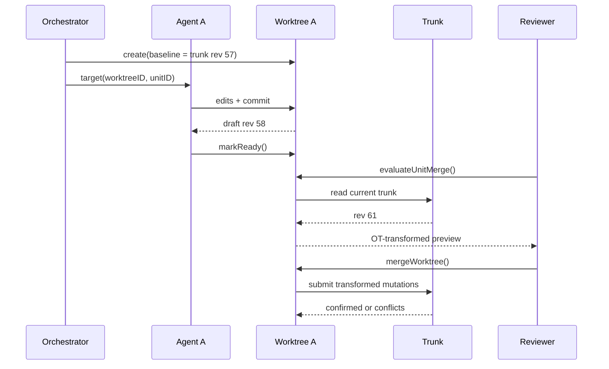
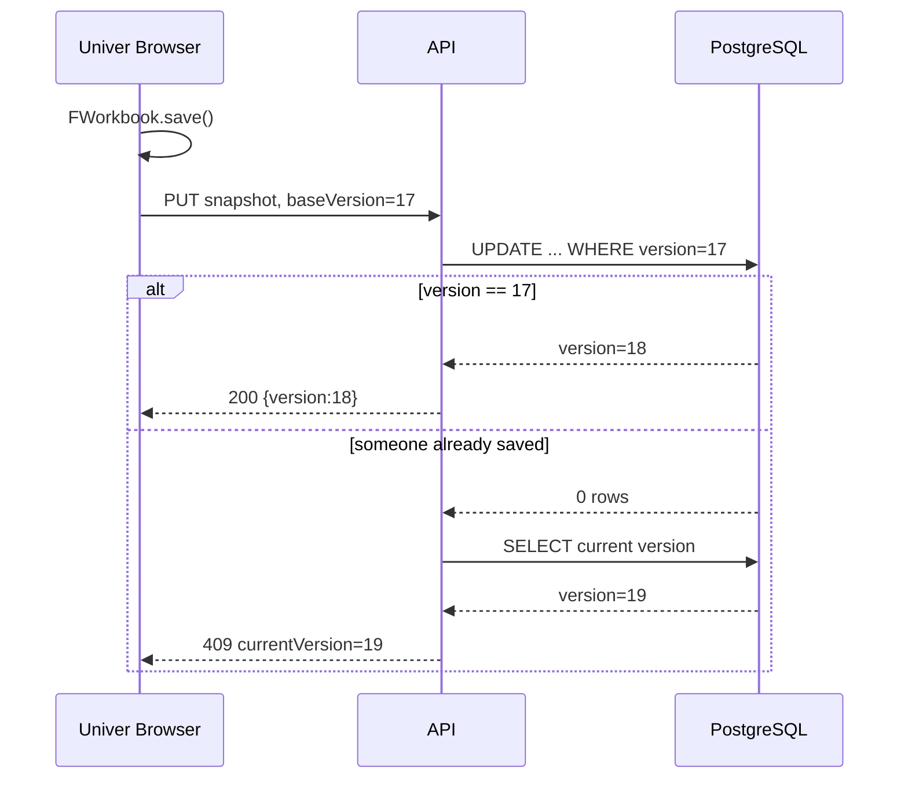

# Вторая итерация исследования: аудит Univer и архитектура spreadsheet-слоя поверх Tiptap/Node.js

## Результат критического аудита

Эта итерация принципиально отличается от первого исследования: здесь я фиксирую поведение по исходному коду и публичным контрактам **Univer v1.5.2**, а затем отдельно строю рекомендуемую архитектуру вашей системы. Для open-source части Univer точкой привязки выбран tag `v1.5.2`; официальная API-документация на момент исследования также маркирована `v1.5.2`. Для server/collaboration-части часть контрактов опубликована в документации и community-репозиториях, но основной Collaboration Service является коммерческим SDK, поэтому ниже я не приписываю ему внутренних алгоритмов, которых нельзя подтвердить публичным кодом или документацией. citeturn661961search3turn943041view0turn296489view8

Полный текст первого отчёта через доступный мне retrieval-слой сейчас не возвращается, поэтому я не могу честно сделать построчное «в первом отчёте строка X неверна». Я могу, однако, провести более полезный аудит утверждений, которые следуют из его темы и из вашего запроса, и заменить потенциально рискованные предположения проверенными контрактами.

Ключевой вывод второй итерации: **Univer не следует воспринимать как “Excel в одном JSON”**. `IWorkbookData` — snapshot агрегата workbook, но значимая часть функциональности подключаемых модулей сериализуется отдельно через `resources`; в collaboration-режиме authoritative state дополнительно разлагается сервером на snapshots, changesets, revisions и для больших Sheets — sheet blocks. `FWorkbook.save()` специально собирает базовый snapshot вместе с plugin resources. Это архитектурно важно для вашего backend: сохранять только `sheets.*.cellData` недостаточно. citeturn943041view0turn943041view1turn943041view4

Второй важный вывод: `IWorkbookData.rev` — **не подходящий универсальный application version для вашей собственной таблицы документов**. В API он определён как revision spreadsheet, используемый при collaborative editing и начинающийся с `1`; в Collaboration SDK revision означает позицию в подтверждённой истории Unit. Для вашей общей Tiptap+Spreadsheet БД нужен отдельный `state_version`/CAS token. citeturn943041view4turn296489view3

Третий вывод: **не стоит объединять Tiptap JSON и Univer snapshot в единую внутреннюю document-schema**. Tiptap хранит ProseMirror document tree, а изменения применяет транзакциями; Univer Sheets хранит workbook/sheets/cells/resources и меняет состояние через commands/mutations. Общим должен быть registry/envelope, identity, ACL, lifecycle и storage abstraction, а не сам content schema. Tiptap прямо рекомендует хранить `editor.getJSON()` как JSON, а ProseMirror описывает transaction как последовательность steps над immutable document state. citeturn897028search0turn897028search2turn897028search3

Ниже — карта наиболее важных исправлений, которые я бы внёс в первый отчёт.

| Возможное утверждение первого слоя | Вердикт второй итерации | Исправление |
|---|---|---|
| «Workbook можно хранить как один `IWorkbookData` JSON» | Частично верно | Только для snapshot/local-only режима. `resources` обязательны для полного snapshot; collaboration имеет отдельную серверную историю. citeturn943041view0turn943041view1 |
| «Достаточно сериализовать `cellData`» | Неверно | Теряются styles, merge, row/column metadata, calculation settings и plugin resources. citeturn347521view3turn943041view4 |
| «`save()` просто возвращает Workbook.getSnapshot()`» | Неверно | `FWorkbook.save()` вызывает `ResourceLoaderService.saveUnit`, который deep-clone'ит unit snapshot и подставляет актуальные plugin resources. citeturn943041view0turn943041view1 |
| «`rev` можно использовать как version в общей Documents БД» | Рискованно | Делать отдельный application CAS/version. `rev` оставлять Univer Collaboration. citeturn943041view4 |
| «События — источник истины для persistence» | Рискованно | Commands/events полезны для telemetry/business interception, но persistence должен опираться либо на `save()`+CAS, либо на Collaboration Service. citeturn247108search3turn247108search4 |
| «Можно напрямую патчить JSON ячеек» | Нежелательно | В runtime использовать Facade/commands; семантика формул/shared formulas при patch не тривиальна. citeturn247108search2 |
| «Collaboration — просто WebSocket broadcast» | Неверно | Публичный контракт включает OT, revisions, snapshots, persistence, HTTP/WS, ACK/session lifecycle и DB CAS/idempotency. citeturn296489view3turn296489view8 |
| «Агентский merge можно реализовать заменой snapshot» | Неверно для Univer Worktree | Worktree merge собирает draft mutations и отправляет их через trunk Collaboration Service; при изменившемся trunk применяется OT. citeturn347521view8 |
| «Merge нескольких документов атомарен» | Неверно | Multi-Unit Worktree merge прямо объявлен неатомарным. citeturn347521view7turn347521view8 |
| «XLSX round-trip через open-source JS library будет lossless» | Неподтверждённо и обычно неверно | Нужно определить support envelope и тестировать OOXML fidelity; неизвестные parts желательно сохранять opaque. SheetJS CE сам ориентирован прежде всего на extraction, а LibreOffice предупреждает об ограничениях conversion. citeturn296489view11turn296489view13 |
| «Commercial Univer SDK можно считать open-source backend» | Неверно | Open-source editor core и commercial Server SDK — разные лицензионные слои; production commercial modules требуют соответствующей лицензии. citeturn296489view9 |

## Реальная модель данных Univer: snapshot, cells, resources и команды

### Что фактически представляет `IWorkbookData`

На `v1.5.2` публичный контракт выглядит так:

```ts
interface IWorkbookData {
  id: string
  rev?: number
  name: string
  appVersion: string
  locale: LocaleType
  dateSystem?: DateSystem
  calculationSettings?: IWorkbookCalculationSettings
  styles: Record<string, Nullable<IStyleData>>
  sheetOrder: string[]
  sheets: {
    [sheetId: string]: Partial<IWorksheetData>
  }
  defaultStyle?: Nullable<IStyleData> | string
  resources?: IResources
  custom?: CustomData
}
```

Это не реконструкция — именно такой interface опубликован в API `v1.5.2`. Документация отдельно говорит, что snapshot содержит worksheet data, порядок листов, shared styles и plugin resources, а `FWorkbook.save()` возвращает этот тип. citeturn943041view4

`IWorksheetData.cellData` — sparse object matrix `IObjectMatrixPrimitiveType<ICellData>`, то есть логически это структура вида:

```ts
cellData: {
  [rowIndex: number]: {
    [columnIndex: number]: ICellData
  }
}
```

В worksheet snapshot помимо неё находятся `mergeData`, `rowData`, `columnData`, размеры, freeze, scroll/zoom, headers, gridlines, RTL и другие sheet-level параметры. Следовательно, backend-модель «таблица = двумерный массив значений» сразу недостаточна даже до появления формул и plugins. citeturn347521view3

Ячейка на `v1.5.2` имеет следующий контракт:

```ts
interface ICellData {
  p?: Nullable<IDocumentData>
  s?: Nullable<IStyleData | string>
  v?: Nullable<CellValue>
  t?: Nullable<CellValueType>
  f?: Nullable<string>
  ft?: Nullable<FormulaType>
  fd?: Nullable<BooleanNumber>
  ref?: Nullable<string>
  xf?: Nullable<string>
  si?: Nullable<string>
  custom?: CustomData
}
```

`v` — raw value, `f` — formula, `p` — rich-text document snapshot, `s` — inline style или reference на shared style; `ft`, `fd`, `ref`, `xf`, `si` относятся к более специальной formula/shared-formula semantics. citeturn347521view2

Из этого следует очень важный практический запрет: **не делайте generic JSON merge по `ICellData`**. Univer документирует, что object с `v` или `p`, но без `f` и `si`, заменяет существующую формулу и её shared-formula identity; передача `f` без `si` также отсоединяет shared formula. Patch только style/custom сохраняет formula. Запись `v` при этом сама по себе не очищает rich text `p`; если value действительно заменяет rich text, нужен `p: null`. citeturn247108search2

То есть код такого типа потенциально разрушителен:

```ts
cellData[row][col] = {
  ...cellData[row][col],
  ...incomingPatch,
}
```

Правильная модель — **semantic operation**, например:

```ts
type SheetOperation =
  | {
      type: 'set-value'
      sheetId: string
      row: number
      col: number
      value: string | number | boolean | null
    }
  | {
      type: 'set-formula'
      sheetId: string
      row: number
      col: number
      formula: string
    }
  | {
      type: 'set-style'
      sheetId: string
      row: number
      col: number
      style: Record<string, unknown>
    }
```

а преобразование operation → Facade/command должно жить в spreadsheet adapter.

### Почему `resources` нельзя выбрасывать

Исходник [`packages/sheets/src/facade/f-workbook.ts` на `v1.5.2`] показывает, что `save()` не возвращает непосредственно model snapshot:

```ts
save(): IWorkbookData {
  const snapshot =
    this._resourceLoaderService.saveUnit<IWorkbookData>(
      this._workbook.getUnitId()
    )!

  return snapshot
}
```

Комментарий прямо говорит, что результат включает conditional formatting, data validation и прочие plugin data. citeturn943041view0

Далее [`ResourceLoaderService.saveUnit`] делает следующее:

```ts
const resources =
  this._resourceManagerService.getResources(unitId, unit.type)

const snapshot =
  Tools.deepClone(unit.getSnapshot()) as {
    resources: typeof resources
  } & T

snapshot.resources = resources
return snapshot
```

То есть **snapshot модели + сериализованные состояния plugins собираются только на границе `saveUnit()`**. citeturn943041view1

Обратная загрузка resources работает через plugin hooks: loader находит resource по `r.name === hook.pluginName`, вызывает `hook.parseJson(plugin.data)`, затем `hook.onLoad(unitId, data)`. citeturn296489view1

Это объясняет реальную архитектуру лучше, чем попытка интерпретировать `resources` как «некий metadata-массив»:

```text
IWorkbookData
│
├── workbook core snapshot
│   ├── sheets
│   ├── styles
│   ├── calculationSettings
│   └── ...
│
└── resources[]
    ├── plugin A serialized state
    ├── plugin B serialized state
    ├── plugin C serialized state
    └── ...
```

Следствие для БД: snapshot нужно считать **opaque versioned aggregate**, а не раскладывать все plugin resources в собственные SQL-колонки. Если вам понадобится отдельный поиск по конкретной бизнес-сущности — например, ваша собственная annotation — храните отдельный projection/index, но не заменяйте им canonical Univer resource.

Также нельзя предполагать стабильность внутренних JSON payload каждого resource между версиями. В release notes Univer уже фиксировались изменения custom resource serializers, включая удаление некоторых `version/schemaVersion` полей. Это ещё один аргумент хранить необработанный resource payload и мигрировать его только по документированной схеме конкретного plugin. citeturn255625search1

### Команды и события

Univer имеет явное разделение command-level API. Например, `SetRangeValuesCommand` имеет ID:

```text
sheet.command.set-range-values
```

и принимает `ICellData`, `ICellData[][]` либо sparse matrix. citeturn247108search0

Facade допускает execution по command ID:

```ts
await univerAPI.executeCommand(
  'sheet.command.set-range-values',
  {
    value: { v: 'Hello, Univer!' },
    range: {
      startRow: 0,
      startColumn: 0,
      endRow: 0,
      endColumn: 0,
    },
  }
)
```

и имеет события `BeforeCommandExecute` / `CommandExecuted`; before-event может отменить command, а listener возвращает disposable. `FWorkbook` также предоставляет workbook-scoped `onBeforeCommandExecute()` и `onCommandExecuted()`. citeturn247108search3turn247108search4

Для вашей системы это разделение нужно использовать так:

```text
UI
 ↓
Facade / business command
 ↓
Univer command
 ↓
mutations
 ↓
live model
 ↓
save()            ← local/snapshot mode

или

mutations
 ↓
changeset
 ↓
Collaboration     ← collaborative mode
```

**Не стоит** строить persistence на `CommandExecuted → JSON.stringify(workbook)` после каждого keystroke. Это создаёт write amplification и превращает event stream пользовательского UI в storage protocol. Команды полезнее использовать для audit/analytics/business hooks; для local-only состояния сохранять debounced/checkpoint snapshot, а для collaborative state — использовать Collaboration protocol.

## Что реально делает серверный Collaboration SDK

### Граница между вашей системой и Univer

Официальное описание Collaboration SDK говорит, что серверный SDK отвечает за OT, revisions, snapshots, realtime synchronization и persistence authoritative Unit. Продуктовое приложение при этом сохраняет ответственность за users, tenants, business hierarchy, sharing, identity mapping, ACL и продуктовые API. citeturn296489view3turn296489view8

Это означает, что у вашей системы должны быть **две разные логические БД-модели**:

```text
YOUR APPLICATION DB
────────────────────────────────
users
tenants
document_registry
folders
sharing
ACL
business metadata
Word/Tiptap content if self-owned
links to Univer unit_id

UNIVER COLLABORATION STORAGE
────────────────────────────────
units
snapshots
changesets
revisions/head
sheet blocks
submission identity/idempotency
worktree data
```

Если вы используете commercial Collaboration SDK, не надо дублировать его changesets/revisions в своей `documents` таблице «на всякий случай». Ваш registry должен знать `unit_id`, но authoritative spreadsheet collaboration history должен оставаться в storage layer, которым управляет соответствующий adapter.

### Что видно в реальном PostgreSQL adapter

Community repository публикует PostgreSQL `IDatabaseAdapter`. Документация adapter указывает Node.js ≥22 и PostgreSQL ≥13, а таблицы размещаются в schema `collaboration`: `units`, `snapshots`, `changesets`, `sheet_blocks`, `schema_versions`. Protocol objects сериализуются как MessagePack `BYTEA`. Для крупных workbook `sheet_blocks` составляют основной объём cell data; существует отдельный PostgreSQL+S3 adapter, который переносит blocks в object storage. citeturn943041view2

Это очень важный факт для вашей собственной архитектуры: производители Univer **не пытаются превращать каждую spreadsheet cell в SQL row**. Для document engine canonical state логичнее хранить как snapshots/blocks/change records, а SQL использовать для identity, versioning и metadata.

DB adapter contract testkit дополнительно раскрывает существенную transactional semantics:

- `commitChangeset` должен проверить current head, записать changeset и обновить head в одной atomic boundary;
- commit использует revision CAS;
- `unitMetadata` и `changeset.metadata` должны записываться вместе с commit;
- failed CAS не должен частично менять metadata;
- некоторые batch lifecycle operations имеют all-or-nothing semantics. citeturn943041view3

Это уже не предположение, а публично тестируемый adapter contract.

### Revision, CAS и idempotency — три разные вещи

Их особенно важно не смешать.

**Revision** — позиция подтверждённого состояния Unit в collaboration history. `IWorkbookData.rev` используется collaborative editing и начинается с `1`. citeturn943041view4

**CAS** — storage-side проверка: commit можно подтвердить только относительно ожидаемого head. Adapter test contract требует, чтобы проверка head и запись нового changeset/head были атомарными. citeturn943041view3

**Idempotency identity** — отдельная идентичность submission. Univer публично описывает `sid + reqId` как changeset submission identity, стабильную между retry. Если outcome предыдущего submit неизвестен, agent runtime сохраняет ту же пару и повторяет commit так, чтобы backend подтвердил тот же changeset, а не создал дубль. citeturn296489view7turn296489view8

Модель можно представить так:

```text
Client
 base revision = 41
 sid = S123
 reqId = R991

          submit edits
               │
               ▼
Server checks:
  1. Has (sid,R991) already been confirmed?
      └─ yes → return same outcome
  2. Can edits be reconciled with current revision?
  3. Atomically CAS current head and append changeset
               │
               ▼
 revision = 42
```

Нельзя утверждать, что именно так реализованы внутренние SQL queries коммерческого service: это закрытая часть. Но перечисленные externally observable contracts подтверждены документацией и adapter tests. citeturn943041view3turn296489view7

### Реальные server examples

Публичный `database-adapter` example действительно собирает:

```ts
SQLiteDatabaseAdapter
UniverCollabService
UniverCollabEndpoint
createNodeTransport()
```

затем передаёт adapter в service, service в endpoint, регистрирует endpoint на transport и создаёт Unit через `service.createUnitFromData(...)`. В том же example `IWorkbookData` содержит `rev: 1`, `styles: {}`, `resources: []`. citeturn255625search3

Репозиторий examples отдельно предупреждает, что fixed users, allow-all/demo authorization и local secrets предназначены только для обучения. Quick start использует memory adapter, остальные single-node examples используют persistent SQLite; есть отдельные examples для permissions, history, comments, worktree, exchange и multi-node. citeturn255625search2

В production необходимо проверять права как минимум на join, чтение Unit и submit. Документация подчёркивает, что запрет UI или даже проверка WebSocket join не защищает прямые HTTP reads; server middleware должен отдельно защищать `readUnitData` и `submitChangeset`. `sid + reqId`, `memberID` и revision не являются заменой authentication identity; trusted `userID` устанавливает приложение. citeturn296489view8

Практически это означает:

```text
JWT/session
   ↓
Transport middleware
   ↓
context.userID + tenantID
   ↓
┌───────────────┬────────────────┬──────────────────┐
│ joinUnit ACL  │ readUnitData   │ submitChangeset  │
│ realtime room │ snapshot/read  │ authoritative    │
│               │ history        │ modification     │
└───────────────┴────────────────┴──────────────────┘
```

Для horizontal scaling архитектура должна иметь shared durable database, а realtime/session coordination — shared infrastructure; не следует делать WebSocket node владельцем документа. Публичный SDK позиционирует PostgreSQL adapter для нескольких collaboration nodes с одной БД. citeturn943041view2

## Формулы, workers, headless и агентские worktrees

### Formula engine в worker — это второй Univer instance

Univer worker architecture существенно интереснее обычного «отправили формулу в Worker».

Официальное описание говорит, что в worker запускается отдельный экземпляр `Univer`. Main-thread `DataSyncPrimaryController` синхронизирует создание Units и mutations в worker через RPC; результаты расчётов возвращаются обратно как mutations через replica side. citeturn347521view10

Концептуально:

```text
Browser Main Thread
┌──────────────────────────┐
│ Univer instance A        │
│ sheets UI                │
│ commands/mutations       │
│ DataSyncPrimary          │
└─────────────┬────────────┘
              │ RPC
              ▼
Web Worker
┌──────────────────────────┐
│ Univer instance B        │
│ formula engine           │
│ remote sheets formula    │
│ DataSyncReplica          │
└─────────────┬────────────┘
              │ result mutations
              └──────────────► A
```

В main instance formula-related plugins должны быть настроены с `notExecuteFormula: true`, а worker-side packages на актуальной линии импортируются через dedicated `/worker` entrypoints, например `@univerjs/rpc/worker`, `@univerjs/engine-formula/worker`, `@univerjs/sheets/worker`. citeturn347521view10turn255625search1

Это имеет непосредственное значение для coding-agent: если он найдёт старый пример, импортирующий worker-only API из root package, на `1.5.x` такой пример может быть устаревшим.

### Headless Node

Univer поддерживает отдельный headless Node composition. Публичный пример создаёт `Univer` без UI, регистрирует Sheets/Docs/Formula plugins и при необходимости Node RPC worker. В commercial composition используются также Pro formula/collaboration plugins. citeturn347521view9

Для вашей системы headless нужен не для обычного browser save, а для трёх полезных классов задач:

```text
1. Agent editing
   LLM/tool call
      ↓
   headless Univer
      ↓
   Facade commands
      ↓
   validated workbook mutation

2. Server-side validation/calculation
   snapshot/revision
      ↓
   headless formula runtime
      ↓
   calculated/read-back result

3. Background conversion/export preparation
   canonical spreadsheet state
      ↓
   headless transformations
```

При этом не следует считать `execute()` agent runtime транзакцией. Univer прямо предупреждает: если program throws, ранее выполненные mutations могут остаться pending; `execute()` не делает автоматический rollback. citeturn296489view7

Поэтому agent execution layer должен иметь собственную boundary:

```ts
type AgentRunState =
  | { status: 'drafting' }
  | { status: 'ready-to-commit' }
  | { status: 'committing' }
  | { status: 'confirmed'; revision: number }
  | { status: 'pull-required' }
  | { status: 'conflict' }
  | { status: 'unknown'; submissionId: string }
```

### Worktree — не Git worktree

Univer отдельно подчёркивает, что Worktree изолирует **document content**, а не filesystem/Git working directory. Один и тот же Unit может одновременно существовать в trunk и нескольких Worktrees; для обращения к draft нужен контекст `worktreeID + unitID`. citeturn347521view8

Draft имеет собственные snapshots, changesets, revisions, Presence и collaboration rooms. При создании для существующего Unit фиксируется trunk revision baseline. `markReady()` замораживает review head. citeturn347521view8

Merge существующего Unit делается не путём snapshot replacement. Service берёт draft changesets между baseline и Ready head, собирает mutations и отправляет их через trunk Collaboration Service. Если trunk ушёл вперёд, mutations проходят OT transformation против более поздних trunk edits; неприменимые изменения возвращаются как conflicts. citeturn347521view8

Это именно тот механизм, который вам полезен для параллельных AI-агентов:



Univer рекомендует для параллельных задач давать каждому agent свой Worktree. Это совпадает с архитектурно безопасным вариантом: два агента не должны незаметно писать в один mutable draft, если это не осознанная совместная сессия. citeturn347521view8

`evaluateUnitMerge()` даёт preview merge без модификации trunk или draft, но preview может устареть до реального merge, поскольку trunk продолжает двигаться. citeturn347521view8

Критически важное ограничение: **merge нескольких Units не является общей транзакцией**. Если Agent изменяет workbook + Tiptap document + presentation как одну бизнес-задачу, Worktree не даёт вам cross-document ACID. Univer прямо говорит, что Unit'ы merge'ятся по одному и уже merged Units не откатываются автоматически, если следующий Unit упал. citeturn347521view7turn347521view8

Для вашего общего «документного workspace» поверх этого нужен application saga:

```text
task_commit
  id
  status
  desired_units[]
  completed_units[]
  failed_units[]
  compensating_action / manual_review
```

Для Tiptap + spreadsheet bundle я бы вообще избегал автоматического атомарного обещания. Лучше UI «3/4 частей применено, Spreadsheet conflict — требуется review».

## XLSX: где заканчивается JSON и начинается OOXML fidelity

### Commercial Univer Exchange

Univer предоставляет snapshot-based и collaboration-based import/export. `importSheetToSnapshotAsync()` импортирует XLSX в `IWorkbookData` и не требует collaboration; `exportSheetBySnapshotAsync(snapshot)` экспортирует из snapshot. Unit-ID методы требуют Collaboration. citeturn347521view11

То есть для **не collaborative** варианта возможен pipeline:

```text
XLSX
 ↓
Univer Exchange
 ↓
IWorkbookData
 ↓
Web editor
 ↓
FWorkbook.save()
 ↓
IWorkbookData
 ↓
Univer Exchange
 ↓
XLSX
```

Для collaborative режима:

```text
XLSX
 ↓
Exchange Service
 ↓
Collaboration Unit
 ↓
unitId
 ↓
Web / Headless clients
 ↓
collaboration history
 ↓
current confirmed Unit
 ↓
Exchange Service
 ↓
XLSX
```

Server-side Exchange создаёт/читает Units через Collaboration Service и использует File Service для исходных/результирующих файлов; import/export проходят свои middleware boundaries. citeturn347521view7

Однако даже официальный pricing FAQ не обещает абсолютный lossless round-trip: Univer пишет, что стремится сохранять content/layout XLSX/DOCX/PPTX, но unsupported elements могут быть потеряны, и рекомендует тестировать реальные файлы, включая formulas/charts/layout. citeturn296489view9

Следовательно, коммерческий Exchange — наиболее интегрированный путь для Univer, но всё равно нужен fidelity corpus.

### Бесплатный стек: почему одной ExcelJS недостаточно

**SheetJS CE** имеет Apache-2.0 license и допускает commercial use при соблюдении условий лицензии. citeturn296489view10

Но его собственная документация говорит, что CE parser по умолчанию ориентирован на data extraction; number formats не сохраняются без `cellNF`, расширенная style metadata требует `cellStyles`, а более богатая styling/conditional-formatting functionality относится к Pro. Некоторые encryption schemes также доступны только Pro. citeturn296489view11

**ExcelJS** — MIT и является полноценным XLSX workbook manager, поэтому удобен для серверного чтения/создания common Excel structures. citeturn296489view12

Это всё равно не означает «ExcelJS losslessly round-trips произвольный OOXML». XLSX — ZIP package с большим числом XML parts и relationships. Если parser не моделирует конкретный объект, read→model→write потенциально его потеряет или перепишет.

**LibreOffice** умеет открывать и сохранять OOXML, включая `.xlsx`, но сам проект публикует список Microsoft Office features, которые могут создавать conversion problems. Поэтому headless LibreOffice полезен как fallback/conversion engine, но не как доказательство fidelity. citeturn296489view13

### Рекомендуемая бесплатная стратегия

Я бы разделил два режима.

**Режим A — native spreadsheet created in your product.**

Canonical state:

```text
IWorkbookData-compatible application snapshot
```

Supported subset чётко ограничен тем, что реально умеет Univer open-source editor и ваш converter.

Здесь можно написать:

```text
SheetJS / ExcelJS
       │
       ▼
your XLSX adapter
       │
       ▼
normalized workbook DTO
       │
       ▼
IWorkbookData
```

и обратно.

**Режим B — imported arbitrary customer XLSX.**

Canonical assets:

```text
original.xlsx              ← immutable source
supported-edit-model.json  ← editable projection
unsupported-parts manifest
```

При export:

```text
original XLSX package
      +
supported modifications
      ↓
OOXML patcher
      ↓
new XLSX
```

Иными словами, вместо «разобрать всё → выбросить неизвестное → собрать заново» максимально сохранять неизвестные XML parts и relationships opaque.

Для fidelity-critical продукта именно этот вариант потенциально сильнее generic ExcelJS reserialization.

Нужно явно классифицировать features:

| XLSX feature | Политика |
|---|---|
| Scalar values | Полная поддержка |
| Basic formulas | Поддержка + regression |
| Number formats | Поддержка + locale/date tests |
| Basic style | Поддержка |
| Merged cells | Поддержка |
| Row/column dimensions | Поддержка |
| Shared formulas | Отдельные tests |
| Dynamic arrays | Отдельные tests |
| Conditional formatting | Не считать автоматически lossless |
| Data validation | Отдельный converter |
| Tables | Отдельный converter |
| Images/drawings | Preserve opaque, если не редактируются |
| Charts | Preserve opaque или commercial |
| Pivot tables/cache | Preserve opaque; не нормализовать без полной модели |
| Slicers | Opaque |
| External links | Security review + opaque |
| Macros/VBA | Не исполнять; preserve only если policy разрешает |
| OLE/embedded objects | High-risk; quarantine/preserve |
| Password-encrypted XLSX | Не поддерживать в CE path или отдельный engine |

Это должно быть не документацией «когда-нибудь», а executable compatibility contract.

Например:

```ts
export type SpreadsheetCapability =
  | 'values'
  | 'formulas-basic'
  | 'number-formats'
  | 'styles-basic'
  | 'merged-cells'
  | 'row-column-size'
  | 'data-validation'
  | 'conditional-formatting'
  | 'tables'
  | 'images'
  | 'charts'
  | 'pivot-tables'
  | 'macros'
  | 'external-links'

export interface ImportDiagnostic {
  capability: SpreadsheetCapability
  severity: 'info' | 'warning' | 'blocking'
  sheet?: string
  message: string
}
```

Если importer видит unsupported pivot table:

```json
{
  "capability": "pivot-tables",
  "severity": "warning",
  "sheet": "Report",
  "message": "Pivot table will be preserved as opaque OOXML but cannot be edited."
}
```

Это гораздо безопаснее, чем молча открыть файл и потом при export уничтожить часть структуры.

## Целевая архитектура Tiptap + Univer

### Главный принцип: общий registry, разные document engines

Tiptap хранит ProseMirror JSON document tree и предоставляет `editor.getJSON()` для persistence; ProseMirror изменения представляются transactions/steps. citeturn897028search0turn897028search3

Univer хранит spreadsheet aggregate со своей моделью sheets/cells/resources. Поэтому target architecture я рекомендую такую:

```text
                           ┌──────────────────────────┐
                           │     Document Registry    │
                           │ id / tenant / kind / ACL │
                           │ title / lifecycle        │
                           └───────────┬──────────────┘
                                       │
                      ┌────────────────┴───────────────┐
                      │                                │
                      ▼                                ▼
         ┌──────────────────────┐        ┌─────────────────────────┐
         │ RichText Engine      │        │ Spreadsheet Engine      │
         │ Tiptap / ProseMirror │        │ Univer                  │
         │ JSON or Yjs          │        │ snapshot/collaboration  │
         └──────────┬───────────┘        └───────────┬─────────────┘
                    │                                │
                    ▼                                ▼
         richtext persistence             sheet persistence
         JSONB / Yjs updates               local snapshot
                                           OR Univer Collab
```

Не делать:

```json
{
  "document": {
    "nodes": "...",
    "cells": "...",
    "slides": "...",
    "universalOperations": "..."
  }
}
```

Делать discriminated envelope:

```ts
export type DocumentRef =
  | {
      id: string
      kind: 'richtext'
      engine: 'tiptap-prosemirror'
    }
  | {
      id: string
      kind: 'spreadsheet'
      engine: 'univer'
      unitId?: string
    }
```

### SQL migration для product registry

Ниже — PostgreSQL migration, которую можно применять как основу. Она специально **не копирует internal collaboration tables Univer**.

```sql
CREATE EXTENSION IF NOT EXISTS pgcrypto;

CREATE TYPE document_kind AS ENUM (
  'richtext',
  'spreadsheet'
);

CREATE TYPE document_engine AS ENUM (
  'tiptap-prosemirror',
  'univer'
);

CREATE TYPE document_status AS ENUM (
  'active',
  'archived',
  'deleted'
);

CREATE TABLE document_registry (
  id uuid PRIMARY KEY DEFAULT gen_random_uuid(),

  tenant_id uuid NOT NULL,

  kind document_kind NOT NULL,
  engine document_engine NOT NULL,

  title text NOT NULL,
  status document_status NOT NULL DEFAULT 'active',

  -- Only for an externally managed/collaborative engine.
  external_unit_id text,

  -- Application-level CAS. This is NOT Univer rev.
  state_version bigint NOT NULL DEFAULT 0,

  created_by uuid NOT NULL,
  created_at timestamptz NOT NULL DEFAULT now(),
  updated_at timestamptz NOT NULL DEFAULT now(),

  CONSTRAINT document_engine_kind_ck CHECK (
    (kind = 'richtext' AND engine = 'tiptap-prosemirror')
    OR
    (kind = 'spreadsheet' AND engine = 'univer')
  ),

  CONSTRAINT spreadsheet_external_unit_ck CHECK (
    kind <> 'richtext'
    OR external_unit_id IS NULL
  )
);

CREATE UNIQUE INDEX document_registry_tenant_external_unit_uq
  ON document_registry (tenant_id, external_unit_id)
  WHERE external_unit_id IS NOT NULL;

CREATE INDEX document_registry_tenant_status_idx
  ON document_registry (tenant_id, status, updated_at DESC);

CREATE TABLE richtext_snapshot (
  document_id uuid PRIMARY KEY
    REFERENCES document_registry(id)
    ON DELETE CASCADE,

  version bigint NOT NULL,
  content jsonb NOT NULL,

  content_sha256 bytea NOT NULL,
  updated_by uuid NOT NULL,
  updated_at timestamptz NOT NULL DEFAULT now(),

  CONSTRAINT richtext_snapshot_version_ck CHECK (version >= 0)
);

-- Use this table ONLY for the free/local spreadsheet mode.
-- Do not make it authoritative when Univer Collaboration owns the Unit.
CREATE TABLE spreadsheet_snapshot (
  document_id uuid PRIMARY KEY
    REFERENCES document_registry(id)
    ON DELETE CASCADE,

  version bigint NOT NULL,

  -- Whole IWorkbookData including resources.
  payload jsonb NOT NULL,

  payload_sha256 bytea NOT NULL,
  updated_by uuid NOT NULL,
  updated_at timestamptz NOT NULL DEFAULT now(),

  CONSTRAINT spreadsheet_snapshot_version_ck CHECK (version >= 0)
);

CREATE TABLE document_blob (
  id uuid PRIMARY KEY DEFAULT gen_random_uuid(),

  document_id uuid NOT NULL
    REFERENCES document_registry(id)
    ON DELETE CASCADE,

  role text NOT NULL,
  storage_key text NOT NULL,

  media_type text NOT NULL,
  size_bytes bigint NOT NULL,
  sha256 bytea NOT NULL,

  created_at timestamptz NOT NULL DEFAULT now(),

  CONSTRAINT document_blob_role_ck CHECK (
    role IN (
      'original-xlsx',
      'exported-xlsx',
      'attachment',
      'preview'
    )
  )
);

CREATE UNIQUE INDEX document_blob_storage_key_uq
  ON document_blob(storage_key);
```

Для больших snapshots я бы заменил `spreadsheet_snapshot.payload jsonb` на object-store key:

```text
Postgres:
 document_id
 version
 blob_key
 sha256

S3:
 workbook-snapshots/<tenant>/<document>/<version>.msgpack|json.zst
```

Это соответствует общему подходу, который виден и в Univer: большие sheet blocks могут выноситься из PostgreSQL в S3-compatible storage. citeturn943041view2

### CAS save для бесплатного snapshot-режима

API:

```http
PUT /api/documents/:id/spreadsheet-snapshot
Content-Type: application/json

{
  "baseVersion": 17,
  "snapshot": { "...IWorkbookData..." }
}
```

Успех:

```json
{
  "version": 18
}
```

Конфликт:

```http
409 Conflict
```

```json
{
  "code": "VERSION_CONFLICT",
  "currentVersion": 19
}
```

SQL CAS:

```sql
UPDATE spreadsheet_snapshot
SET
  payload = $3::jsonb,
  version = version + 1,
  payload_sha256 = digest($4, 'sha256'),
  updated_by = $5,
  updated_at = now()
WHERE document_id = $1
  AND version = $2
RETURNING version;
```

И **в той же DB transaction** обновлять `document_registry.state_version`.

Compile-ready Node/TypeScript route с `express`, `pg`, `zod`:

```ts
import express from 'express'
import { Pool } from 'pg'
import { z } from 'zod'

const app = express()
app.use(express.json({ limit: '20mb' }))

const pool = new Pool({
  connectionString: process.env.DATABASE_URL,
})

const SaveSpreadsheetSchema = z.object({
  baseVersion: z.number().int().nonnegative(),
  snapshot: z.object({
    id: z.string().min(1),
    name: z.string(),
    appVersion: z.string(),
    locale: z.unknown(),
    styles: z.record(z.string(), z.unknown()),
    sheetOrder: z.array(z.string()),
    sheets: z.record(z.string(), z.unknown()),
    resources: z.array(z.unknown()).optional(),
    custom: z.record(z.string(), z.unknown()).optional(),
  }).passthrough(),
})

app.put(
  '/api/documents/:id/spreadsheet-snapshot',
  async (req, res) => {
    const parsed = SaveSpreadsheetSchema.safeParse(req.body)

    if (!parsed.success) {
      res.status(400).json({
        code: 'INVALID_REQUEST',
        issues: parsed.error.issues,
      })
      return
    }

    const documentId = req.params.id
    const { baseVersion, snapshot } = parsed.data

    const canonicalJson = JSON.stringify(snapshot)
    const client = await pool.connect()

    try {
      await client.query('BEGIN')

      const result = await client.query<{ version: string }>(
        `
        UPDATE spreadsheet_snapshot
        SET
          payload = $3::jsonb,
          version = version + 1,
          payload_sha256 = digest($4, 'sha256'),
          updated_at = now()
        WHERE document_id = $1::uuid
          AND version = $2
        RETURNING version
        `,
        [
          documentId,
          baseVersion,
          canonicalJson,
          canonicalJson,
        ],
      )

      if (result.rowCount !== 1) {
        const current = await client.query<{ version: string }>(
          `
          SELECT version
          FROM spreadsheet_snapshot
          WHERE document_id = $1::uuid
          `,
          [documentId],
        )

        await client.query('ROLLBACK')

        res.status(409).json({
          code: 'VERSION_CONFLICT',
          currentVersion:
            current.rowCount === 1
              ? Number(current.rows[0].version)
              : null,
        })
        return
      }

      const newVersion = Number(result.rows[0].version)

      await client.query(
        `
        UPDATE document_registry
        SET
          state_version = $2,
          updated_at = now()
        WHERE id = $1::uuid
        `,
        [documentId, newVersion],
      )

      await client.query('COMMIT')

      res.json({ version: newVersion })
    } catch (error) {
      await client.query('ROLLBACK')
      console.error(error)

      res.status(500).json({
        code: 'INTERNAL_ERROR',
      })
    } finally {
      client.release()
    }
  },
)

app.listen(3000)
```

Это **application CAS**, а не попытка переиспользовать Univer `rev`.

Последовательность:



В multi-user real-time spreadsheet режиме этот endpoint **не должен** быть способом сохранения активного collaborative Unit. Там write path должен идти через Collaboration client/service, иначе один whole-snapshot PUT будет конкурировать с OT history.

### Проверенный React mounting Univer

Официальная React integration на `v1.5.2` создаёт Univer внутри `useEffect`, создаёт child container, а на cleanup вызывает `univer.dispose()`. citeturn661961search0

Минимальный TSX компонент:

```tsx
import { useEffect, useRef } from 'react'
import type { IWorkbookData } from '@univerjs/core'
import { UniverSheetsCorePreset } from '@univerjs/preset-sheets-core'
import UniverPresetSheetsCoreEnUS from '@univerjs/preset-sheets-core/locales/en-US'
import {
  createUniver,
  LocaleType,
  mergeLocales,
} from '@univerjs/presets'

import '@univerjs/preset-sheets-core/lib/index.css'

export interface SpreadsheetEditorProps {
  initialSnapshot: IWorkbookData
  onReady?: (save: () => IWorkbookData) => void
}

export function SpreadsheetEditor({
  initialSnapshot,
  onReady,
}: SpreadsheetEditorProps) {
  const hostRef = useRef<HTMLDivElement>(null)

  useEffect(() => {
    const host = hostRef.current
    if (!host) return

    const container = document.createElement('div')
    container.style.height = '100%'
    container.style.width = '100%'
    host.append(container)

    const { univer, univerAPI } = createUniver({
      locale: LocaleType.EN_US,

      locales: {
        [LocaleType.EN_US]: mergeLocales(
          UniverPresetSheetsCoreEnUS,
        ),
      },

      presets: [
        UniverSheetsCorePreset({
          container,
        }),
      ],
    })

    const workbook =
      univerAPI.createWorkbook(initialSnapshot)

    onReady?.(() => workbook.save())

    return () => {
      queueMicrotask(() => {
        univer.dispose()
        container.remove()
      })
    }
  }, [initialSnapshot, onReady])

  return (
    <div
      ref={hostRef}
      style={{
        height: '100%',
        minHeight: 500,
        width: '100%',
      }}
    />
  )
}
```

`createUniver` + `UniverSheetsCorePreset` и React lifecycle в этом коде соответствуют официальному example; `FWorkbook.save()` — публичный facade method, подтверждённый source на tag `v1.5.2`. citeturn661961search0turn943041view0

В реальном приложении нельзя передавать новый `initialSnapshot` object при каждом parent render, иначе effect будет пересоздавать весь editor. Лучше mount editor по `documentId`, а смену документа делать контролируемым remount.

### Tiptap: plain JSON против collaborative Yjs

Если ваш текущий Word editor одиночный/optimistic-lock, оставляйте:

```text
Tiptap
 ↓
editor.getJSON()
 ↓
JSONB snapshot + application CAS
```

Tiptap официально поддерживает хранение результата `editor.getJSON()` в БД. citeturn897028search0

Если требуется real-time rich-text collaboration, Tiptap Collaboration extension использует Yjs shared document. Yjs updates обладают commutative, associative и idempotent properties, а синхронизация может опираться на state vectors. citeturn897028search4turn897028search5

Тогда архитектура:

```text
Document Registry
       │
       ├── richtext
       │     └── Y.Doc / Yjs update store
       │
       └── spreadsheet
             └── Univer Collaboration Unit
```

Не пытайтесь заставить Univer OT и Yjs жить в одном CRDT. У них должны быть отдельные collaboration engines и общий business-level registry.

### Unified application API

Полезно дать frontend и agents общий типизированный API:

```ts
import { z } from 'zod'

export const DocumentKindSchema =
  z.enum(['richtext', 'spreadsheet'])

export const DocumentDescriptorSchema =
  z.discriminatedUnion('kind', [
    z.object({
      id: z.string().uuid(),
      kind: z.literal('richtext'),
      engine: z.literal('tiptap-prosemirror'),
      title: z.string(),
      version: z.number().int().nonnegative(),
    }),

    z.object({
      id: z.string().uuid(),
      kind: z.literal('spreadsheet'),
      engine: z.literal('univer'),
      title: z.string(),
      version: z.number().int().nonnegative(),
      unitId: z.string().optional(),
      mode: z.enum([
        'snapshot',
        'collaboration',
      ]),
    }),
  ])

export type DocumentDescriptor =
  z.infer<typeof DocumentDescriptorSchema>
```

Но content endpoints должны различаться:

```text
GET  /api/documents/:id
GET  /api/documents/:id/richtext
PUT  /api/documents/:id/richtext

GET  /api/documents/:id/spreadsheet-snapshot
PUT  /api/documents/:id/spreadsheet-snapshot

POST /api/documents/:id/import/xlsx
POST /api/documents/:id/export/xlsx

POST /api/documents/:id/agent-runs
POST /api/document-tasks/:taskId/commit
```

При commercial collaboration spreadsheet endpoint загрузки должен отдавать client configuration/unit ID, а не authoritative whole snapshot для последующего REST overwrite.

## Выбор стека, риски и задания coding-agent

### Какой вариант я бы выбрал

Для вашего текущего проекта есть три практически разных стека.

| Вариант | Frontend | Spreadsheet persistence | XLSX | Collaboration | Когда выбирать |
|---|---|---|---|---|---|
| **Free/minimal** | Univer OSS | `IWorkbookData` snapshot + CAS | ExcelJS/SheetJS adapter | Нет realtime | Сначала добавить полноценный spreadsheet editor |
| **Free/advanced** | Univer OSS | snapshot/object storage + own operation log | OOXML-preserving custom converter | Own solution | Только если вы готовы поддерживать document engine сами |
| **Commercial Univer** | Univer Web SDK | Collaboration SDK + PostgreSQL/S3 adapter | Univer Exchange | OT/revisions/worktree | Если realtime, agents и fidelity важнее стоимости лицензии |

Open-source core действительно позволяет поднять базовый spreadsheet editor без commercial Server SDK. Официальный quick start использует `@univerjs/presets` + `@univerjs/preset-sheets-core`. citeturn661961search6

Но real-time collaboration и server-side Office conversion относятся к commercial layer; production deployment commercial modules требует Business/Enterprise license, тогда как development/testing может использовать Freemium с ограничениями. citeturn296489view9

Для вашей конкретной системы я бы делал **двухэтапно**:

1. Сначала free snapshot architecture с правильным registry, CAS, original-XLSX blob и `IWorkbookData` snapshot. Это сразу даёт spreadsheet как новый document type и не связывает весь backend с commercial protocol.
2. Границу persistence сделать через interface, чтобы потом заменить `SnapshotSpreadsheetStore` на `UniverCollaborationSpreadsheetStore`, не меняя Tiptap, registry и business API.

Интерфейс:

```ts
export interface SpreadsheetStore {
  create(
    documentId: string,
    snapshot: unknown,
  ): Promise<void>

  load(
    documentId: string,
  ): Promise<{
    version: number
    snapshot: unknown
  }>

  save(
    documentId: string,
    baseVersion: number,
    snapshot: unknown,
  ): Promise<{
    version: number
  }>
}
```

Commercial implementation в действительности не должна симулировать whole-snapshot `save`; лучше сделать другой capability:

```ts
export interface CollaborativeSpreadsheetHandle {
  documentId: string
  unitId: string
  collaborationUrl: string
}
```

и поднимать appropriate client.

### Матрица рисков

| Риск | Вероятность | Ущерб | Что делать |
|---|---:|---:|---|
| Сохранение workbook без `resources` | Высокая | Высокий | Persist только результат `FWorkbook.save()` |
| Generic JSON merge `ICellData` | Высокая | Высокий | Semantic operations / Facade |
| Использование Univer `rev` как app version | Средняя | Высокий | Отдельный `state_version` |
| Whole-snapshot overwrite при concurrent editing | Высокая | Критический | CAS или Collaboration |
| Потеря charts/pivots/OLE при XLSX round-trip | Высокая | Высокий | Fidelity corpus + opaque OOXML |
| Формулы после import отличаются от Excel | Средняя | Высокий | Golden calculation tests |
| Старые worker imports | Средняя | Средний | Pin `1.5.2`, `/worker` imports |
| UI-only ACL | Средняя | Критический | Server middleware на read/submit/export |
| Agent retry дублирует edits | Средняя | Высокий | Stable idempotency identity |
| Agent modifies trunk instead of draft | Средняя | Критический | target = `(worktreeID, unitID)` |
| Worktree preview устарел перед merge | Средняя | Средний | Re-evaluate близко к merge + handle failure |
| Multi-Unit agent merge воспринимается как atomic | Средняя | Высокий | Saga / per-Unit result |
| Дублирование collab history в product DB | Средняя | Средний | Registry stores only Unit reference |
| Snapshot JSON становится слишком большим | Средняя | Средний | compressed object storage |
| XLSX bomb / zip bomb | Средняя | Критический | limits before unzip, sandbox conversion |
| Formula injection в CSV export | Средняя | Высокий | explicit CSV escaping policy |
| External links / OLE / macros | Средняя | Критический | quarantine, no execution |
| Plugin resource schema changes после upgrade | Средняя | Высокий | Version-pinned migrations + fixtures |
| Неодинаковые версии `@univerjs/*` | Средняя | Высокий | exact dependency alignment; Univer рекомендует держать coordinated packages на одной release line. citeturn661961search6 |

### Security boundary

Upload XLSX нельзя считать обычным JSON upload.

Pipeline должен быть:

```text
upload
 ↓
size / MIME / extension check
 ↓
ZIP central-directory limits
 ↓
anti zip-bomb policy
 ↓
malware scan
 ↓
OOXML structural inspection
 ↓
reject/enforce policy:
   macros
   external relationships
   embedded OLE
   remote images
 ↓
conversion worker sandbox
 ↓
normalized snapshot
 ↓
storage
```

Converter process не должен иметь production DB credentials и исходящий internet access.

Для Agent:

```text
Agent identity
   ↓
task authorization
   ↓
document ACL
   ↓
allowed operation policy
   ↓
Worktree/draft
   ↓
validation
   ↓
human/automatic review
   ↓
merge
```

Даже у Univer Worktree draft ACL и trunk merge permission являются независимыми concerns; isolation сама по себе не выдаёт access rights. citeturn347521view8turn296489view8

### Минимальный fidelity test corpus

Coding-agent должен создать fixtures, а не только unit tests converter functions:

```text
fixtures/xlsx/
  values.xlsx
  number-formats.xlsx
  dates-1900.xlsx
  dates-1904.xlsx
  merged-cells.xlsx
  styles.xlsx
  rich-text-cell.xlsx
  formulas.xlsx
  shared-formulas.xlsx
  dynamic-arrays.xlsx
  data-validation.xlsx
  conditional-formatting.xlsx
  tables.xlsx
  images.xlsx
  charts.xlsx
  pivot.xlsx
  external-links.xlsx
  comments.xlsx
  hidden-sheets.xlsx
  frozen-panes.xlsx
  protected.xlsx
  xlsm-with-vba.xlsm
  embedded-object.xlsx
```

Для каждого:

```text
source.xlsx
 ↓ import
snapshot.json
 ↓ edit supported fields
export.xlsx
 ↓ unzip OOXML
semantic comparison
 ↓ reopen in:
   Excel where available
   LibreOffice
   your converter
```

Сравнивать не ZIP bytes: Excel при сохранении может переставлять XML/relationship IDs. Нужен semantic OOXML comparator.

### Контрактные тесты persistence

Free snapshot store:

```text
✓ save at version N → N+1
✓ two concurrent saves from N → exactly one succeeds
✓ failed CAS does not modify snapshot
✓ resources survive save/load
✓ original XLSX never overwritten
✓ tenant cannot access another tenant document
```

Spreadsheet runtime:

```text
✓ value survives save/load
✓ formula survives style-only patch
✓ set value removes old formula as expected
✓ rich-text cell is explicitly cleared where required
✓ merges survive
✓ validation survives
✓ conditional formatting survives
✓ workbook calculation settings survive
```

Commercial collaboration:

```text
✓ duplicate submission identity does not create duplicate edit
✓ stale revision is reconciled/rejected according to protocol
✓ unauthorized HTTP snapshot read denied
✓ unauthorized WS join denied
✓ unauthorized submit denied
✓ disconnect/reconnect catches missing changesets
✓ node failover preserves authoritative Unit
```

Agent/worktree:

```text
✓ agent can only write its Worktree
✓ trunk unchanged until merge
✓ markReady prevents further draft edits
✓ trunk can advance after agent baseline
✓ evaluate does not mutate trunk
✓ conflict surfaced, never silently overwritten
✓ Unit A merge success + Unit B failure exposed as partial result
```

### Конкретный backlog для coding-agent

| Приоритет | Задача | Definition of Done |
|---|---|---|
| P0 | Pin Univer `1.5.2` dependencies | lockfile содержит согласованные `@univerjs/*` версии |
| P0 | Ввести `document_registry` | Tiptap и Spreadsheet имеют общий ID/ACL/lifecycle, но разные content stores |
| P0 | Сделать `SpreadsheetEditor` React wrapper | create/dispose корректно, load `IWorkbookData`, expose `save()` |
| P0 | Snapshot storage с CAS | concurrent integration test доказывает one-writer success |
| P0 | Persist `FWorkbook.save()` целиком | `resources` round-trip test проходит |
| P0 | Добавить blob storage original XLSX | оригинал immutable и checksum-verified |
| P0 | Убрать direct mutation raw `cellData` | application writes идут через Facade/commands |
| P1 | Создать spreadsheet operation DTO | операции type-safe и auditable |
| P1 | Реализовать XLSX capability scanner | unsupported features возвращают diagnostics |
| P1 | Реализовать first converter subset | values/formulas/styles/merges/size/date/number format |
| P1 | Создать OOXML regression corpus | fixtures покрывают таблицу выше |
| P1 | Security sandbox для import | zip limits, external link/OLE/macro policy |
| P1 | Unified ACL middleware | tenant + read/edit/export permissions |
| P1 | Add audit log | actor, document, operation, request id, result |
| P2 | Object-store snapshots | большие workbook не держатся обязательно в JSONB |
| P2 | Headless Univer validation service | agent-generated edits проверяются до commit |
| P2 | Formula worker | frontend formula compute не блокирует UI |
| P2 | Agent tool surface | `readRange`, `setValues`, `setFormula`, `insertRows`, `save/commit` |
| P2 | Agent idempotency key | retry одного tool run не дублирует business operation |
| P3 | Commercial adapter spike | один Unit проходит create/edit/reconnect/export |
| P3 | PostgreSQL Collaboration adapter | durability и multi-node tests |
| P3 | Worktree integration | separate Worktree per agent/task |
| P3 | Merge review UI | evaluate preview + conflicts + per-Unit result |
| P3 | Exchange A/B fidelity benchmark | сравнить free converter и Univer Exchange на реальных ваших XLSX |

### Архитектурная форма, к которой я бы в итоге пришёл

```text
┌───────────────────────────────────────────────────────────────┐
│                       React Application                       │
│                                                               │
│  TiptapEditor                       UniverSpreadsheetEditor   │
│       │                                      │                │
└───────┼──────────────────────────────────────┼────────────────┘
        │                                      │
        ▼                                      ▼
┌───────────────────────────────────────────────────────────────┐
│                       Application API                         │
│                                                               │
│ DocumentRegistryService                                      │
│ ACL / Tenant / Sharing                                       │
│ ImportExportService                                          │
│ AgentTaskService                                             │
│ AuditService                                                 │
└───────────┬───────────────────────────────┬───────────────────┘
            │                               │
            ▼                               ▼
┌───────────────────────┐       ┌──────────────────────────────┐
│ RichTextRepository    │       │ SpreadsheetGateway           │
│                       │       │                              │
│ snapshot JSONB        │       │ ┌──────────────────────────┐ │
│ or Yjs                │       │ │ Snapshot implementation  │ │
└───────────┬───────────┘       │ │ IWorkbookData + CAS      │ │
            │                   │ └──────────────────────────┘ │
            │                   │             OR               │
            │                   │ ┌──────────────────────────┐ │
            │                   │ │ Collaboration impl.      │ │
            │                   │ │ unitId / OT / revisions  │ │
            │                   │ └──────────────────────────┘ │
            │                   └──────────────┬───────────────┘
            ▼                                  ▼
┌───────────────────────┐       ┌──────────────────────────────┐
│ PostgreSQL            │       │ PostgreSQL / S3             │
│ product schema        │       │ collaboration storage       │
│                       │       │                              │
│ registry              │       │ snapshots                   │
│ ACL                   │       │ changesets                  │
│ richtext              │       │ sheet blocks                │
│ tasks                 │       │ worktrees                   │
└───────────────────────┘       └──────────────────────────────┘

                           ┌────────────────────────────┐
                           │ Conversion Workers         │
                           │                            │
                           │ free: OOXML adapter        │
                           │ commercial: Univer Exchange│
                           └────────────────────────────┘
```

Самая важная инженерная развилка здесь не «какую Excel library выбрать». Она находится уровнем выше:

**нужно решить, является ли spreadsheet у вас просто snapshot-документом или полноценным collaborative document engine.**

Если задача ближайшего релиза — «сейчас Word/Tiptap JSON, хочу такой же тип документа Excel», оптимальная первая реализация — **Univer OSS UI + complete `IWorkbookData` snapshots + application CAS + immutable original XLSX + ограниченный и явно тестируемый XLSX converter**. Это существенно проще, контролируемее и не заставляет преждевременно воспроизводить OT backend.

Если же требования уже включают одновременное редактирование, reconnect/offline, agent edits параллельно с человеком, review branches, merge/rebase и server-side authoritative export, воспроизводить эту систему самостоятельно — фактически отдельный крупный document-infrastructure проект. В таком случае публично подтверждённые Collaboration/Worktree contracts Univer уже закрывают именно эти слои: OT/revisions/snapshots/persistence, stable retry identity, isolated draft revisions и merge mutations в текущий trunk. citeturn296489view3turn296489view7turn347521view8

И последнее исправление, которое особенно важно перед передачей задачи coding-agent: **не разрешать ему реализовывать поведение по догадке из TypeScript names**. Для Univer нужно зафиксировать `v1.5.2`, держать рядом source links на `FWorkbook.save`, `ResourceLoaderService`, API contracts `IWorkbookData`/`ICellData`, а для commercial server частей опираться только на опубликованные Collaboration contracts и runnable examples. Там, где исходник закрыт, acceptance test должен проверять observable contract, а не предполагаемую внутреннюю реализацию. citeturn943041view0turn943041view1turn943041view4turn347521view2turn255625search3