# Распределение исполнителей (моделей), волны выполнения и протокол приёмки

Документ задаёт единую матрицу назначения доступных моделей на каждую из **30 задач** (фазы `00–10`) по **5 репозиториям**, порядок параллельных волн, протокол передачи артефактов между репозиториями и порядок ревью/приёмки.

## 1. Профили доступных моделей

| Модель | Роль в конвейере | Сильные стороны | Где применяется |
| --- | --- | --- | --- |
| **Astra** | Главный архитектор и независимый ревьюер критических ворот | Глубокий аудит конкурентности, протоколов, безопасности ACL, SQL-блокировок, распределённых гонок и кросс-репозиторных контрактов | Обязательное финальное ревью критических задач (`1.0`, `2.2`, `3.3`, `3.5`, `4.2`, `6.1`, `7.1`, `8.2`, `9.1`, `10.2`), разрешение спорных гейтов и архитектурный sign-off |
| **GPT-6.2 Sol** | Ведущий системный инженер (concurrency, протоколы, БД, state machines) | Транзакционные инварианты, CAS/fencing, Yjs/Hocuspocus, RFC 8785 JCS, возобновление после SIGKILL, SSE ordering, runtime wire | Самые сложные stateful/concurrency-задачи (`1.0`, `2.2`, `3.3`, `3.5`, `4.2`, `6.1`, `8.2`, `9.1`) + техническое ревью интеграционных задач |
| **Gemini Neon** | Ведущий full-stack и кросс-пакетный разработчик | Многофайловая разработка PHP + TypeScript/Vue, вынос пакетов, SDK-адаптеры, Tiptap-расширения, OOXML/DOCX, интеграция исполнителей | Основной поток многомодульных задач (`1.1`, `1.2`, `2.0`, `3.1`, `3.2`, `3.4`, `4.3`, `5.1`, `7.1`, `8.1`, `8.3`, `9.2`, `10.1`, `10.2`) + ревью задач Carbon/Argon |
| **Gemini Carbon** | Инженер изолированных модулей, UI-потребителей, бенчмарков и E2E | Сфокусированные задачи с чёткими границами: E2E-потребители, исправление точечных дефектов, бенчмарки, тонкие клиенты | Задачи `1.3`, `2.1`, `4.1`, `5.2`, `6.2`, `7.2` |
| **Gemini Argon** | Быстрый инженер базовых проверок, скаффолдинга и механической верификации | Запуск контрольных скриптов, фиксация baseline, первичная инициализация структуры новых репозиториев, сверка снапшотов | Задачи `0.1`, `0.2`, первичный scaffold репозиториев (`composer.json`, `package.json`, CI-шаблоны) перед стартом волн |

## 2. Полная матрица «Задача → Репозиторий → Исполнитель → Ревьюер»

| Волна | ID | Задача | Репозиторий | Исполнитель | Ревьюер |
| --- | --- | --- | --- | --- | --- |
| W0 | `0.1` | Поставляемый редактор (baseline) | `vaulter` | **Gemini Argon** | Gemini Carbon |
| W0 | `0.2` | Версии схемы и эталоны | `vaulter` | **Gemini Argon** | Gemini Carbon |
| W1 | `1.0` | Переразложить хранение документа + `write_mode` | `vaulter` | **GPT-6.2 Sol** | **Astra** |
| W1 | `1.1` | Передать книгу в `vaulter-sheets` (перенос) | `vaulter-sheets` | **Gemini Neon** | GPT-6.2 Sol |
| W1 | `2.0` | Вынести коллаборацию в `vaulter-collaboration` | `vaulter` + `vaulter-collaboration` | **Gemini Neon** | GPT-6.2 Sol |
| W1 | `4.1` | Выбрать профиль движка книг (бенчмарк) | `vaulter-sheets` | **Gemini Carbon** | Gemini Neon |
| W2 | `1.2` | Очистить публичную поверхность `vaulter` | `vaulter` | **Gemini Neon** | Gemini Carbon |
| W2 | `2.1` | Исправить `protocol=2` в WebSocket | `vaulter-collaboration` | **Gemini Carbon** | Gemini Neon |
| W2 | `3.1` | Адресуемые блоки `blockId` (PHP + Vue + Hub) | `vaulter` (+ parity `vaulter-collaboration`) | **Gemini Neon** | GPT-6.2 Sol |
| W3 | `1.3` | Пользовательский путь из списка (`documents-basic`) | `vaulter` | **Gemini Carbon** | Gemini Neon |
| W3 | `2.2` | Долговечность, compaction lease, поколения и фикс restore E2E | `vaulter-collaboration` | **GPT-6.2 Sol** | **Astra** |
| W3 | `3.2` | Ядро AI SDK, поиск и адресное чтение | `vaulter-ai` | **Gemini Neon** | GPT-6.2 Sol |
| W3 | `4.2` | Пакет одиночной книги + Node runtime + `AtomicDocumentMutation` | `vaulter-sheets` (+ порт в `vaulter`) | **GPT-6.2 Sol** | **Astra** |
| W3 | `8.1` | История preview/compare и Range Comments | `vaulter-editor-pro` | **Gemini Neon** | GPT-6.2 Sol |
| W3 | `10.1` | Корпус OOXML (D1–D4) и локальный офлайн-экспорт DOCX | `vaulter-editor-pro` | **Gemini Neon** | Gemini Carbon |
| W4 | `3.3` | Подготовка, запись (`AtomicDocumentMutation`), JCS и проверка | `vaulter-ai` (+ порт в `vaulter`) | **GPT-6.2 Sol** | **Astra** |
| W4 | `4.3` | Обмен XLSX и CSV (условная по профилю) | `vaulter-sheets` | **Gemini Neon** | Gemini Carbon |
| W4 | `6.1` | Совместные структурные операции в книге | `vaulter-sheets` | **GPT-6.2 Sol** | **Astra** |
| W4 | `6.2` | Ссылка на диапазон в Tiptap (`WorkbookReference`) | `vaulter-sheets` | **Gemini Carbon** | Gemini Neon |
| W5 | `3.4` | Исполнители Laravel AI и AgenTools | `vaulter-ai` | **Gemini Neon** | GPT-6.2 Sol |
| W5 | `3.5` | Атомарная команда в живой комнате (strict sequencer, A42) | `vaulter-collaboration` + `vaulter-ai` | **GPT-6.2 Sol** | **Astra** |
| W5 | `5.1` | Офисный SDK для книг (`sheet.fill_formula@1`) | `vaulter-ai` (+ `vaulter-sheets`) | **Gemini Neon** | GPT-6.2 Sol |
| W5 | `8.2` | Текстовый Tracked Changes и атомарный accept/reject | `vaulter-editor-pro` | **GPT-6.2 Sol** | **Astra** |
| W5 | `10.2` | Серверные `document_exchange_jobs` и атомарный импорт DOCX | `vaulter-editor-pro` | **Gemini Neon** | **Astra** |
| W6 | `5.2` | Измерить стоимость поручения (1×/10×, токены, SQL) | `vaulter-ai` | **Gemini Carbon** | Gemini Neon |
| W6 | `7.1` | Согласование P/Q, многошаговые поручения и возобновление | `vaulter-ai` | **Gemini Neon** | **Astra** |
| W6 | `8.3` | Структурный review и политика пересечений (snapshot + journal) | `vaulter-editor-pro` | **Gemini Neon** | GPT-6.2 Sol |
| W7 | `7.2` | Смена исполнителя (PHP/HTTP/Python) и эмулятор канала | `vaulter-ai` | **Gemini Carbon** | Gemini Neon |
| W7 | `9.1` | Backend AI-чата, SSE `Last-Event-ID` и tool call ledger | `vaulter-ai` | **GPT-6.2 Sol** | **Astra** |
| W7 | `9.2` | UI панели чата, streaming Laravel AI/AgenTools и канал | `vaulter-ai` | **Gemini Neon** | GPT-6.2 Sol |

> **Примечание по общему порту `AtomicDocumentMutation`:** его реализует в `vaulter/packages/documents` тот исполнитель из пары `3.3` / `4.2`, который стартует первым (обе задачи ведёт **GPT-6.2 Sol** с ревью **Astra**). Рекомендуется выпустить порт `AtomicDocumentMutation` в `vaulter` сразу при открытии волны W3 (до параллельного запуска `4.2` и `3.3`), чтобы оба репозитория (`vaulter-sheets` и `vaulter-ai`) потребили один и тот же зафиксированный артефакт `vaulter`.

## 3. Параллельные волны выполнения

```mermaid
flowchart LR
    W0["W0: 0.1, 0.2 (Argon)"] --> W1["W1: 1.0 (Sol), 1.1 (Neon), 2.0 (Neon), 4.1 (Carbon)"]
    W1 --> W2["W2: 1.2 (Neon), 2.1 (Carbon), 3.1 (Neon)"]
    W2 --> W3["W3: 1.3 (Carbon), 2.2 (Sol), 3.2 (Neon), 4.2 (Sol), 8.1 (Neon), 10.1 (Neon)"]
    W3 --> W4["W4: 3.3 (Sol), 4.3 (Neon), 6.1 (Sol), 6.2 (Carbon)"]
    W4 --> W5["W5: 3.4 (Neon), 3.5 (Sol), 5.1 (Neon), 8.2 (Sol), 10.2 (Neon)"]
    W5 --> W6["W6: 5.2 (Carbon), 7.1 (Neon), 8.3 (Neon)"]
    W6 --> W7["W7: 7.2 (Carbon), 9.1 (Sol), 9.2 (Neon)"]
```



## 4. Протокол передачи артефактов между репозиториями (Handoff)

1. Когда задача в репозитории-поставщике (например, `1.0` или `3.1` в `vaulter`) принята, исполнитель собирает артефакты (Composer ZIP, npm tgz, Docker image) и публикует запись в `artifacts.json` текущего прогона с полной Git SHA и SHA-256 каждого архива.
2. Потребляющий репозиторий (`vaulter-collaboration`, `vaulter-sheets`, `vaulter-ai`, `vaulter-editor-pro`) **не монтирует** соседние исходники в `vendor/` или `node_modules/` на этапе приёмки — он устанавливает конкретные архивы из `artifacts.json`.
3. Кросс-репозиторная задача (например, `3.5` = `vaulter-collaboration` + `vaulter-ai`) сдаётся одним отчётом приёмки с указанием полных Git SHA **обоих** репозиториев в поле `repos`.

## 5. Протокол сдачи и ревью каждой задачи

1. **Исполнитель** реализует задачу строго по карточке фазы (`plan/phases/`) и плану своего репозитория (`plan/dev-plans/<repo>.md`).
2. **Исполнитель** запускает команды проверки критериев, формирует JSON-отчёт по шаблону [acceptance.md](../acceptance.md) и валидирует его:
   ```bash
   python3 plan/checks/verify-plan.py --report /path/to/report-<task>.json
   ```
   Ожидаемый результат: `<task> pass` и код возврата `0`.
3. **Ревьюер** (назначенная модель из таблицы выше) проверяет:
   - фактический diff кода и отсутствие обхода контрактов (прямого SQL к чужим таблицам, утечек секретов, приватного кода в `vaulter`);
   - достаточность доказательств в `commands[].output` (реальные маркеры, ETag, SQL-состояние, отказ негативных кейсов);
   - независимое воспроизведение критических проверок.
4. **Astra** (на критических воротах) проводит adversarial-проверку: ищет гонки блокировок, обход ACL при отзыве прав, потерю ответа после commit, stale generation/fence и утечки данных между tenant/project. Без sign-off ревьюера зависимые задачи следующей волны не стартуют.
