# Глобальный план оркестрации: SKM + Antigravity Workflows, экономика моделей и анти-залипание

Документ задаёт единую производственную систему для всех **31 задачи** (фазы `00–10`) по **5 репозиториям** (`/home/vostrikov/projects/packages/vaulter*`) с максимальной скоростью поставки, рациональным расходом квот и жёстким правилом **«Исполнитель ≠ Ревьюер»**. Все исполнители обязаны соблюдать 12 постоянных стоп-кранов из [spec/engineering-standards.md](../spec/engineering-standards.md).

---

## 1. Двухконтурная оркестрация (`SKM orch.py` + `Antigravity run_workflow`)

| Контур | Инструмент и провайдеры | За что отвечает |
| --- | --- | --- |
| **Контур A — `SKM orch.py`** | `orch.py conduct run --no-batch --options plan/execution/orch-options/<preset>.json` (`grok`, `codex` = GPT-6.2 Sol / Astra) с Linux Landlock (`ro-run.py`) | Исполнение задач Grok (`grok/grok-4.7/xhigh`, `--fence plan`), дешёвое сжатие контекста (`context-scout: grok/grok-4.5/low`), глубокие системные задачи в `codex/gpt-6.2-sol/high` и точечный adversarial sign-off через `codex/gpt-6-astra/high` (`review-only`) |
| **Контур B — `Antigravity (agy)` + `run_workflow`** | Тонкий оркестратор `Gemini Neon (low effort)` + `run_workflow` (чистые одноразовые `await agent(...)`) | Диспетчеризация волн (`W0`–`W7`) через `watchdog.py` + `pack-brief.py`, параллельный fan-out full-stack задач PHP+TS+Vue по разным репозиториям и независимое ревью всего потока Grok |

---

## 2. Экономика моделей (4 эшелона + жёсткое правило `Исполнитель ≠ Ревьюер`)

| Эшелон / Модель | Провайдер и пресет `orch.py` | Профиль ресурсов | Роль в конвейере | Где применяется (и где НЕ тратится) |
| --- | --- | --- | --- | --- |
| **Эшелон 1: Grok 4.7 X High** *(+ `grok-4.5/low` scout)* | `grok` (`grok-exec.json`, Landlock + `--fence plan`) | Много ресурсов, быстро, слабее на нечёткой архитектуре | **Массовый исполнитель строго специфицированных задач** + **дешёвый `context-scout`** (`condense 60k → 8k`) перед старшими моделями | Задачи `W0-Scaffold`, `0.1`, `0.2`, `1.3`, `2.1`, `4.1`, `5.2`, `6.2`, `7.2`, плюс **подзадачи-бойлерплейт** (миграции по SQL-эталону, корпус D1–D4, ранбуки) и сжатие контекста. **Никогда не ревьюит критический код и не проектирует протоколы** |
| **Эшелон 2: Gemini Neon** | `agy` / `run_workflow` (чистый `await agent`) | Сбалансированный, силён в многофайловом full-stack | **Тонкий оркестратор (low effort)** + **основной разработчик PHP/TS/Vue/OOXML/SDK** + **главный ревьюер всех задач Grok** | Задачи `1.1`, `1.2`, `2.0`, `3.1`, `3.2`, `3.4`, `4.3`, `5.1`, `7.1`, `8.1`, `8.3`, `9.2`, `10.1`, `10.2` + ревью всего потока Grok (`W0-Scaffold`, `0.1`, `0.2`, `1.3`, `2.1`, `4.1`, `5.2`, `6.2`, `7.2`) |
| **Эшелон 3: GPT-6.2 Sol** | `codex` (`gpt-6.2-sol`, `sol-exec.json` / `review-sol.json`) | Дорогой, сильнейший в concurrency / БД / протоколах | **Ведущий системный инженер** (state machines, блокировки, Yjs/Hocuspocus, fencing, JCS, SSE, runtime wire) + **главный технический ревьюер сложных задач Gemini** | Задачи `0.3`, `1.0`, `Port-ADM`, `2.2`, `3.3`, `3.5`, `4.2`, `6.1`, `8.2`, `9.1` + ревью `1.1`, `1.2`, `2.0`, `3.1`, `3.2`, `3.4`, `4.3`, `5.1`, `8.1`, `8.3`, `9.2`, `10.1` |
| **Эшелон 4: Astra** | `codex` frontier (`gpt-6-astra`, `review-astra.json`, `review-only`) | Самый дорогой и дефицитный ресурс | **Хирургический архитектурный и adversarial Sign-Off** (только самые дорогие по цене ошибки ворота, строго ПОСЛЕ зелёных автотестов!) | **Только 11 критических ворот:** `0.3`, `1.0`, `Port-ADM`, `2.2`, `3.3`, `3.5`, `4.2`, `6.1`, `7.1`, `8.2`, `9.1`, `10.2`. **Не тратится на скаффолдинг, UI, бенчмарки, фикстуры и мелкие фиксы** |

> **Важно про дефолты SKM:** по умолчанию `orch.py` без `--options` маршрутизирует `executor` в `claude-code/sonnet` и `reviewer` в `grok/grok-4.7`. Поэтому **все запуски `orch.py` обязаны передавать один из проверенных пресетов** из `plan/execution/orch-options/{grok-exec,sol-exec,review-sol,review-astra}.json`.

### Матрица пар «Исполнитель → Ревьюер» (всегда разные модели!)
- **`Grok 4.7 X High`** → ревьюит **`Gemini Neon`** (чистый `run_workflow` агент).
- **`Gemini Neon`** → ревьюит **`GPT-6.2 Sol`** (`review-sol.json`) или **`Astra`** (`review-astra.json` на `7.1`, `10.2`).
- **`GPT-6.2 Sol`** → ревьюит **`Astra`** (`review-astra.json` — frontier-модель `gpt-6-astra` для adversarial sign-off).

---

## 3. Полная матрица «Задача → Репозиторий → Исполнитель → Ревьюер → Контур»

> **Спринт-предподготовка W0-Scaffold (до старта W1):** **Grok** (через `orch.py bounded-implementer`) по единому шаблону инициализирует `composer.json`, `package.json`, `phpstan.neon`, `phpunit.xml`, `Dockerfile` (Node 26.13.1 + `libatomic`), лицензионный CI-чек и `release/packages.json` в созданных репозиториях `vaulter-collaboration`, `vaulter-sheets`, `vaulter-ai`, `vaulter-editor-pro`; быстрый чек — **Gemini Neon**.

| Волна | Трек | ID | Задача | Репозиторий | Исполнитель | Ревьюер | Контур |
| --- | --- | --- | --- | --- | --- | --- | --- |
| W0 | MVP-1 | `0.1` | Поставляемый редактор (baseline) | `vaulter` | **Grok** | **Gemini Neon** | `orch.py` |
| W0 | MVP-1 | `0.2` | Версии схемы и эталоны | `vaulter` | **Grok** | **Gemini Neon** | `orch.py` |
| W0.5 | MVP-1 | `0.3` | Инженерное укрепление базы, безопасность и стоп-краны CI *(бойлерплейт ранбуков/фикстур можно делегировать Grok)* | `vaulter` | **GPT-6.2 Sol** | **Astra** | `orch.py` |
| W1 | MVP-1 | `1.0` | Переразложить хранение документа + `write_mode` *(миграции по SQL-эталону может заготовить Grok)* | `vaulter` | **GPT-6.2 Sol** | **Astra** | `orch.py` |
| W1 | MVP-1 | `1.1` | Передать книгу в `vaulter-sheets` (перенос) | `vaulter-sheets` | **Gemini Neon** | **GPT-6.2 Sol** | `run_workflow` |
| W1 | MVP-1 | `2.0` | Вынести коллаборацию в `vaulter-collaboration` + полные `docs/guides/{collaboration,hub}.md` | `vaulter` + `vaulter-collaboration` | **Gemini Neon** | **GPT-6.2 Sol** | `run_workflow` |
| W1 | MVP-1 | `4.1` | Выбрать профиль движка книг (бенчмарк Univer OSS / IronCalc) | `vaulter-sheets` | **Grok** | **Gemini Neon** | `orch.py` |
| W2 | MVP-1 | `1.2` | Очистить публичную поверхность `vaulter` | `vaulter` | **Gemini Neon** | **GPT-6.2 Sol** | `run_workflow` |
| W2 | MVP-1 | `2.1` | Исправить `protocol=2` в WebSocket (есть готовый `protocol.test.ts`) | `vaulter-collaboration` | **Grok** | **Gemini Neon** | `orch.py` |
| W2 | MVP-1 | `3.1` | Адресуемые блоки `blockId` (PHP + Vue + Hub) | `vaulter` (+ parity `vaulter-collaboration`) | **Gemini Neon** | **GPT-6.2 Sol** | `run_workflow` |
| W3 | MVP-1 | `1.3` | Пользовательский путь из списка (`documents-basic`) | `vaulter` | **Grok** | **Gemini Neon** | `orch.py` |
| W3 | MVP-1 | `2.2` | Универсальный `protocol` на голове, compaction lease, поколения и фикс restore E2E | `vaulter-collaboration` | **GPT-6.2 Sol** | **Astra** | `orch.py` |
| W3 | MVP-1 | `3.2` | Ядро AI SDK, поиск и адресное чтение | `vaulter-ai` | **Gemini Neon** | **GPT-6.2 Sol** | `run_workflow` |
| W3 | MVP-1 | `4.2` | Пакет одиночной книги + Node runtime (Univer 1.5.2, CAS > 512 КБ) + порт `AtomicDocumentMutation` | `vaulter-sheets` (+ порт в `vaulter`) | **GPT-6.2 Sol** | **Astra** | `orch.py` |
| W3 | MVP-2 | `8.1` | История preview/compare и Range Comments (`#8614`, `prosemirror-changeset`) | `vaulter-editor-pro` | **Gemini Neon** | **GPT-6.2 Sol** | `run_workflow` |
| W3 | MVP-2 | `10.1` | Корпус OOXML (D1–D4) и локальный офлайн-экспорт DOCX *(генерация корпуса D1–D4 — Grok)* | `vaulter-editor-pro` | **Gemini Neon** | **GPT-6.2 Sol** | `run_workflow` |
| W4 | MVP-1 | `3.3` | Подготовка, запись (`AtomicDocumentMutation`), JCS (`UTF-16BE`) и проверка | `vaulter-ai` (+ порт в `vaulter`) | **GPT-6.2 Sol** | **Astra** | `orch.py` |
| W4 | MVP-2 | `4.3` | Обмен XLSX (`fflate`+`saxes`) и CSV (условная по профилю) | `vaulter-sheets` | **Gemini Neon** | **GPT-6.2 Sol** | `run_workflow` |
| W4 | MVP-2 | `6.1` | Совместные структурные операции книги (Zero-Pro `univer-sheets/1` поверх `vaulter-collaboration`) | `vaulter-sheets` | **GPT-6.2 Sol** | **Astra** | `orch.py` |
| W4 | MVP-2 | `6.2` | Ссылка на диапазон в Tiptap (`WorkbookReference` + `WorkbookPreview.vue`) | `vaulter-sheets` | **Grok** | **Gemini Neon** | `orch.py` |
| W5 | MVP-1 | `3.4` | Исполнители Laravel AI (`^1.3.0`) и AgenTools | `vaulter-ai` | **Gemini Neon** | **GPT-6.2 Sol** | `run_workflow` |
| W5 | MVP-1 | `3.5` | Атомарная команда в живой комнате (`Hocuspocus 4.9.0`, `Yjs 13.6.33`, A42, `clientID 2^31`) | `vaulter-collaboration` + `vaulter-ai` | **GPT-6.2 Sol** | **Astra** | `orch.py` |
| W5 | MVP-1 | `5.1` | Офисный SDK для книг (`sheet.fill_formula@1`) | `vaulter-ai` (+ `vaulter-sheets`) | **Gemini Neon** | **GPT-6.2 Sol** | `run_workflow` |
| W5 | MVP-2 | `8.2` | Текстовый Tracked Changes (`dispatchTransaction`, IME) и атомарный accept/reject | `vaulter-editor-pro` | **GPT-6.2 Sol** | **Astra** | `orch.py` |
| W5 | MVP-2 | `10.2` | Серверные `document_exchange_jobs` и атомарный импорт DOCX | `vaulter-editor-pro` | **Gemini Neon** | **Astra** | `run_workflow` |
| W6 | MVP-1 | `5.2` | Измерить стоимость поручения (`1×/10×`, токены, SQL) | `vaulter-ai` | **Grok** | **Gemini Neon** | `orch.py` |
| W6 | MVP-1 | `7.1` | Согласование P/Q, многошаговые поручения и возобновление | `vaulter-ai` | **Gemini Neon** | **Astra** | `run_workflow` |
| W6 | MVP-2 | `8.3` | Структурный review и политика пересечений (`parentId` cascade, snapshot + journal) | `vaulter-editor-pro` | **Gemini Neon** | **GPT-6.2 Sol** | `run_workflow` |
| W7 | MVP-1 | `7.2` | Смена исполнителя (PHP/HTTP/Python) и эмулятор канала | `vaulter-ai` | **Grok** | **Gemini Neon** | `orch.py` |
| W7 | MVP-1 | `9.1` | Backend AI-чата, SSE `Last-Event-ID` (`Centrifugo >= 6.9.0`/Octane 25s) и tool call ledger | `vaulter-ai` | **GPT-6.2 Sol** | **Astra** | `orch.py` |
| W7 | MVP-1 | `9.2` | UI панели чата, streaming Laravel AI/AgenTools и канал | `vaulter-ai` | **Gemini Neon** | **GPT-6.2 Sol** | `run_workflow` |

> **Две продуктовые очереди для быстрого результата:**
> - **Трек `MVP-1` (23 задачи — рабочий FlexCms + FlexCrm Collab + Univer Sheets + AI Agent + AI Chat):** можно вести приоритетно до первого рабочего релиза, не дожидаясь `MVP-2`.
> - **Трек `MVP-2` (8 задач — `4.3`, `6.1`, `6.2`, `8.1–8.3`, `10.1–10.2`):** запускается параллельно при наличии свободных слотов `run_workflow`/`orch.py` или второй очередью — на `MVP-1` он не влияет.
> - **Общий порт `AtomicDocumentMutation`:** выпускается в `vaulter/packages/documents` **GPT-6.2 Sol → Astra** сразу на старте волны W3, чтобы `4.2` и `3.3` потребили один зафиксированный артефакт.

---

## 4. Параллельные волны выполнения

```mermaid
flowchart LR
    W0["W0: 0.1, 0.2 + 4-repo scaffold (Grok → Neon)"] --> W05["W0.5: 0.3 (Sol → Astra)"]
    W05 --> W1["W1: 1.0 (Sol), 1.1 (Neon), 2.0 (Neon), 4.1 (Grok)"]
    W1 --> W2["W2: 1.2 (Neon), 2.1 (Grok), 3.1 (Neon)"]
    W2 --> W3["W3: 1.3 (Grok), 2.2 (Sol), 3.2 (Neon), 4.2 (Sol) | MVP-2: 8.1, 10.1 (Neon)"]
    W3 --> W4["W4: 3.3 (Sol) | MVP-2: 4.3 (Neon), 6.1 (Sol), 6.2 (Grok)"]
    W4 --> W5["W5: 3.4 (Neon), 3.5 (Sol), 5.1 (Neon) | MVP-2: 8.2 (Sol), 10.2 (Neon)"]
    W5 --> W6["W6: 5.2 (Grok), 7.1 (Neon) | MVP-2: 8.3 (Neon)"]
    W6 --> W7["W7: 7.2 (Grok), 9.1 (Sol), 9.2 (Neon)"]
```

---

## 5. Протокол анти-залипания («Быстро и качественно, без бесконечных итераций»)

Чтобы не закапываться в 5–10 раундов ревью и не сжигать квоту `Astra` / `GPT-6.2 Sol`, действует **жёсткий 4-шаговый конвейер**:

1. **Гейт «Сначала роботы, потом ревьюер» (Zero-Token Pre-Gate):**
   Ревьюер **не вызывается**, пока локально/в CI не пройдены с кодом `0`:
   - `python3 plan/checks/verify-plan.py --report /path/to/report-<task>.json` (`<task> pass`);
   - `PG_BIN=/usr/lib/postgresql/18/bin bash plan/checks/schema.sh` (для задач, затрагивающих БД — 0 unindexed FK);
   - профильные тесты (`pest` / `vitest` / `node --test` / Playwright), `phpstan` + disallowed-calls, `archive-check.php` и лицензионный сканер.
2. **Строго 2 корзины замечаний на ревью:**
   - **`BLOCKER` (P0/P1 — стоп-мерж):** гонка/потеря данных, обход ACL/SSRF/ZIP/CVE, нарушение любого из 12 стоп-кранов `engineering-standards.md`, непройденный критерий карточки фазы.
   - **`POLISH` (P2 — НЕ блокирует мерж!):** косметика, переименования, «можно отрефакторить красивее», доп-тесты за пределами критериев карточки. Все `POLISH` фиксируются одной строкой в [polish-backlog.md](../polish-backlog.md) и шлифуются единым проходом после волны / MVP.
3. **Жёсткий лимит: максимум 2 цикла ревью на задачу (Hard Cap = 2):**
   - **Цикл 1:** Ревьюер даёт исчерпывающий список `BLOCKER` (если 0 блокеров → немедленный `APPROVED` и переход к следующей задаче!).
   - **Цикл 2:** Исполнитель закрывает **все** `BLOCKER` одним пакетом; ревьюер проверяет **только закрытие этих блокеров** (новых пожеланий поверх не открывает).
   - **Правило эскалации (если Grok или Gemini застрял после Цикла 2):** вместо 3-й попытки задача немедленно передаётся на эшелон выше (`Grok → Gemini Neon`, `Gemini Neon → GPT-6.2 Sol`) с готовым diff и списком оставшихся блокеров.
4. **Правило промтов для Grok (высокое качество дешёвой моделью):**
   Каждое задание для `Grok` формируется с: (a) точным списком файлов на создание/изменение, (b) копипастной ссылкой на нужный SQL/JSON-контракт из `plan/`, (c) явным списком запретов (из 12 стоп-кранов), (d) точными командами проверки, которые обязаны вернуть exit 0. Это даёт качество уровня middle+ за минимальную цену токенов.

---

## 6. Протокол передачи артефактов между репозиториями (Handoff)

1. После `APPROVED` задачи в репозитории-поставщике (например, `0.3`, `1.0`, `3.1` в `vaulter`) собираются артефакты (Composer ZIP, npm tgz, Docker image) и публикуется запись в `artifacts.json` текущего прогона с полной Git SHA и SHA-256 каждого архива.
2. Потребляющий репозиторий (`vaulter-collaboration`, `vaulter-sheets`, `vaulter-ai`, `vaulter-editor-pro`) **не монтирует** соседние исходники в `vendor/` или `node_modules/` на этапе приёмки — он устанавливает конкретные архивы из `artifacts.json`.
3. Кросс-репозиторная задача (например, `3.5` = `vaulter-collaboration` + `vaulter-ai`) сдаётся одним отчётом приёмки с указанием полных Git SHA **обоих** репозиториев в поле `repos`.

---

## 7. Тонкий оркестратор (`Gemini Neon low`), сборщик контекста и контролёр переполнения (Watchdog)

Главная причина деградации и «захлёбывания» длинных прогонов — накопление контекста от пункта к пункту. Вся система строится так, чтобы **ни оркестратор, ни один исполнитель никогда не читали лишнего**:

### 7.1. Как получать сопоставимое качество от Grok 4.7 X High
`Grok 4.7 X High` быстрый и ресурсно-ёмкий, но слабее держит многофайловые инварианты и склонен «додумывать» API, если дать ему размытое ТЗ. Качество на уровне старших моделей обеспечивается **5 жёсткими предохранителями**:
1. **Только закрытая зона (`bounded-implementer` + `--fence plan`):** Grok получает точный список `--include` (куда имеет право писать) и `--read` (что читать) — Landlock и scope-fence не дают ему сломать соседние модули.
2. **Никакой архитектуры «из головы»:** для каждой задачи Grok в `plan/` уже лежат готовые SQL DDL, JSON Schema, тестовые векторы и эталонные скрипты (`plan/checks/`). Grok переносит контракт в код, а не придумывает контракт.
3. **Использование как `context-scout` (конденсатор контекста):** встроенная стадия `condense` в `orch.py` (`policy: full`, `role: context-scout`, лимит `60k → 8k` токенов) позволяет Grok дёшево собирать и сжимать контекст **до** запуска `Gemini Neon` или `GPT-6.2 Sol`.
4. **Zero-Token Pre-Gate (`stage: checks`):** код Grok не попадает даже на ревью, пока локально не пройдут `phpstan`, `pest`/`vitest`, `schema.sh` (0 unindexed FK), `archive-check.php` и лицензионный сканер.
5. **Обязательный независимый ревьюер (`Gemini Neon` или `GPT-6.2 Sol`):** `independent_provider: true` в `orch.py` + Hard Cap = 2 цикла; если на цикле 2 остались блокеры — задача без 3-й попытки эскалируется в `Gemini Neon`.

### 7.2. Тонкий оркестратор (`Gemini Neon`, effort = low)
Главный чат `Neon (low effort)` работает исключительно как **диспетчер и трекер состояния**:
- **ЗАПРЕЩЕНО оркестратору:** читать исходный код пакетов, длинные SQL/спеки целиком, полный вывод тестов или diff-ы (максимум — 5–10 строк статуса/ошибки).
- **Единственная память оркестратора на диске:** компактный файл состояния `.vaulter-orch/state.json` (< 4 КБ: текущая волна, статусы задач `pending|running|review|done|escalated`, Git SHA, ссылки на `artifacts.json` и счётчик раундов ревью).
- **Чистый контекст на каждую задачу:**
  - В `SKM orch.py`: запуск строго с `--no-batch` (отдельная свежая сессия на каждый пункт), `--fence plan`, `--input <task-input.json>` и `policy: full` (автоматические стадии `context → condense (Grok scout) → primary → checks → independent review → commit`).
  - В `Antigravity run_workflow`: каждый исполнитель запускается одноразовым `await agent(prompt=packed_brief, schema=..., workspace=...)` и возвращает строго компактный JSON `{status, commit_sha, gate_exit_code, summary_3_lines, polish_items}` — сырые логи остаются в файлах прогона, не в чате оркестратора.

### 7.3. Сборщик контекста (Context Packer) перед каждым пунктом
Перед запуском любой задачи (в `orch.py` — автоматически через `stage: context` + `condense`; в `run_workflow` — через предварительный детерминированный Python-шаг или Grok `context-scout`) формируется **Task Brief Pack** (`.vaulter-orch/briefs/<task-id>.md`, лимит **<= 24 КБ / <= 6 000 токенов**), в который попадает **ТОЛЬКО**:
1. Секция текущей задачи из `plan/phases/NN-*.md` и `plan/dev-plans/<repo>.md` (не весь файл!).
2. Только релевантные этой задаче SQL-фрагменты/JSON-схемы и 3–5 релевантных пунктов из `plan/spec/engineering-standards.md`.
3. Точный список файлов для чтения (`--read`) и правки (`--include`), актуальные SHA из `artifacts.json` и точные команды гейта (`--check`).
4. **Никакой истории предыдущих задач** (предыдущие задачи передаются только через уже закоммиченный код и `artifacts.json`).

### 7.4. Готовый инструментарий оркестрации и контролёр гигиены контекста (Watchdog)
Чтобы тонкий оркестратор не тратил токены на сборку скриптов и парсинг таблиц, вся механика вынесена в **0-токенные инструменты** в `plan/execution/`:
- [orchestrator-prompt.md](orchestrator-prompt.md) — готовый стартовый промпт для **Gemini Neon (lowest effort)**.
- [watchdog.py](watchdog.py) — трекер `.vaulter-orch/state.json` (< 4 КБ) и контролёр гигиены (`init`, `next`, `record`, `check-diff`, `add-polish`, `health`, `reset-turns`).
- [pack-brief.py](pack-brief.py) — детерминированный сборщик контекста (`.vaulter-orch/briefs/<task>.md`, жёсткий лимит `<= 24 КБ`, автоподбор пресета `orch-options`).
- `plan/execution/orch-options/{grok-exec,sol-exec,review-sol,review-astra}.json` — валидированные пресеты `SKM orch.py` (`per-item`, `scope.fence=plan` для Grok, `correct_min_severity=Major`, `audit_scope=corrected`, `prompt_core_tokens` и `stall_repeat_n=4`).

После **каждой завершённой задачи / волны** оркестратор прогоняет `watchdog.py`:
- **Порог 1 (размер брифа и диффа):** если `brief > 24 КБ` (`pack-brief.py` вернёт exit 2) или `check-diff` показывает `> 15` файлов → **СТОП**, разбить задачу на подзадачи (`a`/`b`).
- **Порог 2 (число раундов / перерасход):** если `rounds > 2` или `context_limit` → `watchdog.py record` автоматически переводит задачу в `escalated` (`grok → neon → sol`), 3-й цикл на той же модели запрещён.
- **Порог 3 (здоровье самого оркестратора):** после каждой завершённой волны или при `session_turns >= 12` `watchdog.py` выставляет `compact_recommended: true` → оркестратор обязан остановиться, вывести короткую сводку и попросить пользователя выполнить `/compact` (или перезапустить чистую сессию Neon с [orchestrator-prompt.md](orchestrator-prompt.md) — она продолжит ровно с `.vaulter-orch/state.json`).
