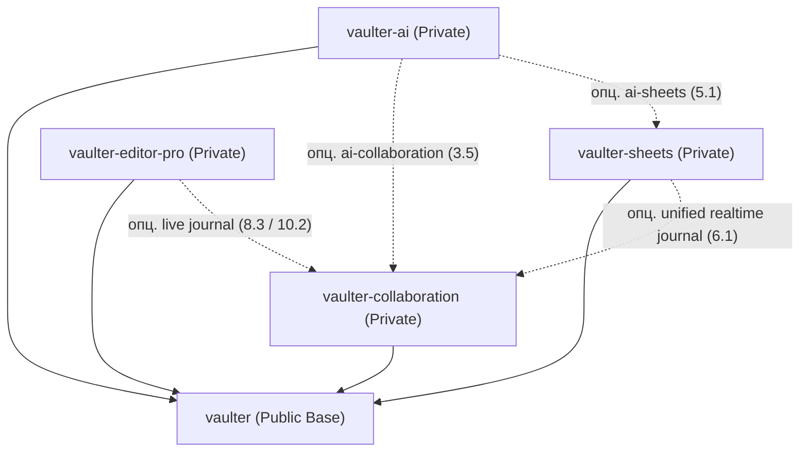

# Карта репозиториев экосистемы Vaulter

Экосистема распределена по **5 независимым репозиториям** с чёткой границей публичного и закрытого кода, едиными контрактами (SPI, Office SDK v1, `AtomicDocumentMutation`, `CollaborativeState`) и передачей зависимостей через собранные и проверенные артефакты (ZIP / tgz / Docker image digest).

| Репозиторий | Статус | Канал | Назначение | Паспорт | План разработки |
| --- | --- | --- | --- | --- | --- |
| `vaulter` | Существует (чистка) | Public (FlexCms) | Базовая платформа: Core, Media, Drive, Documents, публичный Vue/Tiptap | [vaulter.md](vaulter.md) | [dev-plans/vaulter.md](../dev-plans/vaulter.md) |
| `vaulter-collaboration` | Новый (вынос из `vaulter`) | Private | Универсальный движок совместных комнат (`protocol`: `yjs/2`, `univer-sheets/1`, будущие `univer-docs/1`/`slides`), PHP-журнал/fencing/JWT, Vue-адаптер и Hocuspocus Hub | [vaulter-collaboration.md](vaulter-collaboration.md) | [dev-plans/vaulter-collaboration.md](../dev-plans/vaulter-collaboration.md) |
| `vaulter-sheets` | Новый (перенос 1.1 + с нуля) | Private | Электронные книги на Univer OSS (Apache-2.0): PHP Sheets, Vue editor, Node runtime (CAS-вынос >512 КБ), Zero-Pro realtime поверх `vaulter-collaboration`, Tiptap link | [vaulter-sheets.md](vaulter-sheets.md) | [dev-plans/vaulter-sheets.md](../dev-plans/vaulter-sheets.md) |
| `vaulter-ai` | Новый (с нуля) | Private | Офисный AI SDK v1, P/Q согласование, возобновляемый AI-чат SSE, исполнители | [vaulter-ai.md](vaulter-ai.md) | [dev-plans/vaulter-ai.md](../dev-plans/vaulter-ai.md) |
| `vaulter-editor-pro` | Новый (с нуля) | Private | Замена Tiptap Pro: Range Comments, Compare, Tracked Changes, DOCX import/export | [vaulter-editor-pro.md](vaulter-editor-pro.md) | [dev-plans/vaulter-editor-pro.md](../dev-plans/vaulter-editor-pro.md) |

## Граф зависимостей репозиториев

## Общие правила взаимодействия

1. **Никаких относительных path-ссылок между репозиториями на приёмке.** В разработке допускаются локальные артефакты; на приёмке каждый потребитель собирается из конкретных ZIP/tgz/Docker digest через `artifacts.json`.
2. **Один владелец каждой таблицы БД.** Чужой пакет никогда не пишет напрямую в таблицы другого владельца — только через объявленный PHP-порт (`AtomicDocumentMutation`, `CollaborativeState`, `WorkbookOperations`, `Office`).
3. **Запрет утечки приватного кода в `vaulter`.** Базовый `vaulter` собирается и тестируется без приватных токенов, без Hub, без Sheets, без AI и без Editor Pro.
