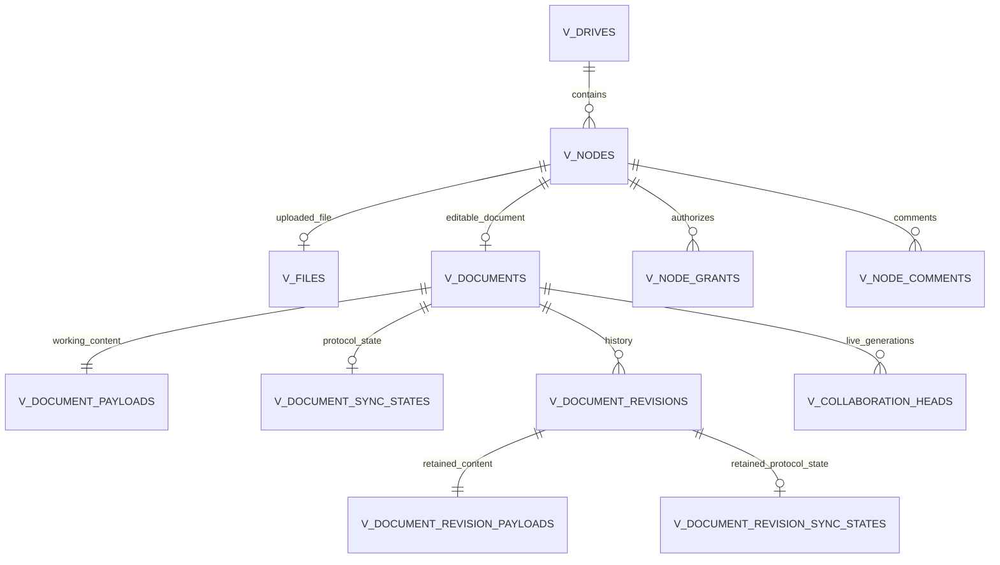

# Целевая база Vaulter

**Ключ офисного API — ID узла Drive.** У каждого редактируемого документа ровно один узел `v_nodes(kind=document)` и один агрегат `v_documents`. Внешний `resource_id` разрешается по `v_documents.node_id` в правах текущего диска. Внутренний FK `document_id` у ревизий, журналов и книжных таблиц ссылается на `v_documents.id`. База создаётся на пустой установке. Физический профиль исполняемых SQL — PostgreSQL, UUIDv7 для внутренних ID, bigint для ключей хоста, префикс `v_`, tenant включён. В базовых таблицах UUID выдаёт приложение. Новые закрытые таблицы с SQL default используют uuidv7() PostgreSQL 18; конкретные defaults указаны в их DDL.

### Пакеты, таблицы и писатели

SQL-файл каждого пакета задаёт полный набор колонок, тип, NULL, default, PK, уникальность, FK и действие при удалении, CHECK и индексы. В запросах API используется ID узла. Допустимость типа и совпадение tenant узла/документа writer проверяет под блокировкой до записи; простой FK на ID сам по себе не проверяет ни тип, ни права. Отдельный тест передаёт реальный ID текстового документа команде книги и ожидает отказ до вызова вычислителя. При разработке Laravel эта схема собирается установочными миграциями владельца. Варианты bigint/ULID/UUID, типов ключа хоста, префикса и tenant проходят существующую проверку снимков на трёх драйверах. [Эталон PostgreSQL до переработки](../../../packages/core/tests/Fixtures/Schema/expected/pgsql/uuid7.bigint.v.on.json) · [Матрица поддерживаемых профилей](../../../packages/core/tests/Fixtures/Schema/expected)

| Пакет и DDL | Таблицы, которыми он распоряжается | Рабочий путь |
| --- | --- | --- |
| [Core](sql/core.sql) | `v_outbox`, `v_outbox_consumers`, `v_outbox_deliveries`, `v_idempotency_keys` | Команда домена фиксирует событие в транзакции. Relay разбирает доставку по consumer. После потери ACK обработчик сверяет ключ. Состояние отдельной семантической команды и её квитанция описаны у конкретного владельца |
| [Media](sql/media.sql) | `v_blobs`, `v_blob_references` | CAS принимает байты, считает хеш, удерживает ссылку на неизменяемый объект. GC освобождает по текущему набору ссылок. Вынесенный из SQL снимок и оригинал XLSX держат самостоятельные ссылки |
| [Drive](sql/drive.sql) | `v_drives`, `v_nodes`, `v_files`, `v_file_revisions`, `v_file_revision_blobs` | Владеет пространством имён, иерархией, удалением и версиями загруженных файлов; один диск содержит документы разных зарегистрированных типов |
| Drive | `v_node_grants`, `v_node_shares`, `v_node_user_states`, `v_activity`, `v_drive_change_heads`, `v_drive_changes` | Решает текущий доступ; состояние пользователя и лента изменений принадлежат диску. Переименование меняет последовательность узла. Оно само по себе не делает устаревшей версию содержимого |
| Drive | `v_upload_sessions`, `v_upload_parts`, `v_scan_policy_states`, `v_scan_backfill_runs`, `v_scan_obligations`, `v_scan_requests`, `v_scan_evidence` | Принимает части загрузки, подтверждает файл, привязывает результат сканирования к конкретной ревизии и блобу |
| [Documents](sql/documents.sql) | `v_documents`, `v_document_payloads`, `v_document_sync_states`, `v_document_revisions`, `v_document_revision_payloads`, `v_document_revision_sync_states`, `v_node_comments` | Общий агрегат и история для всех нативных типов. Комментарий адресует узел. Центральный writer фиксирует payload и метаданные в одной транзакции |
| [Collaboration](sql/collaboration.sql) и [расширение для агента](sql/collaboration-agent.sql) | `v_collaboration_heads`, `v_collaboration_updates`, `v_collaboration_receipts`, `v_collaboration_permission_versions`, `v_collaboration_commands` | PHP ведёт журнал принятых байтов и точный исход бизнес-команды. Hub восстанавливает подтверждённую последовательность в памяти. У физического Yjs update и пользовательской команды разные ключи повтора |
| [Webhooks](sql/webhooks.sql) | `v_webhook_endpoints`, `v_webhook_deliveries` | Необязательный пакет публикует разрешённые события подписчикам и повторяет доставку по состоянию попыток |
| [Sheets](sheets.md) | Закрытое расширение документа, адресация строк/листов, рассчитанные проекции и квитанции; отдельный профиль совместного режима | Один нативный снимок или manifest как типизированное содержимое Documents. Движок получает ограниченное поручение; исход атомарно публикует PHP |
| [AI](ai.md) | Хранилище заданий, маршрутизации, предложений и решений у AI; текстовые проекции и квитанции у владельца документа | На разных соединениях авторитетный исход извлекается у владельца. Межсервисные ссылки несут стабильные ID и доверенную область |
| Метапакет, Vue, Vue Collaboration, Filament, AzGuard, Laravel AI/AgenTools-адаптеры, Node-процессы | Собственные таблицы офисного содержимого отсутствуют | Метапакет выбирает зависимости, UI и плагины используют прикладные порты. Свои внутренние таблицы сторонние исполнители устанавливают по собственным контрактам |

### Что меняется в исходной схеме

| Было в `b230f6e27` | Целевая установка | Инвариант |
| --- | --- | --- |
| Узел, базовый тип и ID агрегата в `v_documents` | Ввести `write_mode` со значениями snapshot/journal (default snapshot); сохранить `id`, `UNIQUE(node_id)`, `type`, `schema_version`, текущую ревизию, `revision_count`, `state_version`, `checkpoint_state_version`, `collab_epoch`, audit-метаданные | Разрешить тип через реестр Documents. При загрузке нового типа добавить ключ и codec своим пакетом; общего enum типов в SQL нет |
| `content, content_hash, content_size` на строке документа и ревизии | Переместить тройку в `v_document_payloads(document_id PK/FK)` и `v_document_revision_payloads(revision_id PK/FK)` | На каждую созданную голову/ревизию writer создаёт одну строку payload в той же транзакции. FK+PK закрепляют владельца и максимум одной строки. Минимум в одну строку обеспечивают writer и проверка целостности. Чтение списка документов выбирает только метаданные |
| Протокольные поля, бинарный checkpoint и маркер отставания на голове | Перенести в необязательную `v_document_sync_states`. Маркер может появиться до первого checkpoint. Содержимое бинарного состояния валидируется зарегистрированным протоколом | Индекс ожидания принадлежит этой таблице. Одновременно задан полный набор полей pending или все пусты. Указатель содержит поколение, версию формата и позицию; выдавать checkpoint как текущий при более свежем принятом журнале нельзя |
| Протокол и бинарный checkpoint повторяются в `v_document_revisions` | Сохранить их в необязательной `v_document_revision_sync_states`. Ревизия хранит собственный тип, поколение, версию схемы, основание восстановления и номер | Restore воспроизводит payload/протокол выбранной ревизии, меняет поколение действующей головы. Для бинарных комнат сохраняются исходные идентичности протокола |
| Снимок книги через общий OpaqueJsonCodec | В фазе 1 сохранение прежнего формата в новом пакете. В фазе 4 тип книги валидирует native snapshot и необходимые ресурсы. В SQL отдельно держатся логические ID и проекция для выборки | Оригинальный XLSX в Media; импортированный workbook, редактируемый документ и байты оригинала имеют разные роли. Переоткрытие из сохранённой версии должно восстановить логические ID |
| В проекте нет доменных квитанций офисного SDK | Схему создаёт установленный закрытый пакет. Стабильная команда связывает одну запись с одной квитанцией и постусловиями | Запись и фиксация исхода происходят у владельца в одном commit. Автономный агент не получает доступ к SQL |

### Переход в исходниках и проверка типов

1. **1.0.** Исправить определения создания Documents `000302` и `000303`, добавить `000304_create_v_document_payloads_table`, `000305_create_v_document_sync_states_table`, `000306_create_v_document_revision_payloads_table`, `000307_create_v_document_revision_sync_states_table` по принятому префиксу `0001_01_01_`. Удаление — в обратном порядке. Перенести GIN по содержимому ревизии к её payload в PostgreSQL, индекс по pending — к активному sync state. Все новые имена учитывают префикс таблиц хоста.
2. Под теми же блокировками Drive tree → node → document изменить hydration, checkpoint, восстановление и сохранение. Загрузка списка и ACL не выбирает большие JSON/bytea. При полной загрузке один явный join/eager load выбирает группы по PK. Ошибка в записи любой группы откатывает новую версию, payload, ревизию и outbox вместе. Таблицы пакетов и конкретные классы перечислены в [карте Vaulter](../implementation/vaulter.md).
3. Публичные типы rich text и Markdown, закрытая книга и тестовый внешний тип проходят один контракт `create → read → save → revision → restore → delete`. Restore одного узла с чужим revision ID отклонён. Тип без зарегистрированной реализации сохраняет прежнее содержимое и допускает штатный fallback. Открытие пользователем с правом чтения оставляет хеш и версию неизменными.
4. Участники закрытых модулей адресуют FK к внутреннему документу только на одном соединении. Получать ID по глобальному поиску в одной таблице для всех tenant запрещает контракт разрешения ресурса. Хост с выключенным tenant использует один явный scope для ключей идемпотентности; SQL NULL в любом компоненте составного UNIQUE не используется как средство дедупликации. Профиль Documents в чистой CMS обходится без хранения AI-индексов, данных книги и живого журнала.
5. Для port одного SQL-эталона на Laravel взять исходные `IdStrategyResolver`, `HostKeyColumns`, `SchemaHelpers`, регистрацию миграций действующим модулем Packman. Порядок FK, полноту payload/пар и границы диапазонов повторить для PostgreSQL, MySQL и SQLite, специфичный GIN остаётся PostgreSQL-индексом. Golden fixtures сравнивать с физической БД. [Существующая программа снимков](../../../scripts/schema-snapshot.php)

Поле `current_revision_id` указывает на именованную/автоматическую ревизию, последняя рабочая запись может быть новее. Составной FK `(current_revision_id,id) → v_document_revisions(id,document_id)` защищает связь от чужой ревизии. Для purge сначала освободить текущую ссылку и Media pins предусмотренной доменом последовательностью. Каскады убирают дочерние строки; очистку асинхронных индексов проверять через повтор доставки и новое разрешение прав. При уборке распознанного ключа команды сохранить предусмотренную контрактом защиту от повторного изменения. [Семантика read-after-write и очистки](../storage.md)

### Выбор писателя

Признак `v_documents.write_mode` хранит владельца последовательности изменений. `snapshot` — можно применить условную запись штатным владельцем типа. `journal` — операция обязана пройти через авторитетный журнал поколения. `collab_protocol` означает поддержку формата и может быть задан в одиночном rich text при создании. Смена режима выполняется отдельно под блокировкой документа, проверкой прав и версии. При входе в journal увеличить поколение и инициализировать его от подтверждённой основы; при выходе сначала дренировать журнал и опубликовать финальный checkpoint, затем сменить режим и поколение. Независимое сохранение в snapshot двигает state_version; поколение меняют restore или переход, требующий отозвать прежние полномочия писателя. Старое подключение, job и отложенный ответ вычислителя после перехода не должны примениться. У книги snapshot право выполнить команду также зависит от `RequiresCommandWrite`: обычный PUT полного JSON отвергается. История содержит протокол/байты своей ревизии; выбор текущего writer делает владелец при восстановлении.

На PostgreSQL 18 запустить `PG_BIN=/usr/lib/postgresql/18/bin bash plan/checks/schema.sh`. Нужны PostgreSQL и Python 3 со стандартной библиотекой. Команда создаёт временный кластер на локальном сокете и проверяет установку каждого профиля. Два независимых соединения начинают с одной версии документа. Тест наблюдает блокировку второго через `pg_blocking_pids`, затем освобождает первого писателя. После commit остаётся первая правка, после rollback принимается вторая, после перехода в journal устаревшая запись оставляет исходный текст и новое поколение. [Установка и проверка профилей](../../checks/schema.sh) · [Гонка записи](../../checks/database/document-race.py) · [Агрегат и ревизии](../../checks/database/documents.sql) · [Аренда checkpoint](../../checks/collaboration/lease-schema.sql) · [Команды живого текста](../../checks/collaboration/command-schema.sql) · [Книги](../../checks/database/sheets.sql) · [AI](../../checks/database/ai.sql)
