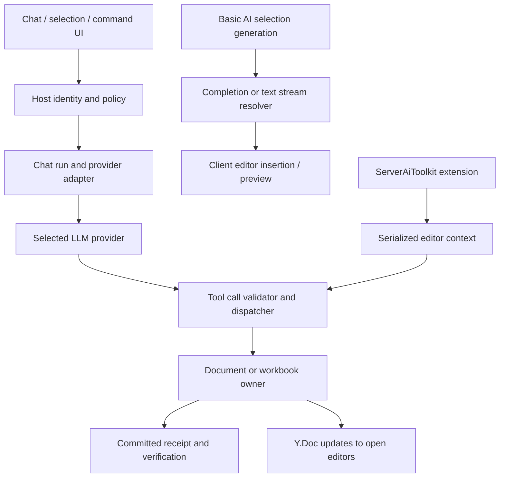

# AI: разбор доступного кода, протоколов и собственный backend

Дата: **2026-11-21**. Здесь исследуется AI-вертикаль целиком: клиентское редактирование, схема документа, chat/tool loop, streaming, авторизация, ключи провайдеров и серверное исполнение. Пометки **SOURCE**, **LOCAL**, **DOC**, **DESIGN**, **UNKNOWN** отделяют прочитанный код, выполненный опыт, документацию, собственное проектирование и недоказанные внутренности Cloud.

## Что получено и что воспроизводится

| Компонент | Версия / доступ | Фактически исследовано |
| --- | --- | --- |
| `@tiptap/ai-toolkit` | **0.5.0**, MIT, установлен exact | Поставляемые `src/`, runtime exports, schema-awareness, hash registration, streaming-reveal |
| `@tiptap-pro/extension-ai` | **3.12.9**, доступен trial registry, установлен exact | Поставляемый исполняемый `dist/index.js`, exports, resolver/command/stream/autocomplete алгоритмы и runtime |
| `@tiptap-pro/client-ai-toolkit` | Registry 403 в общей проверке | Только официальные contracts; локальный код и алгоритмы не доступны и не считаются разобранными |
| Server AI Toolkit service | Удалённый Cloud/on-prem сервис | Официальные v4 contracts; внутренний tool executor, SQL и deployment-код в установленном SDK отсутствуют |
| Legacy AI Agent | Deprecated documentation | Классификация старого продукта; пакет не выдаётся за текущий Server Toolkit |

Установка не затрагивает корневой npm-проект или `lab/src/main.mjs`. Результат — [ai-install.json](results/ai-install.json), точные версии закреплены в lab manifest/shrinkwrap. Бессрочный npm token используется только для скачивания и не является ключом LLM.

Локальный воспроизводимый опыт:

```bash
node plan/tiptap-pro/scripts/ai-toolkit-probe.mjs
```

**LOCAL: 13 проверок passed.** [Скрипт](scripts/ai-toolkit-probe.mjs) запускает отдельный loopback Vite с собственным virtual fixture, headless Chrome и mock resolvers. Он не читает `.env`, не меняет основную lab-страницу и блокирует внешние browser requests. Для HTTP resolver используется подмена `fetch`, а не внешний адрес. Реальных LLM-вызовов: **0**. [Полные собственные наблюдения](results/ai-toolkit-local.json) содержат JSON редактора, synthetic request payloads и SHA-256 исследованных файлов, без копии bundle/map.

## Разные пути AI, которые нельзя смешивать



**SOURCE:** Basic `Ai` — клиентское расширение генерации выделенного фрагмента, с локальным состоянием ответа и вставкой в editor. Public `ServerAiToolkit` — расширение схемы и генератор metadata для удалённого сервиса. Ни одно не является готовым хранилищем заданий, approval или квитанций Vaulter.

**DOC:** В современном server chatbot LLM вызывает backend приложения, а приложение получает tool definitions и исполняет их через Tiptap service. В client toolkit tool call исполняет открытый editor. Поэтому последний путь требует браузера, а server execution может работать без него. [Server chatbot](https://tiptap.dev/docs/ai/ai-toolkit/agents/ai-agent-chatbot), [Client chatbot](https://tiptap.dev/docs/ai/ai-toolkit/client/agents/ai-agent-chatbot).

## Public SDK 0.5.0: реальные алгоритмы

### Регистрация `_hash`

**SOURCE:** `src/server-ai-toolkit-extension.ts` подключает внутренний hash extension. Он добавляет nullable `_hash` к определённым non-inline nodes; исключает text, doc, tableCell, tableHeader и расширения группы inline. Если уже есть full `aiToolkit`, повторная регистрация пропускается. HTML parsing/rendering переносит атрибут только при его наличии.

**LOCAL:** после создания двух paragraphs `_hash` равен null; обычная вставка текста не назначает значения. Здесь нет локального алгоритма «посчитать хеш всего узла» или registry stable IDs. Публичный SDK лишь допускает сохранение атрибута, назначаемого другим исполнителем. Имя `_hash` не доказывает криптографическую природу значения и не делает его эквивалентом нашего `blockId`.

### `getEditorContext`

**SOURCE:** `src/schema-awareness/get-editor-context.ts` выполняет такую последовательность:

1. Собирает имена реально установленных extensions.
2. Получает metadata через `addJsonSchemaAwareness` каждого extension; mark определяется отдельно.
3. Отбрасывает встроенную metadata, если schema не объявляет требуемые для неё attributes.
4. Объединяет defaults → extension metadata → `options.customNodes`; более поздняя запись замещает одноимённый `extensionName` целиком.
5. Оставляет только entries установленных extensions.
6. Преобразует Zod attributes в JSON Schema.
7. Возвращает `{serializedSchema, items}`.

**SOURCE:** serializer сохраняет node/mark specs и defaults, исключая DOM parser/renderer и текстовые callback hooks. Attribute `validate` сохраняется, если уже строковый; функция-валидатор **удаляется**, а не передаётся executable source. Сервер обязан самостоятельно валидировать значения по допустимому профилю.

**LOCAL:** context не содержит текст synthetic документа, собственный `probeBlock` появился в items, metadata paragraph была переопределена, DOM hooks не сериализованы. Это схема возможностей редактора, а не snapshot контента. **DESIGN:** хранить версионированный context/schema profile на backend и выбирать его по доверенному типу ресурса; arbitrary context браузера не должен добавлять серверу возможности.

Официальный контракт также разрешает хранить JSON context и обновлять при смене набора extensions. [Editor context](https://tiptap.dev/docs/ai/ai-toolkit/api-reference/editor-context).

## Basic AI 3.12.9: транспорт

**SOURCE + LOCAL:** default base — `https://api.tiptap.dev/v1/ai`; baseUrl и resolvers переопределяемы. Exported resolvers формируют POST JSON и используют `Authorization: Bearer ...`, дополнительно передавая `X-App-Id`. В них нет доступа к provider OpenAI key.

| Вызов | Путь | Собственный runtime fixture |
| --- | --- | --- |
| Completion | `/text/<action>` | `{html:true,format:"rich-text",modelName:"synthetic-model",language:"en",text:"Own synthetic text."}` |
| Text stream | `/text/<action>?stream=1` | JSON включает `stream:true`; переданный AbortController становится fetch signal |
| Legacy image resolver | `/image/prompt` | Synthetic image options и text; возвращается URL из `response` |

Completion читает JSON `response`. Stream возвращает `response.body`, без SSE decoder на этом уровне: потребитель читает UTF-8 текст. HTTP error JSON преобразуется в исключение; тест использовал искусственный403. Это проверка resolver-контракта без обращения к Tiptap или провайдеру модели.

**DOC:** актуальная настройка Basic использует JWT audience AI и permission `AI:Generation`; браузерный token не должен быть provider API key. Custom resolver возвращает строку, `ReadableStream<Uint8Array>` или URL в зависимости от режима. [Basic install](https://tiptap.dev/docs/ai/basic/install), [Custom LLM](https://tiptap.dev/docs/ai/basic/custom-llms).

**UNKNOWN:** смешение исторического `X-App-Id` с новой JWT-схемой в данном package version не показывает, как устроено внутреннее хранилище credentials Cloud. В лаборатории реальные generation/image requests не выполнялись.

## Basic AI: команда, preview, reject и stream

**SOURCE:** все предустановленные text commands сходятся в общий runner. Он отказывает при уже `loading`, выбирает completion/stream resolver, сохраняет исходный selection slice, выставляет generation decoration и запускает async обработку. Команда обычно возвращает bool о запуске; этот bool не доказывает завершение модели и тем более domain commit. Реальное имя общего text prompt в изученном runtime — `aiTextPrompt`.

`AiStorage` содержит состояние idle/loading/error, response, initialContent, прошлые responses и generated range/options. Это память editor instance. Она не является журналом заданий, idempotency key, server approval или receipt. Callbacks loading/chunk/success/error относятся к этой локальной операции.

**SOURCE:** `StreamContent` поддерживает буфер полученной строки и текущий insertion range. Между частями он накапливает mappings чужих ProseMirror transactions. Очередная часть повторно разбирает **накопленный** HTML в schema fragment, проверяет его и заменяет только mapped generated range. После собственной вставки mapping сбрасывается и диапазон обновляется. Некорректный промежуточный fragment может быть пропущен; это не подтверждение корректности финального результата. При cleanup удаляется listener и завершается stream metadata.

Потоковый decoder использует UTF-8 streaming mode, поэтому многобайтовый символ может пересекать network chunk boundary. Вспомогательный accumulator временно удерживает завершающий `<`, чтобы не подавать parser заведомо оборванное начало HTML tag. Выбор глубины открытого fragment учитывает совпадение типов окружающих узлов, позволяя продолжать текст внутри блока.

| **LOCAL** опыт | Результат |
| --- | --- |
| Выделено bold15; plain-text direct completion →30 | Текст изменён, **bold потерян** в JSON текущего fixture |
| Затем `aiReject()` | Возвращён исходный slice с bold15; response history очищена |
| `insert:false`, затем accept | До accept текст прежний; после accept30 остаётся bold |
| Stream с UTF-8 chunks по2 bytes | Emoji собран без повреждения; editor получает итоговый текст |
| Второй command при loading | Возвращает false |
| Во время held stream правка независимого второго paragraph | Независимая правка сохранена, generated range дописан до30 |
| Искусственная ошибка resolver | State error, исходный текст сохранён |

Различие bold — подтверждённый результат конкретных plain-text путей этой версии, а не утверждение о любой конфигурации AI. Оно прямо показывает, почему для p42 нужен независимый `text_and_marks` verifier.

**SOURCE + LOCAL:** completion добавляет результат в `pastResponses` дважды; первый успешный fixture имеет count2. Stream добавляет один раз. Для собственной реализации этот список не копируется как модель истории — нет причин строить долговечность на такой UI-структуре.

**SOURCE:** accept снимает decoration и при предварительном `insert:false` выполняет вставку ответа; reject reset восстанавливает initial slice в generated range, pause меняет локальный state. Это не транзакционный rollback удалённого owner. Проверка удержания чужих правок **внутри** generated range, совместного undo и закрытия браузера этим локальным опытом не покрыта.

### Autocompletion

**SOURCE:** plugin запускает autocomplete на конце текстового блока. Для Tab внутри tableCell отдаёт управление таблице. Контекст берётся из последних максимум трёх блоков перед cursor, затем ограничивается `inputLength` (default4000). Результат stream сначала отображается decorations, а accept вставляет suggestion; изменение selection/обычный ввод/Escape очищает preview и вызывает abort. Изученная сборка держит текущий autocomplete AbortController в module-level variable; поведение двух одновременно использующих autocomplete editors требует отдельного runtime опыта.

Это быстрый интерактивный UX. Он не реализует область чтения офисного SDK, сохранённый run или безопасное восстановление команды после потери ответа. [Autocompletion](https://tiptap.dev/docs/ai/basic/text-generation/autocompletion).

## Server-side tools и протоколы

**DOC, не remote execution:** v4 предоставляет следующие границы. База — `https://api.tiptap.dev`; подпись JWT ES256 делается сервером, audience AI, permission `AI:Toolkit`; для Cloud document добавляется Documents audience и право на конкретный документ. [Install server toolkit](https://tiptap.dev/docs/ai/ai-toolkit/install).

| Endpoint | Контракт |
| --- | --- |
| POST `/v4/ai/toolkit/fetch-tools` | Принимает editorContext и включённые tools; возвращает systemPrompt и definitions с inputSchema |
| POST `/v4/ai/toolkit/execute-tool` | Принимает context, document, tool/name/input/config; возвращает tool output, before, document и docChanged |
| WS / POST `/v4/ai/toolkit/stream-tool` | Stream tool input; WS text frames либо HTTP NDJSON |

Document имеет inline-content или cloud-ID форму; inline execution не является записью в хранилище. Cloud mode хранит результат через Document service. Успешный HTTP не заменяет проверку tool output; ошибки tool могут находиться внутри него. `docChanged` может отражать служебные `_hash`, а не изменение видимого текста. [REST v4](https://tiptap.dev/docs/ai/ai-toolkit/api-reference/rest-api).

Пример synthetic lifecycle из опубликованного streaming-контракта:

```json
{"version":1,"type":"start","editorContext":{},"document":{"type":"cloud","id":"synthetic-document"},"tool":{"name":"tiptapEdit"},"user":"synthetic-agent"}
{"version":1,"type":"delta","argsTextDelta":"{\"operations\":["}
{"version":1,"type":"delta","argsTextDelta":"]}"}
{"version":1,"type":"end"}
```

Пустой context выше обозначает место собственного полноценного serialized context, а не валидный executable request. Это illustration protocol, не capture Cloud.

**DOC:** server streaming принимает raw JSON argument deltas модели; ответ содержит action/completed либо error. Изменения документа приходят editor по collaboration, независимо от chat text stream. Это два разных канала. Browser не должен повторно применять те же edits из chat response. [Server streaming](https://tiptap.dev/docs/ai/ai-toolkit/agents/streaming).

### Tool selection и ограничения

**DOC:** tools выключены по умолчанию. Client contracts различают chunked read/edit, чтение selection и управление threads; получение definitions и исполнение call — отдельные шаги. Client `executeTool`/`streamTool` требуют открытый toolkit/editor. [Client tools](https://tiptap.dev/docs/ai/ai-toolkit/client/agents/tools), [Client execute](https://tiptap.dev/docs/ai/ai-toolkit/client/api-reference/execute-tool).

**DOC:** `tiptapQuery` выбирает узлы/текст/ranges и выполняет read/replace/insert/attrs/marks. `expect` ограничивает число совпадений. Вызов содержит до50 операций и выполняется последовательно; при ошибке прежние операции **сохраняются**, последующие пропускаются. Read может назначать отсутствующие hashes. Это не атомарность всей группы и не наш pure read/prepare. [Tiptap Query](https://tiptap.dev/docs/ai/ai-toolkit/api-reference/tiptap-query).

**DESIGN:** свои selector/search/read layers полезно ограничивать формальным бюджетом, но не перенимать partial-write semantics незаметно. Для первого Office v1 сохранить существующие семь operations, строгую `text.replace_exact@1` и `sheet.fill_formula@1`. Более общий query engine — отдельная версия с явно выбранной атомарностью, ACL и evidence.

### Review и content protection

**DOC:** server review различает direct writes и `trackedChanges`; attribution задаётся отдельно, diff ignore rules исключают служебные attrs/marks. Client toolkit дополнительно имеет собственные preview/review options. Одно название режима не означает одинаковую реализацию обеих ветвей. [Server review](https://tiptap.dev/docs/ai/ai-toolkit/api-reference/review-options), [Client review](https://tiptap.dev/docs/ai/ai-toolkit/client/api-reference/review-options).

**DOC:** protection policy задаётся доверенным backend: read-only или hidden targets по schema. Она передаётся и при definitions, и при execution. Описание запрета в prompt само по себе недостаточно; исполняющий сервис проверяет фактическое изменение. Stream-edit имеет ограничения поддержки этой policy. [Content protection](https://tiptap.dev/docs/ai/ai-toolkit/agents/content-protection).

**DESIGN:** policy профиля выбирается хостом. Модель не может отправить более разрешающий `contentProtectionPolicy`, подменить actor или сделать unrestricted document replacement. Pending suggestion не является разрешением Office commit; принятие конкретного proposal/digest идёт через доверенный UI/handler P/Q.

## Визуализация server stream в открытом editor

**SOURCE:** открытый subpath `@tiptap/ai-toolkit/streaming-reveal` экспортирует view-only extension. Он слушает remote Yjs inserts и awareness `user.aiInstanceId`. Автора выводит из изменения client clocks; mixed-author batch пропускает. Якоря новых runs — Yjs relative positions, а не абсолютные offset.

Эффект ограничивает размер подсвеченного участка, игнорирует массовую вставку блоков как initial sync, объединяет соседние decoration runs и округляет возраст анимации. Default длительность550ms, cap400символов, шаг100ms, whole-node batch больше2блоков не анимируется. Устаревший span с изменившейся длиной не рисуется. Decoration не добавляет content marks, не сохраняет approval и не влияет на receipt.

**DESIGN:** свою подсветку можно строить поверх нормализованных событий committed edits; awareness AI identity использовать только для отображения. Она не является доверенной подписью автора или способом предоставить инструменту доступ.

## Provider key: где он действительно живёт

| Режим | Установлено | Не установлено |
| --- | --- | --- |
| Basic через Tiptap Cloud | **DOC:** provider key настраивается у Cloud app; browser использует Tiptap JWT | Способ шифрования key в Cloud DB, master key custody, ротация и журналы доступа |
| Server AI Toolkit с собственным chatbot backend | **DOC:** пример хранит `OPENAI_API_KEY` в окружении приложения; LLM вызывает customer backend | Конкретная реализация deployment secrets пользователя; никакой key в лаборатории не запрашивался |
| Client AI Toolkit | **DOC:** browser получает tool call, но LLM endpoint и provider credential остаются на backend | Внутренности закрытого toolkit, registry403 |
| Наша реализация | **DESIGN:** secret manager/encrypted credentials и server-only provider adapter | Не утверждается, что Tiptap использует эту же физическую схему |

Первый ряд следует [Basic setup](https://tiptap.dev/docs/ai/basic/install), второй — [server chatbot](https://tiptap.dev/docs/ai/ai-toolkit/agents/ai-agent-chatbot). Public SDK не содержит сервера хранения ключей; frontend bundle не может доказать его шифрование.

## Собственный AI backend: независимый blueprint

### Provider credentials и LLM port

Хост регистрирует provider profile: ID, тип провайдера, allowed models, credential reference, лимиты трат/шагов, timeout и permitted tool catalog. Секрет хранится server-side, отдельно от chat transcript и job payload. Для многопользовательского BYOK ciphertext привязан к tenant/provider credential ID; encryption context, версия master key и ротация принадлежат secret service. API просмотра возвращает только masked статус, не значение. Worker получает право читать нужный credential reference, browser — только состояние подключения.

Абстракция `LlmPort` принимает нормализованные messages, tool definitions, профиль и cancellation signal. Выдаёт события `textDelta`, `toolInputStart`, `toolInputDelta`, `toolInputComplete`, `usage`, `finish`, `error`. Адаптеры разных моделей преобразуют формат function/tool calls на этой границе. Наличие input delta не разрешает исполнение: schema-valid complete call проходит allowlist, область, policy и лимиты.

Протокол модели и собственный Office API независимы. Код не должен распознавать «готово» из текста assistant как подтверждение document commit. Модель не выбирает DSN, owner endpoint, effective subject, secret или approval flag.

### Chat session, run и tool-call ledger

Сохраняемые сущности:

| Сущность | Собственная ответственность |
| --- | --- |
| Conversation | Tenant/project, участники, сообщения, retention; каждый read повторно авторизован |
| Run | Исходный инициатор, конечное поручение, зафиксированный профиль/catalog/schema, лимит ресурсов и resume state |
| Tool invocation | Стабильный toolCall ID, normalized input digest, execution state, связь с proposal/command/receipt |
| Proposal decision | Конкретные P и digest, один terminal approval/reject, reviewer и dispatch |
| Resource outcome | Авторитетная запись owner; CORE хранит ссылку и восстанавливает её после потери ответа |
| Stream cursor | Позиция событий UI; не является позицией содержимого документа |

После reconnect UI читает durable run и события с cursor. Повтор chat final event не запускает второй run; повтор tool action не создаёт новый command ID. Незавершённые JSON deltas не сохраняются как исполнимая команда. Отмена завершает генерацию новых действий, но не откатывает уже committed effect без отдельной команды.

### Исполнение read/write tools

Schema context выбирается по поддерживаемому типу документа и версии, включая marks/attrs. `DocumentCodec` первой поставки работает с Tiptap JSON и адресуемыми blocks; token-efficient encoding можно добавить независимо после corpus roundtrip. Read возвращает ограниченную область и Marker/read_token, не весь документ по умолчанию. Техническая миграция IDs выполняется явной owner-командой, не скрытым побочным эффектом read.

Write tool проходит существующий путь: `describe/read → prepare → trusted approval при необходимости → commit → status → verify`. За p42 сохраняются block identity, контекст, marks и attrs; за книгой — устойчивые row IDs, scope и formula/calculation evidence. Atomic owner path сохраняет effect, idempotent outcome и receipt; собственный AI worker лишь связывает run с этим результатом. Это работает без открытого editor.

В live режиме кандидат готовится на отдельном состоянии. Streaming prompt/model progress отображается UI либо в отдельном preview, пока не принят durable commit. Если продукт потребует именно live progressive writes, каждая подтверждаемая часть получает отдельное намерение/receipt и явно видимый partial outcome. Прерывание stream не превращается в фиктивный rollback всего поручения.

### Review как интерфейс к намерению

Предложение можно показать diff, comments и tracked marks. Но UI projection не изменяет immutable prepared proposal. P/Q решение подтверждает сохранённый digest через доверенный handler; принятие P не одобряет Q. Worker действует под исходным инициатором и заново проверяет его права у owner. Проверка `at_commit` читает evidence квитанции, `current` — актуальный подтверждённый результат; поздняя правка человека может развести эти ответы.

Для нашего p42 verifier проверяет bold и прочие attrs, даже если UI пишет success. Для live эффекта дополнительно проверяется окно относительных якорей с соседними символами, чтобы merge15→20 и15→30 не принять за правильные30 рядом с20. Подробности — [Comments/Versions и Office](comments-versions-design.md).

## Что ещё не доказано

- Cloud generation не вызывалась; качества модели, стоимости, provider settings и реального chat SSE здесь нет.
- V4 tools/stream описаны по официальному контракту; их remote execution, exact current tool schemas, retry и частичные результаты не выданы за выполненный опыт.
- Client toolkit и его internal diff/parser недоступны из-за registry403; доступа не обходили.
- Source Basic раскрывает клиентский resolver/stream/editor алгоритм, но не Cloud prompts, SQL, secret encryption и model routing.
- Локальное сохранение независимого paragraph при stream не доказывает конфликтобезопасность правок внутри цели, два браузера, restart durability или owner idempotency.
- SHA/source versions фиксируют изученную сборку; актуальные docs могут описывать более новую конфигурацию и не заменяют runtime fixture.

Следующий разрешённый технический шаг без LLM spend — contract-тесты собственного fake `LlmPort` и Office owner, затем отдельная проверка service entitlement/fetch-tools при стабильной сети. Подключение реального провайдера и платные прогоны остаются отдельным явным действием.
