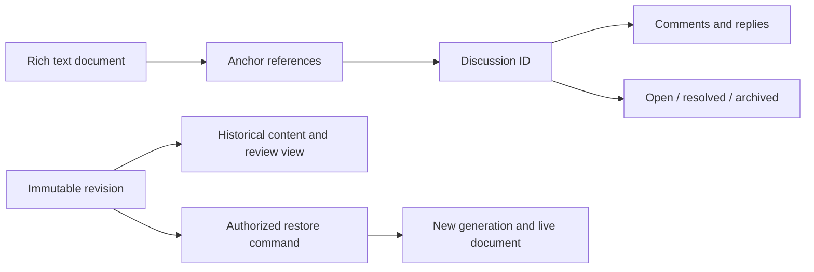

# Собственные Comments и Versions: независимый проект

Дата: **2026-11-21**. Это предложение для Vaulter, а не описание внутренних серверов Tiptap. Наблюдения, публичные контракты и проектные решения ниже разделены явно. Существующие требования [коллаборации](../spec/collaboration.md) и [фазы 2](../phases/02-collaboration.md) сохраняются: commit журнала предшествует durable ACK; restore повышает generation и ограждает старые клиенты.

## Основания

| Основание | Что действительно установлено |
| --- | --- |
| Публичный Comments demo | Собственный текст получает `inlineThread` mark с `data-thread-id`; comment/reply видны в sidebar. Resolve сохраняет mark и переносит обсуждение в Resolved. [Текущий UI опыт](results/public-comments.json), [описание](public-comments-findings.md) |
| Первый demo запуск | Получены Auth, Sync, Awareness, SyncStatus и Stateless; 8 входящих applied=true, document.saved/content.changed и versions.list. Первый полный JSON был заменён диагностическим запуском; сохранён явно обозначенный [summary](results/public-comments-earlier-summary.json), а не восстановленный raw capture |
| Установленные публичные declarations 3.12.9 | Provider описывает thread/comment records, soft-delete и forced-delete, `field` filtering, историю с list/create/preview/revert и событиями. Comments declarations отдельно описывают anchor/state callbacks и диапазоны. Snapshot declarations описывают storage и команды. Исходные bundles не копировались |
| Официальные docs | REST thread creation не создаёт anchor; snapshots по умолчанию восстанавливают текстовый fragment без отката comments; серверная проверка author требует отдельной настройки. [Comments REST](https://tiptap.dev/docs/comments/integrate/rest-api), [Snapshot](https://tiptap.dev/docs/collaboration/documents/snapshot), [Thread authentication](https://tiptap.dev/docs/comments/core-concepts/thread-authentication) |

Версии, названия доступных полей и сигнатуры проверены в локально установленном npm-пакете. Это не свидетельство используемой Cloud SQL-схемы. Declarations и docs местами содержат исторические заметки о тарифах; фактическое предоставление функции проверяется запросом собственного окружения.

## Три независимых сущности

Anchor отвечает на вопрос «к чему относится обсуждение», discussion — «что обсуждается и кем», state — «активна ли дискуссия». Их нельзя свести к одному span или строке JSON. Resolve — смена состояния discussion; remove-anchor — изменение содержимого; archive — скрытие discussion; permanent-delete — отдельная управляемая операция.

Для своего формата предлагаются собственные имена `reviewAnchor` и `discussionId`, без зависимости от Pro extension. В первой поставке inline anchor — mark над rich text, block anchor — атрибут устойчивого `blockId` либо schema-совместимый wrapper. Один discussion допускает несколько anchors; отсутствие anchor — допустимое состояние, а не повод молча уничтожить комментарии.

## Модель данных и единственный владелец записи

Предлагается хранить согласованное совместное состояние текста и review в Y.Doc текущего поколения. Владелец валидирует и сохраняет единый update в имеющийся журнал; SQL-таблицы для поиска, уведомлений и выдачи списков являются проекцией конкретного `(generation, seq)`. SQL projection не принимает самостоятельные изменения, которые затем бесконтрольно перезаписывают Y.Doc.

Собственный shared namespace `vaulter:review:v1` содержит discussion records с уникальными ID, а комментарии адресуются собственными ID. Для reply предпочтительны отдельные records с явным порядком; конкурентные replies не должны заменять целиком один массив. Не принимать вложенный JSON клиента за готовую авторизованную команду.

| Запись | Предлагаемые данные | Кто задаёт доверенные поля |
| --- | --- | --- |
| Discussion | ID, document ID, field, createdAt, createdBy, state, stateVersion, metadata | Владелец команды |
| Comment | ID, discussion ID, content, createdBy, timestamps, editedAt, deletedAt, version | Владелец; content проходит schema/size validation |
| Anchor | Discussion ID, block ID, fragment, текущие границы / CRDT identity, affinity, generation | Владелец и plugin, проверенные по документу |
| Terminal outcome | Command ID, request digest, accepted/rejected, resulting seq, effect IDs | Существующий durable command owner |
| Projection | Extracted text, author display lookup, open count, lastActivityAt, source generation/seq | Projection worker; чтение учитывает отставание |

Это собственная схема уровня домена. Физические имена таблиц и конкретный Yjs layout выбираются при реализации и не выводятся из названий private provider methods.

## Anchors и жизненный цикл схемы

`from/to` ProseMirror — временные координаты одного состояния. Для live anchors нужны CRDT-привязка и определённое поведение на границах; для SDK и восстановления — `blockId`, quote/context и source revision. Relative positions одного поколения нельзя без проверки переносить в новый Y.Doc.

| Событие | Предлагаемое поведение |
| --- | --- |
| Вставка перед диапазоном | Anchor перемещается с исходным текстом |
| Вставка ровно на границе | Применяется явная affinity; единое правило на всех клиентах |
| Частичное удаление | Anchor сужается, discussion сохраняется |
| Удаление всего target | Discussion становится detached; сохраняются quote и исходная revision |
| Split/join блока | Применяется mapping block IDs и диапазонов, возможны несколько anchors |
| Move блока | Discussion следует за устойчивой идентичностью блока |
| Copy/paste | По умолчанию текст копируется без discussion identity; «копировать с обсуждением» создаёт новые ID |
| Resolve/reopen | Меняется state; anchors сохраняются |
| Archive | Скрывается discussion, остаётся обратимое состояние |
| Permanent delete | Создаётся audit event; anchors удаляются управляемой командой, tombstone ограничивает resurrection |
| Schema upgrade | Проверяется совместимость всех участников; неизвестные review nodes не удаляются незаметно |

Установленные Comments declarations подтверждают, что callbacks различают локальное исчезновение последнего anchor и local/remote state transitions. Это полезное разделение ответственности; наш контракт не должен зависеть от клиентского автоматического удаления orphan threads. В read-only history viewer любые cleanup callbacks запрещены.

## Команды и REST

Предлагаемый transport-independent набор: `discussion.create`, `discussion.reply`, `comment.edit`, `comment.archive`, `discussion.resolve`, `discussion.reopen`, `discussion.archive`, `anchor.attach`, `anchor.detach`. Команда содержит `commandId`, document/field, generation, expected state version при изменении конкретного record и минимальный payload. Автор берётся из сессии, а не из payload metadata.

Создание discussion с anchor — одна логическая команда. Внутри она готовит оба эффекта на копии состояния, проверяет диапазон и права, сохраняет update и outcome атомарно и публикует живой комнате только committed update. Это избегает двухэтапного orphan состояния, которое наблюдаемо в чужом REST API. Detached discussion разрешён только как явно выбранная операция.

Для browser API и SDK нужен один семантический обработчик. REST endpoint не должен выполнять GET всего документа, редактировать JSON и PUT поверх уже изменившейся комнаты. В `journal` он обращается к владельцу комнаты и получает receipt. В `snapshot` применяется тот же контроль generation/version и owner lock по действующему плану.

Наблюдаемые события для хоста — `discussion.created`, `comment.added`, `discussion.stateChanged`, `anchor.detached`, `revision.created`, `document.restored`. Они доставляются из durable outbox с event ID, generation и seq; получатель дедуплицирует. Нельзя отправлять уведомление до commit или считать порядок доставки уведомлений порядком документа.

## Авторизация

Права чтения, правки текста, комментирования, moderation, чтения истории и restore самостоятельны. Read-only текстовый пользователь с comment permission может добавлять разрешённый review record и anchor, но не менять сам текст. Сервер сравнивает подготовленный эффект с разрешёнными операциями; disabled toolbar и клиентская metadata не являются проверкой.

Если сохраняется приём arbitrary Yjs updates от браузера, владелец обязан проверять фактические различия до/после: изменены ли защищённые поля автора, чужой comment, content при comment-only или чужой field. Альтернатива — review-команды вместо произвольных review-updates. Непроверяемый update не получает durable ACK. Решение о форме транспорта не снимает этого требования.

Состояние после отклонённого optimistic изменения не должно оставаться «сохранённым» только у автора: клиент восстанавливает подтверждённую основу и повторно применяет только допустимые локальные намерения. Отзыв доступа проверяется у действующего владельца перед commit.

## Versions: freeze, preview и restore

Пользовательская revision — неизменяемая точка `(documentId, generation, seq, schemaVersion, digest)` с именем и metadata. Transport checkpoint — средство ускорения загрузки журнала. Они различны: compaction может удалять старые updates, но не payload сохраняемой пользовательской revision.

### Freeze

1. Авторизовать создание revision и выбрать подтверждённую позицию H.
2. Восстановить состояние ровно до H; параллельные updates после H не включать в снимок.
3. Зафиксировать immutable binary и каноническую проекцию с digest, source generation/seq, schema и author attribution.
4. Атомарно опубликовать revision record и durable outcome; повтор command ID возвращает тот же revision ID.

Автоверсии — отдельная политика quiet window / max interval / minimum change. Периодический таймер не создаёт одинаковые revisions без изменения. `force` означает явное сохранение одинакового состояния и фиксируется как причина; не маскирует гонку границы H.

### Preview

Preview создаёт отсоединённое read-only представление immutable revision. Оно не подключается provider к живой комнате, не отправляет cleanup и не меняет текущую generation. Исторические schema migrations выполняются как производная view с provenance; исходный payload не переписывается. Compare использует две явно названные immutable основы.

### Restore

По действующему плану Vaulter restore всегда повышает generation. Нельзя реализовать его простым `Y.applyUpdate(oldSnapshot)` в текущий Y.Doc: merge старого CRDT update не равен замене состояния и допускает возвращение старых/offline операций.

1. Заблокировать документ и голову, проверить права, expected head и restore command ID.
2. Закрепить предыдущее подтверждённое состояние для аудита/возврата.
3. Создать состояние нового поколения из выбранной revision по поддерживаемой схеме; перенести review по явно выбранной политике.
4. Атомарно сохранить новую голову, state version, generation fence, receipt и событие restore.
5. Закрыть/переавторизовать старые соединения; клиенты уничтожают старый Y.Doc и создают новый.
6. Старый token, offline envelope, lease/checkpoint и delayed projection job не могут менять новое поколение.

Предлагаемая политика первой поставки: history сохраняет полный review view для исторического чтения; обычный restore возвращает **текст**, а актуальные discussions сохраняет. Anchors пересопоставляются по устойчивым IDs, неподтверждённые соответствия становятся detached. «Восстановить также discussions» — отдельный режим с явной приёмкой и migration правил. Это продуктовый выбор Vaulter, не вывод о поведении сервера Tiptap.

## Для чего это нужно конечному продукту

Цель плана — агент, который выполняет поручение в документе или книге и может доказать сохранённый результат. Совместный редактор, comments, tracked marks, history и diff обслуживают эту цель, но сами по себе не реализуют поручение. Первый результат должен работать с закрытым браузером и без модели; после детерминированной приёмки тот же контракт вызывают Laravel AI, опциональный AgenTools и отдельный HTTP/Python-процесс. [SDK](../spec/agent-sdk.md), [пакеты AI](../spec/implementation/ai.md).

Конкретный текстовый сценарий: агент находит пункт **p42**, меняет «15» на «30», сохраняет полужирное оформление и атрибуты marks. Сотрудник одновременно меняет **p71** — эта независимая правка остаётся. Если сотрудник меняет контекст самого p42, например «рабочих» на «календарных», старое предложение получает конфликт. Возврат числа «30» из editor.getText() не доказывает правильность всего этого результата.

В v1 `text.replace_exact@1` работает с одним `paragraph`/`heading` и устойчивым `blockId`. Поддерживается единственное совпадение внутри одного run с одинаковыми marks и их атрибутами. Смещения — UTF-16, а не байты; значимый контекст подготовки — весь целевой блок. Собственный comments anchor и tracked suggestion должны уважать эти идентичности и границы, но не подменять `read_token` или предусловия команды.

| Шаг поручения | Долговечный смысл | Как участвуют Comments / Versions |
| --- | --- | --- |
| `office.search/read/describe` | Разрешить доступный ресурс, стабильные block/row IDs, ограниченную область и версию команды | Можно показать существующие discussions и исторический baseline; их наличие не даёт прав читать скрытый текст |
| `office.prepare` | Сохранить неизменяемые proposal, dependencies, base Marker, выбор writer, digest и expiry; содержимое не меняется | Diff или suggestion UI визуализирует сохранённый план. Обычная вставка tracked marks в live документ уже меняет состояние и не считается реализацией prepare |
| Trusted approval | Человек разрешает конкретные proposal ID + digest в своей области | Thread обсуждает предложение; Resolve thread не равен approval. Кнопка accept suggestion без доверенного handler не подтверждает Office proposal |
| `office.commit` | Прежний command ID, текущие права инициатора, предусловия, атомарный эффект и receipt у выбранного owner | Review action может инициировать команду, но её UI success не означает `committed` |
| `office.status` | После timeout выяснить running/committed/rejected у исходного owner, не создать новое намерение | Sidebar перечитывает состояние задания; не делает новую замену и не создаёт новую version «на всякий случай» |
| `office.verify(at_commit)` | Проверить именно сохранённые evidence квитанции и её полный Marker | Историческая revision даёт удержанную основу, но сама version name не является receipt |
| `office.verify(current)` | Проверить доступное подтверждённое текущее состояние с учётом последующих изменений | Новая правка человека может законно дать failed при прежнем at_commit passed |

Marker — пара `(generation, position)`. Для snapshot текста position отображается на версию состояния, для live — на подтверждённую позицию журнала. Revision ID истории, transport synced, счетчик UI и number version Tiptap не являются этим маркером. После restore старое `after_receipt` чтение текущего поколения получает `generation_changed`; историческая проверка возможна только при сохранённом evidence и актуальном доступе.

### Idempotency и writer route

Ключ логического действия сохраняется **до первой отправки**; область — `(tenant, project_scope, effective_subject, resource, command_id)`. Proposal запечатывает writer по режиму `snapshot/journal`. Первый commit сохраняет route до вызова owner; доменный commit атомарно связывает эффект с receipt; ядро затем заполняет свою ссылку на исход. Это несколько отдельных commit, а не одна SQL-транзакция через PHP/Node/HTTP.

Status и повтор commit идут к **ранее выбранному** owner даже после snapshot→journal. Проверка режима до чтения уже существующего исхода ломает восстановление. Другой payload под прежним ключом или второй command ID для того же P даёт `idempotency_conflict`. Потеря ответа требует status с прежним ключом; истёкшее evidence не разрешает повторно применить исходную мутацию.

Ни suggestion ID, ни comment ID, ни имя версии не заменяют command ID. Если пользователь принимает предложение через review UI, связь suggestion→proposal→command сохраняется явно; повторное событие кнопки, очереди, voice channel или LLM action использует тот же outcome.

### P/Q и рабочее место согласования

Тест фазы7 создаёт два предложения P и Q. Два уполномоченных ревьюера конкурируют accept/reject **P**. Доверенный handler разрешает ровно одно решение для P/digest, один заранее сохранённый command ID и один dispatch; Q остаётся pending. Worker выполняет поручение от имени исходного инициатора. Право рецензента принять решение не повышает права инициатора изменять документ. Отзыв до commit прекращает запись; отзыв до просмотра скрывает старый diff. [Фаза7](../phases/07-agent-workspace.md).

Отсюда обязательные отдельные статусы продукта: «предложено», «одобрено человеком», «выполняется», «сохранено владельцем», «проверено на момент записи», «проверено сейчас». Resolved comment или принятый tracked mark могут быть контекстом, но не доказательством прохождения этих этапов. После закрытия браузера и рестарта состояние поднимается по ID задания; первый подтверждённый шаг многоресурсного поручения не повторяется при конфликте второго.

### Live p42 и доказательство эффекта

В живой комнате CRDT может слить независимые правки одной цели: offline «15→20» и агентское «15→30» дают «2030»/«3020». Поэтому live `verify(current)` проверяет не только наличие «30». Evidence сохраняет два относительных Yjs-якоря вокруг изменённого участка **с одним соседним символом с каждой стороны**; вставка внутри или вплотную к окну проваливает проверку. Правка в другом месте p42 может оставаться допустимой. Это самостоятельная проверка эффекта, а не comments anchor.

Эталон A42 требует: подготовка на изолированном состоянии → durable commit точных bytes и outcome у owner → применение к live Y.Doc/рассылка → восстановление после падения до live apply. Review-модель нельзя ставить перед этим commit и считать клиентскую suggestion transform уже подтверждённым эффектом. Состояние «applied» в wire Tiptap используется только как наблюдаемый сигнал исследуемого продукта.

### Закрытый браузер, процессы и приёмка

`owner-http` и PostgreSQL владеют содержимым, правами и receipt; `agent-worker` сохраняет контекст задания и ключ; `projection-worker` строит ограниченные чтения по generation/seq; `hub` держит live Y.Doc и восстанавливается из подтверждённого журнала. Python-клиент получает только Office HTTP и удостоверение пользователя, без DSN, Media или ключей owner. [Процессы](../spec/implementation/processes.md).

Потребители устанавливают собранные ZIP/tgz и проверяют публичные порты пакетов в изоляции от продуктов. Базовый профиль FlexCms остаётся одиночным без приватного registry; FlexCrm/Edufy подключают закрытые collaboration/Sheets/AI пакеты. Один и тот же результат подтверждается PHP, HTTP и отдельным клиентским процессом. Browser test показывает UX; background test доказывает независимость поручения от открытого editor. [Матрица потребителей](../spec/implementation/hosts.md).

Первый текстовый вертикальный срез требует лишь существующей команды замены и её строгих гарантий. Полноценная новая SDK-команда «оставь замечание» — последующая версия каталога с собственными digest/idempotency/verify. Исследование Comments не должно незаметно расширить семь wire operations или две команды первой поставки.

## Приёмка

| ID | Проверка | Критерий |
| --- | --- | --- |
| OWN-COM-01 | Два пользователя создают replies одновременно | Сохраняются оба уникальных comment ID после reconnect |
| OWN-COM-02 | Resolve/reopen + concurrent text edit | Текст не откатывается; anchors и state остаются согласованными |
| OWN-COM-03 | Удаление target + undo/redo | Предсказуемый detached/reattached lifecycle без потери discussion |
| OWN-COM-04 | Comment-only отправляет изменение текста / чужого автора | Серверный отказ, новый независимый читатель видит прежнее защищённое состояние |
| OWN-COM-05 | Повтор create/reply после потери ACK | Один logical effect и тот же terminal outcome |
| OWN-VER-01 | Freeze до41, параллельно append42 | Revision указывает41 и имеет его digest; current содержит42 |
| OWN-VER-02 | Preview старой revision | Ноль live updates и cleanup; текущие comments неизменны |
| OWN-VER-03 | Restore при offline старой вкладке | Новое поколение, старый ввод отклонён, свежий клиент видит restored head |
| OWN-VER-04 | Reconnect/restart после ACK restore | Сохраняются новая generation и outcome, старый lease не публикуется |
| OWN-VER-05 | Compaction + retention | Закреплённая revision продолжает читаться независимо от хвоста журнала |
| OWN-MIX-01 | Thread в tracked deletion, затем accept/reject | Не возникают silently orphaned data; policy применяется одинаково всеми писателями |

Cloud black-box может дать наблюдаемые UX и wire examples, но эти durability критерии принимаются на собственном PostgreSQL/Hub fault-стенде.
