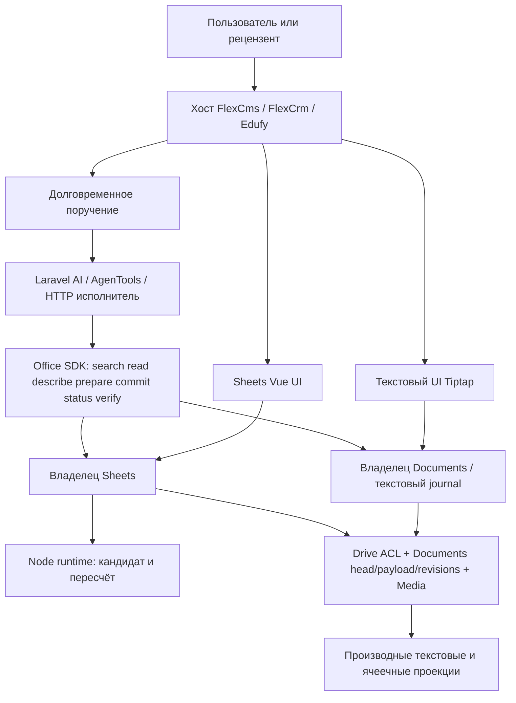

# Продуктовая цель Vaulter и место исследования Tiptap

Дата: 2026-11-21. Это сводка существующего `plan/`, а не изменение архитектуры или отчёт о готовности продукта. Пути будущих пакетов и описанные гарантии ниже — целевые требования, пока они не приняты соответствующим пакетным прогоном. Локальные проверки Tiptap-стенда не закрывают эти требования.

## Какой продукт строится

Цель — расширяемый офис документов и электронных книг с серверным SDK для агентов. Пользователь хранит ресурсы в Drive, работает с rich text/Markdown или книгой в браузере, поручает агенту ограниченную правку, при необходимости согласовывает предложение и получает проверяемый сохранённый результат. Работа продолжается при закрытом браузере. Долгосрочный ориентир — возможности офиса уровня Univer.ai; первый сквозной результат гораздо конкретнее: изменить условие договора либо заполнить формулами выбранные строки книги. Основание: [README плана, строки 5–11](../README.md).

Один граф ответственности объединяет три разные области: базовый домен ресурсов и доступа, типизированных владельцев содержимого и адаптеры исполнения агентских поручений. Текст и электронная книга имеют общий ресурс/ACL/историю, но разные форматы, редакторы, вычислительные модели и протоколы совместной записи.

## Продукты, пакеты и граница исходников

| Поставка | Состав и ответственность | Самостоятельность |
| --- | --- | --- |
| База для платной FlexCms с доступным клиентам кодом | `axiomasoft/vaulter`: Core, Media, Drive, Documents; `@vaulter/vue`, Vue и Tiptap хоста. Rich text/Markdown, одиночный autosave, ETag, конфликт, ACL, revisions, существующие comments и применимые HTML/Markdown exports | Собирается и работает без Hub, Sheets, AI, приватного npm registry и ключа LLM |
| Закрытая совместная работа FlexCrm | `axiomasoft/vaulter-collaboration`, `@vaulter/vue-collaboration`, образ `vaulter-collaboration-hub` | Отдельно квалифицируется согласованная тройка PHP/JS/Hub: два писателя, читатель, ACK, replay, отзыв и restore |
| Отдельный закрытый `vaulter-sheets` | PHP `axiomasoft/vaulter-sheets`; npm `@vaulter/sheets-vue`, `@vaulter/sheets-runtime`; независимо включаемые `@vaulter/sheets-realtime` и `@vaulter/sheets-tiptap` | Использует публичные контракты Documents/Drive. Vue viewer и engine не входят в базовый bundle. Пакет владеет собственными миграциями и профилем книги |
| Отдельный закрытый `vaulter-ai` | `vaulter-ai-core`, адаптеры documents/sheets/collaboration, исполнители laravel-ai/agentools | Не ставит второй редактор или второй источник истины. Вызывает доменных владельцев через прикладные порты |
| FlexCrm/Edufy как хосты | Выбирают набор возможностей, guard, tenant/project/subject, модель, согласование и канал поручения | Edufy может иметь отдельный процесс агента. Первую приёмку выполняют изолированные потребители без обязательной установки продуктовых приложений |

Названия AI в таблице сокращены; точные Composer-имена имеют префикс `axiomasoft/`. Разделение закреплено в [base-install.md, строки 3–24](../spec/base-install.md), [Sheets packages, строки 7–19](../spec/implementation/sheets.md), [AI packages, строки 7–20](../spec/implementation/ai.md).

Открытые технологии Tiptap/Yjs/Hocuspocus и доступность исходников базового продукта — разные вопросы. Платная FlexCms с открываемым клиенту кодом не означает обязательную публичность всех закрытых дополнений или истории общего Git. Точные лицензии сторонних компонентов проверяются для выбранных выпусков; эта сводка не объявляет весь стек Vaulter «бесплатным OSS».

Существующую оболочку книги и тип `vaulter/spreadsheet` сначала переносят в отдельную поставку, проверяют пару архивов и лишь затем удаляют их рабочую регистрацию/экспорт из базы. Универсальные slots, кодеки, viewer fallback и обычная текстовая таблица Tiptap остаются в базе. Текстовая таблица `table/tableRow/tableCell` не является электронной книгой Sheets. Основание: [перенос Sheets, строки 5–17](../spec/spreadsheets.md), [базовые инварианты, строки 20–24 и 61–66](../spec/base-install.md).

## Как работают человек и агент

### Одиночный текст

Хост открывает документ из Drive и монтирует Tiptap в слот `VaulterDocumentNode`. Публичный API возвращает abilities и содержание; пользовательское редактирование отдаёт JSON в `setContent`/`flush`. Вторая вкладка с прежним ETag получает 412 и сохраняет локальный черновик. Read-only UI подкреплён серверным отказом прямой записи. Новое открытие читает сохранённую версию. Это самостоятельный начальный продукт, а не сокращённый frontend Cloud. [Базовый сценарий, строки 26–32 и 50–57](../spec/base-install.md).

### Поручение по договору

Агент находит нужный ресурс, читает ограниченные адресуемые блоки, готовит `text.replace_exact@1` и показывает пользователю конкретную замену с digest. Изменение соседнего абзаца не обязано конфликтовать с неизменившейся целью; изменение самого условия «15» на «20» требует перечтения и нового предложения. Форматирование целевого фрагмента сохраняется.

Если хост требует согласования, предложения P и Q имеют разные ID. Два reviewers могут одновременно принять/отклонить P, но получают одно конечное решение, Q остаётся ожидающим. Авторизация рецензента согласовать предложение и авторизация инициатора выполнить запись — самостоятельные проверки. После принятия сохраняются command ID и dispatch; «принято человеком» отличается от «сохранено владельцем». Потеря ответа и закрытие браузера восстанавливаются по заданию/status без повторной правки. В многошаговом задании завершённый первый ресурс и конфликт второго показываются как частичный исход, а не как ложный общий успех. [Фаза 7](../phases/07-agent-workspace.md), [H3, строки 44–59](../spec/host-integrations.md).

### Поручение по книге

Пользователь выделяет строки, а не передаёт модели всю рабочую книгу. Через `sheet_catalog` агент получает устойчивые ID листа/таблицы/колонок; через `sheet_table` — только нужные row IDs, поля и подтверждение полноты. `sheet.fill_formula@1` задаёт типизированное выражение. Серверный владелец разрешает его на актуальной книге, пересчитывает, фиксирует и проверяет формулу и значения по отдельным ячейкам. Константа, равная численному результату формулы, не является выполнением поручения.

В контрольном примере SDK `fixed_members` после вставки новой строки заполняет прежние выбранные записи в D2/D4, даёт 20/−20, не трогает новую D3 и стороннее D5=77. Для `current_rows` появление строки меняет область: прежнее предложение получает `scope_changed`, затем нужны новое чтение и новый ключ. Координата C3 после вставки может указывать уже на другой товар. ID логической строки сохраняется при перемещении, копирование создаёт новую идентичность; ID назначает владелец, а не случайный повтор runtime. [Фаза 5, строки 5–17](../phases/05-sheet-sdk.md), [спецификация Sheets, строки 25–35](../spec/spreadsheets.md), [table bindings, строка 113](../spec/implementation/sheets.md).

Обычная человеческая правка и агентская команда проходят один серверный путь. Пока агент считает формулы, человек может изменить соседнюю ячейку; входящий принятый результат не должен перезаписать соседнюю правку или отправиться обратно как новое пользовательское изменение. Фокус, selection и локальная история редактора сохраняются согласно профилю. [Браузерный workflow, строки 55–58](../spec/spreadsheets.md).

### Закрытый браузер и смена исполнителя

Работа SDK не зависит от DOM и открытой вкладки. Первым исполнителем служит Laravel AI с ключом на сервере; AgenTools подключается отдельным адаптером. Тот же контракт доступен через авторизованный HTTP отдельному процессу, в том числе тонкому Python-клиенту. Наличие LLM не нужно для детерминированной приёмки семантики записи.

Хост сохраняет инициатора, доверенную область, proposal/digest, command ID, решение и промежуточные исходы. Worker заново разрешает актуальные права и ресурс перед попыткой. Финальное сообщение внешнего канала и его дубликат создают одно поручение; промежуточная реплика не запускает commit. Loqum — будущий канал, его работающий сервис не требуется первой приёмке. [Agent SDK, строки 3–25](../spec/agent-sdk.md), [host integrations H1](../spec/host-integrations.md), [фаза 7.2](../phases/07-agent-workspace.md).

## Что означает собственная электронная книга

Выбор движка остаётся отдельным решением по общему корпусу. План использует конкретные испытанные версии Univer для образцов, сравнивает IronCalc и Handsontable+HyperFormula и отдельно рассматривает grids CRM. Успешный canvas или ввод в сетку ещё не доказывает полноценную книгу с формулами, ресурсами, холодным открытием и серверным исполнением. Перечисленные в плане версии описывают корпус сравнения, а не вечную рекомендацию брать текущий latest. [Фаза 4.1](../phases/04-sheets.md), [критерии движка, строки 34–45](../spec/implementation/sheets.md).

Одна версия книги содержит обёртку `format_version:2`, профиль с точными версиями engine/plugins, полный native snapshot с обязательными ресурсами и `tables` с устойчивыми ID. Web и Node читают тот же формат. Неподдерживаемый ресурс или ресурс, потерянный при `save()`, отвергает кандидата до публикации новой версии. Известный дефект переноса conditional formatting блокирует затрагивающие операции соответствующего профиля вместо молчаливой порчи. [Формат и хранение, строки 51–55](../spec/implementation/sheets.md), [ограничения корпуса, строки 41–49](../spec/spreadsheets.md).

### Runtime и фиксация

PHP владеет узлом, ACL, состоянием команды и commit; Node получает проверенные данные и возвращает кандидата вычисления. Node не получает DSN, пользовательские ключи или произвольный URL исполняемой программы. Для локального исполнения предусмотрен одноразовый CLI, для стенда — фиксированный приватный HTTP runtime с ограничениями CPU/RAM, времени, размера и очереди. Долгая работа движка проходит **вне** PostgreSQL-транзакции. HTTP 200 от runtime — ещё не пользовательское подтверждение. [Обмен и процессы, строки 67–83](../spec/implementation/sheets.md).

Владелец затем под доменными блокировками перепроверяет текущие права, generation/head/digest/lease и исход команды. В одном commit сохраняются payload/manifest, маркер Documents, command outcome/receipt и outbox. Потерянный ответ читается по тому же command ID. Обнаруженный повтор восстанавливает исходную квитанцию, даже если соседняя запись уже сдвинула head; новый ключ со старым основанием конфликтует. [Атомарная запись, строки 87–93](../spec/implementation/sheets.md), [сквозной workbook flow](../spec/implementation/workbook-flow.md).

Три политики записи не смешиваются:

| Политика | Намерение | Конкурентное изменение |
| --- | --- | --- |
| `exact_base` | Структурная UI-команда по координатам под If-Match | Изменившаяся голова отвергает кандидата |
| `rebase_cells` | UI-команда содержимого по A1 с проверенным прежним `expected` | Соседняя ячейка может сохраниться вместе с правкой; структурное изменение того же листа блокирует перебазирование, потому что координата могла сменить логическую цель |
| `revalidate_by_id` | Агентская команда по устойчивым IDs | Владелец повторно разрешает IDs и зависимости; fixed members получают новые координаты, current rows могут получить `scope_changed` |

Политика входит в fingerprint команды. Wire различает число, строку, boolean, пустую ячейку и исходную формулу. Native snapshot cache не является доказанным пересчётом: искусственный 999 должен стать подтверждённым 41 после вычислительного барьера. SHA кандидата охватывает всю обёртку, профиль и ID bindings, но не обязан воспроизводиться новым расчётом из-за случайных IDs стилей. Повтор использует сохранённый исход, а не сравнение нового candidate digest. [Wire v1, строки 15–47 и 66–92](../spec/implementation/sheets-runtime-wire.md).

### Хранение и адресное чтение

Общий Documents хранит единственную авторитетную голову и payload/manifest; именованные revisions удерживают свои неизменяемые payload. Начальный профиль хранит JSON в Documents. Если измерения требуют Media blobs, сначала подготавливаются immutable bytes, затем владелец транзакционно публикует ссылку, pin и receipt; история удерживает объект до освобождения последней ссылки. Второй канонический снимок в параллельной таблице Sheets не вводится. [Хранение, строки 51–55](../spec/implementation/sheets.md).

Адресные cell projections — производные данные для дешёвого чтения SDK. Проектор публикует одну готовую сборку, читатель присоединяет один build ID; нельзя смешивать ячейки разных версий или выдавать старое поколение после restore. Отставание означает явное ожидание/авторитетное чтение, а не ложное подтверждение квитанции. Стоимость SDK измеряется по SQL/buffers, байтам, p95, модельным токенам, записи и rebuild, с отделением реального расхода провайдера от оценки токенизатора. [Workbook flow, строки 40–45](../spec/implementation/workbook-flow.md), [фаза 5.2](../phases/05-sheet-sdk.md).

## Совместная работа книги и связь с текстом

Совместный текст на Yjs и совместная книга — две самостоятельные реализации. План предлагает для Sheets выбрать лицензированный родной Univer Pro protocol либо собственный серверный журнал типизированных команд. Для собственного варианта сервер задаёт единственный порядок, перебазирует по выбранным политикам, рассылает принятый результат, а клиент снимает и повторно накладывает неподтверждённый ввод. Конфликт структурных изменений и старой координаты разрешается устойчивым ID либо явным отказом. Подключение Yjs для текста само по себе этого не обеспечивает. [6.1, строка 117](../spec/implementation/sheets.md).

У каждой активной книги один авторитетный write mode. Переход snapshot → journal поднимает generation и ограждает прежние контексты. В journal отказ realtime не разрешает незаметно записать старый snapshot; возврат требует управляемого дренирования и checkpoint. Agent и human входят в ту же последовательность; поздний worker/lease/update после restore не может вернуть прошлое поколение. Realtime capability остаётся выключенной до аварийных тестов. [Фаза 6.1](../phases/06-extensions.md), [режимы, строка 119](../spec/implementation/sheets.md).

Независимый `@vaulter/sheets-tiptap` начинает со скромной совместимой интеграции: обычный link mark, нейтральный текст и HTTPS URL узла/листа/диапазона. Первый профиль использует фиксированные физические координаты, поэтому после вставки открывает новые значения этих координат. Preview строится при отображении и заново проверяет ACL книги; доступ к уроку не даёт доступа к исходным ячейкам. Без расширения обычный редактор сохраняет ссылку. Export также заново проверяет доступ. [Фаза 6.2](../phases/06-extensions.md), [реализация ссылки, строка 121](../spec/implementation/sheets.md).

## Импорт, экспорт и доказанная совместимость

Для базовых документов сохраняются применимые HTML/Markdown exports. DOCX import/export не включён в первую базовую поставку; наличие Conversion в Tiptap Cloud не меняет этот scope автоматически. [База, строка 20](../spec/base-install.md).

XLSX и CSV — независимо заказываемые capabilities Sheets. Каждый включённый формат обязан пройти собственный корпус; у выключенного capability отсутствует в API. Импорт сохраняет оригинальный Media blob и отчёт свойств/потерь. Экспорт закрепляет определённую revision/generation/position, а не случайную последнюю голову после ожидания job. Сбой конвертации сохраняет оригинал и предыдущую рабочую книгу; повтор job не публикует второй импорт. [Фаза 4.3](../phases/04-sheets.md), [exchange, строки 95–107](../spec/implementation/sheets.md).

Для XLSX проверяются no-op и structural edit, формулы и кэш, стили, merged cells, validation, named ranges, conditional formatting, неизвестные части и даты 1900/1904; обещанный уровень Excel compatibility подтверждается целевым приложением. CSV первого профиля — один лист, явный диалект/кодировка/quotes; текст без схемы сохраняет ведущие нули, формульные литералы и преобразования должны быть отражены в отчёте. CSV не обещает multi-sheet workbook, styles и эквивалент XLSX.

## Зачем сейчас исследуем Tiptap

У исследования есть прямое продуктовое основание в [H3, строка 59](../spec/host-integrations.md): перед расширением собственной точной текстовой замены до пересекающихся структурных изменений сравнить trial Pro с собственным вариантом по P/Q, правам, восстановлению и headless-пути. Требуется понять наблюдаемые contracts и поведение, достаточные для независимой реализации нужных возможностей на Tiptap.

Текущий приоритет исследования — текстовая совместная работа и слой review: provider/auth и подтверждения, comments и устойчивые anchors, version history/restore/compare, tracked changes и accept/reject, несовместимые schema и отказ старого клиента, сохранение результата без работающего UI. Существующие Documents comments/revisions не равны автоматически Pro-подобным range threads, realtime suggestions или визуальному сравнению.

| Что даст исследование Tiptap | Что остаётся отдельной работой основного плана |
| --- | --- |
| Наблюдаемые сценарии text collaboration и UI/backend контракты | Собственная транзакционная долговечность и весь аварийный corpus 2.2/3.5 |
| Модель text review/comments/history и требования к независимым extensions | Полный spreadsheet engine, native serialization, расчёт, row identities и структурные ссылки |
| Headless text API и поведение повторов на стенде | Office SDK, доверенный контекст, scope/read limits, receipts/verify и persisted orchestration |
| Требования к неизвестным nodes/marks и деградации клиента | XLSX/CSV roundtrip, plugins/resources и признаки готового расчёта |
| Совместимые ссылки/preview внутри Tiptap | Собственный realtime Sheets, fence поколений и общий порядок human/agent команд |

Tiptap Cloud здесь — доступный эталон наблюдаемого поведения и набор тестовых зависимостей. Будущая независимая реализация может иметь иной внутренний storage и алгоритм; её принимают по собственной спецификации и fixtures. Наблюдаемый WS exchange не раскрывает чужие SQL-транзакции и не доказывает все внутренние гарантии. Успешный локальный OSS-тест не объявляется Cloud-результатом.

## Как читать готовность этого направления

План требует собранные реальные артефакты, isolated Laravel/PostgreSQL/Vue consumers, версии и digest, новые процессы и независимое перечитывание. Существующие reference experiments уже доказывают отдельные алгоритмы, но не заменяют пакетную приёмку ACL, HTTP, Composer/npm installation и browser workflow. Сравнение движков и доступность конкретных Pro capabilities также остаются проверяемыми результатами, а не предположением из названия пакета. [Карта приёмки Sheets, строки 123–134](../spec/implementation/sheets.md), [wire: граница образца, строка 92](../spec/implementation/sheets-runtime-wire.md), [приёмка базы, строки 61–66](../spec/base-install.md).

Полностью прочитанные для этой сводки разделы: фазы [4](../phases/04-sheets.md), [5](../phases/05-sheet-sdk.md), [6](../phases/06-extensions.md), [7](../phases/07-agent-workspace.md); [spreadsheets](../spec/spreadsheets.md); [implementation/sheets](../spec/implementation/sheets.md); [sheets-runtime-wire](../spec/implementation/sheets-runtime-wire.md); [workbook-flow](../spec/implementation/workbook-flow.md); [base-install](../spec/base-install.md). Дополнительно использованы уже изученные фазы 2/3 и протокол коллаборации, README, указанные выше части AI/host contracts. Основной `plan/` этой запиской не меняется.
