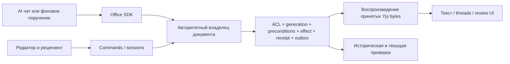

# Контракт собственной замены Pro-модулей

Это проект собственной реализации, выведенный из существующего плана, разбора доступных пакетов и опытов. Это не утверждение, что весь аналог уже написан. Установленные Pro-пакеты остаются образцом в `lab/`. Состав фактически доступных пакетов и закрытых областей уточняется в [каталоге](module-catalog.md).

## Целевой результат

У пользователя один ресурс Drive, действующие ACL, история и один авторитетный владелец содержимого. Tiptap UI, рецензент и фоновый агент обращаются к этому владельцу. Текстовая коллаборация использует Yjs/Hocuspocus; электронные книги имеют собственный runtime и протокол. Общий продуктовый контекст — [product-context.md](product-context.md).

Для договора из плана агент читает p42, предлагает 15→30, сохраняет bold и соседнюю правку p71, получает сохраняемый исход и после обрыва восстанавливает его по тому же ключу. UI комментария или suggestion не заменяет этот исход. Собственный renderer review может показывать предложение, пока содержательная запись ещё не состоялась.



## Разделить четыре вида состояния

| Состояние | Где хранить | Зачем разделять |
| --- | --- | --- |
| Содержимое и его CRDT-идентичности | Авторитетный payload/checkpoint + журнал, передаваемый Y.Doc | Редактирование, сходимость, replay |
| Обсуждение и жизненный цикл thread | Командная модель владельца; синхронизируемое представление может находиться в Y.Doc | Комментарий может пережить resolve, удаление anchor и restore текста |
| Намерение и решение P/Q | Неизменяемый proposal/digest, решение хоста, заранее сохранённый command_id | Единственность согласования и восстановление после обрыва |
| Результат исполнения | Квитанция и проверяемые постусловия у владельца | Ответ модели, локальный mark и provider.synced не доказывают сохранённую команду |

Наблюдаемый Pro хранит threads в `Y.Array('__tiptapcollab__threads')`, thread/comment — во вложенных Y.Map/Y.Array. Текстовые предложения используют marks и node attrs. Для нашей реализации это источники сведений о поведении; имена внутренних контейнеров и приватный wire-format сохранять не обязательно. Фактический разбор — [source-level-review.md](source-level-review.md), [tracked-changes-design.md](tracked-changes-design.md).

## Comments: команда, discussion и anchor

Предлагаемые сущности собственного домена:

| Сущность | Минимальные поля и ограничения |
| --- | --- |
| Thread | trusted tenant/project/resource, id, created_by, created_at, resolved_by/at, deleted_at, version |
| Comment | thread_id, id, body, authoritative author_id, created/updated/deleted timestamps; reply/order relationship |
| Anchor | thread_id, document_generation, block_id, Yjs relative endpoints или структурный селектор, исходный marker и schema_version |
| Command outcome | trusted scope + command_id + fingerprint, исход, receipt, принятая позиция |

Публичные операции собственной версии API: создать thread, добавить/изменить/удалить comment, resolve/reopen, удалить/отвязать anchor. Запрос указывает цель и ожидаемый контекст; авторство берётся из проверенного субъекта. Повтор команды возвращает сохранённый исход. Одновременные resolve/reopen требуют определённого правила версии/CAS, а не случайного порядка HTTP-ответов.

Anchor не равен числовому `from/to`: после конкурентной вставки диапазон сдвигается. Yjs RelativePosition задаёт привязку внутри поколения; block_id помогает семантически разрешать цель. По restore прежнего поколения нельзя слепо использовать старую относительную позицию. У orphan-thread должен быть явный статус и доступный пользователю способ восстановления привязки.

Если discussion находится в SQL, а anchor отражается в Y.Doc, публикация их связи должна иметь одну авторитетную границу. Возможный порядок:

```text
authorize current subject and target
lock resource/head and resolve its current writer
validate generation, schema, range and command fingerprint
commit domain change + accepted update bytes + receipt + outbox
replay committed bytes and publish thread state
```

Для строгого живого профиля эта граница обязана охватывать всех писателей согласно A42. Произвольное право записать бинарный Yjs update не удостоверяет `comment.author_id`: клиент умеет создать чужое имя самостоятельно. Это отдельная задача server validation/командного пути.

## Review / Tracked Changes

Первая самостоятельная версия может ограничиваться точной текстовой заменой с однородными marks, как уже определено планом. Полный review дополнительно требует insert/delete/replace, изменения marks/attrs, splits, списков, атомарных nodes, нескольких авторов и таблиц.

Собственная schema хранит стабильный ID предложения, тип операции, автора, временные отметки, связь replacement-половин и исходные/предложенные attrs. Удаление удерживает исходный текст до решения. Accept/reject — детерминированная транзакция над выбранным предложением; replacement решается целиком. Общий префикс/суффикс можно нормализовать, сохранив смысл замены.

Нужны три явные проекции для чтения и AI:

- original: документ до ожидающих предложений;
- proposed: документ с предполагаемым принятием выбранных предложений;
- review: документ с визуальной разметкой и метаданными.

Обычный `getText()` может включать удерживаемые удаления и обе половины replacement. Он не является универсальным источником текста агента.

Перехват локальных транзакций должен завершать преобразование до публикации в Yjs. Remote sync не должен создавать новые предложения от локального пользователя. Соседние операции одного автора могут группироваться; чужая правка внутри ожидающей вставки остаётся самостоятельной. Форматирование, курсоры, undo и исторические метаданные проверяются отдельно. В [probe](results/tracked-changes-probe.json) проверены 28 условий установленной версии, включая nested authors и remote-not-retracked.

Для бизнес-предложения P соответствие `proposal_id → suggestion_ids[]` надёжнее предположения «один mark всегда равен одному поручению». Решение reviewer хранится в домене хоста по конкретному digest. Его принятие не повышает права исходного инициатора и не превращает UI reviewer в владельца записи.

## History, preview, compare, restore

Собственная версия должна хранить immutable snapshot/reference, schema_version, исходное поколение, подтверждённую позицию и metadata. Список версий, создание, preview, compare и restore — разные операции.

Preview читает историческое состояние в отдельную модель и не меняет живой редактор. Compare строит структурный diff по nodes/marks/attrs и показывает decorations в отдельном EditorView. Применять `setContent` с diff к активному пишущему editor опасно: визуальное сравнение может превратиться в пользовательскую запись. Наблюдаемые алгоритмы Snapshot Compare разобраны отдельно в source-level-review.

В нашем Cloud опыте restore вернул текст 30→15, а resolved discussion с двумя комментариями сохранился. Это подтверждает необходимость раздельных жизненных циклов, не задаёт для Vaulter единственно допустимую продуктовую политику.

У Vaulter restore открывает новое поколение и ограждает старые токены, offline updates, lease, intent и outbox. Restore не должен позволять старой вкладке повторно опубликовать откаченные изменения. Если продукт решит восстанавливать comments вместе с текстом, эта политика задаётся явно и проверяется на P/Q и orphan anchors.

## AI: чат, модели и tools

Собственный backend чата хранит сессию, сообщения, последовательность потоковых событий, задания tools, согласования и ссылки на квитанции. Provider key остаётся в серверном хранилище хоста. Браузер получает права на сессию, а не ключ LLM и не администраторский JWT документов.

Состав доступных tools определяется установленными возможностями, профилем и текущими правами. Содержимое чата не расширяет эти права. Контекст редактора — ограниченные адресуемые фрагменты с marker/read_token и описанием schema, а не обязательная загрузка всего договора или книги.

Предлагаемый поток собственной реализации:

```text
persist user request and trusted initiating context
resolve allowed model and tool catalogue
stream assistant deltas; persist tool requests before execution
read/describe -> prepare immutable proposal
if required: wait for trusted decision on this digest
commit using pre-persisted command_id
on unknown outcome: status, then verify
publish a resumable result referencing the owner's receipt
```

Потоковые события имеют sequence/ID, чтобы переподключение читало сохранённый хвост и не запускало tool повторно. Прерывание stream или закрытие браузера не откатывает уже принятую доменную запись. UI различает «модель предложила», «рецензент согласовал», «владелец сохранил» и «проверка результата прошла».

Первый детерминированный executor не требует реальной LLM. Затем подключается выбранный хостом API или локальная модель. Это позволяет собственной реализации не зависеть от Tiptap AI subscription. Актуальный разбор доступных AI-пакетов, mock protocol и границы закрытого сервиса находятся в [ai-reverse-engineering.md](ai-reverse-engineering.md).

## Conversion и остальные UI-модули

Конвертация должна иметь тестируемые матрицы поддерживаемых nodes/marks/resources, предупреждения о потерях и одинаковую semantics browser/Node. Базовый DOCX export в опыте работает локально на Node без сетевых запросов; выбранные дополнительные ветви, например обработка шрифтов через сервис, имеют отдельный контракт. Собственный exporter можно построить на OOXML/ZIP и открытой библиотеке `docx`, не связывая обычный export с доступностью Cloud. Полный mapping и проверки — [conversion-design.md](conversion-design.md).

Pages, paste normalization, composable slots/variables, diagrams и whiteboard рассматриваются отдельными расширениями. Их наличие не должно затянуть закрытые зависимости в базовый редактор. Layout pagination не равна серверному экспорту; renderer variable не равен авторизованному источнику данных; UI content-protection не равен ACL. Их точный исследованный статус, источники и необходимые серверные части находятся в module-catalog.

## Что переносить в основной plan

После выбора продуктовой политики можно добавить отдельные карточки range-comments, text review, compare и AI chat поверх существующих фаз. Базовую CMS, перенос Sheets и семь операций SDK не следует задерживать ожиданием полной копии word-processor features. Расширение `text.replace_exact@1` на структурные операции потребует новой версии команды и отдельной приёмки.

Для каждого добавления нужны: владелец данных, schema/codec и версии, ACL, жизненный цикл поколений, история/retention, чистая пакетная установка и конечный сценарий. Эта записка не меняет существующие specs автоматически и не помечает их требования выполненными результатами лаборатории.
