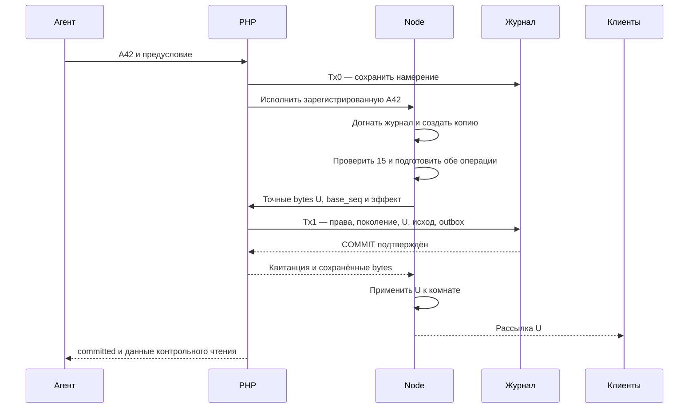
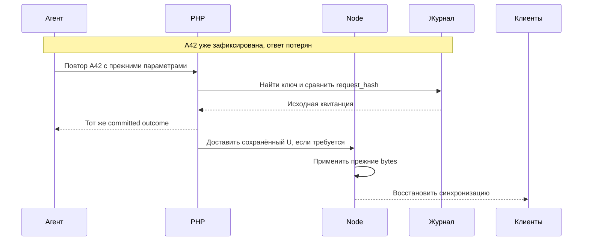

**Для первого прототипа я выбираю протокол «изолированная копия → фиксация точных бинарных данных и исхода команды в PostgreSQL → применение в живой комнате».** Во второй версии рекомендация стала строже: все принимаемые изменения документа должны проходить через один последовательный обработчик, а следующая команда обязана дождаться восстановления подтверждённого состояния комнаты.

**Наблюдение, которое сделает предложенную реализацию непригодной:** в тесте изменение человека проходит в активный `Y.Doc` между окончательной проверкой предусловия A42 и её фиксацией, обходя общий обработчик. Тогда обещание «A42 применена именно к проверенному состоянию» не выполняется.

Я прочитал первый отчёт и подготовил **вторую версию — 25 страниц**, с уточнённым протоколом, таблицей сбоев, контрактами, границами транзакций, ссылками на закреплённые исходники и воспроизводимыми экспериментами.

### Документы

[Vaulter_AI_write_protocol_v2.docx](https://chatgpt.com/library?file_id=libfile_fde3_f-777f7a2f4db48191a70930d0c3a9c397_85d1bd2b929481919d7d3958976529bf&account_id=personal) — редактируемая версия полного отчёта.

[Vaulter_AI_write_protocol_v2.pdf](https://chatgpt.com/library?file_id=libfile_fde3_f-80cf49c51d708191a2b68bf28b2ee31e_85d1bd2b929481919d7d3958976529bf&account_id=personal) — версия для чтения и обсуждения командой.

[Vaulter_protocol_v2_reproducible_checks.zip](https://chatgpt.com/library?file_id=libfile_fde3_f-9086dd556a148191b37c6aa1690cc300_85d1bd2b929481919d7d3958976529bf&account_id=personal) — код проверок, точные `package-lock.json`, результаты запусков и сведения о проверенных исходниках.

Ниже — основные результаты второй итерации и конкретные изменения архитектурного решения.

## 1. Что удалось проверить исполнением

Выполнены **17 проверок Yjs/y-prosemirror и два эксперимента Hocuspocus**. Использовались:

| Компонент | Проверенная версия |
|---|---|
| Yjs | `13.6.33` |
| y-prosemirror | `1.3.7` |
| Hocuspocus server и provider | `4.7.1` |
| y-protocols | `1.0.6` |
| ProseMirror model / state | `1.25.4` / `1.4.3` |
| Node.js | `24.22.3` |

Это закреплённый исследовательский набор, а не утверждение, что все версии последние. Такое закрепление существенно: основная ветка `y-prosemirror` уже описывает экспериментальный `@y/prosemirror` для Yjs 14 и направляет пользователей Yjs 13 к документации `1.3.7`. API этих веток нельзя смешивать. [GitHub](https://github.com/yjs/yjs/releases?utm_source=chatgpt.com)

**Граница выполненной проверки:** эксперименты действительно запускались на опубликованных библиотеках. Два клиента Hocuspocus соединялись по настоящему WebSocket, но выполнялись в Node.js. Сквозной контур с вашим PHP, PostgreSQL, Vue/Tiptap и двумя браузерами пока не проверен; для него в документе дана отдельная программа приёмки.

### `Y.Doc.transact` оставляет частичную правку при исключении

В эксперименте A42 успела заменить `15` на `30`, после чего callback выбросил исключение до вставки следующего абзаца.

Получилось:

```text
Аванс в течение 30 дней
Реквизиты: OLD
```

Абзаца основания нет. При этом Yjs уже выпустил бинарное обновление, и его применение к другой реплике перенесло именно этот частичный результат.

Это соответствует [исходнику `Transaction.js` закреплённой версии](https://github.com/yjs/yjs/blob/9ea3a4fb57b814292ce18dfd13c4f422e44e6c5c/src/utils/Transaction.js): callback выполняется в `try`, очистка — в `finally`; возврата уже изменённых структур в исходное состояние нет. Документация также прямо указывает, что транзакции Yjs нельзя отменить. [Yjs Docs](https://beta.yjs.dev/docs/api/transactions/?utm_source=chatgpt.com)

Отсюда практическое правило: **объединение двух действий в один `transact` само по себе не обеспечивает «обе операции либо ни одной».** В выбранном протоколе это свойство создаётся иначе: повреждённая копия уничтожается до публикации её данных.

Дополнительно проверен `async` callback. Изменение до `await` и изменение после него стали двумя отдельными транзакциями. Поэтому конструкция `doc.transact(async () => await saveToPHP())` не связывает память Node с SQL-транзакцией.

### Два вычисления A42 создают два эффекта

Один и тот же сохранённый update, применённый повторно, дал правильный результат: `30` и один абзац основания. Идемпотентность бинарных обновлений — документированное свойство Yjs. [docs.yjs.dev](https://docs.yjs.dev/api/document-updates?utm_source=chatgpt.com)

Но два независимых преобразования одинаковой исходной копии дали:

```text
Аванс в течение 3030 дней
Основание: решение финансового директора
Основание: решение финансового директора
```

Причём оба новых абзаца имели одинаковый заданный `blockId`.

**Детерминированный ID нового абзаца не заменяет идемпотентность команды.** Атрибут узла не является ограничением уникальности в CRDT. Единственный принятый результат выбирает ваш журнал; после этого повторяют его bytes, а не вычисление преобразования.

Также установлено, что `transaction.origin` не переносит `command_id` внутри update на другую реплику. Он полезен для локальной маршрутизации, но связь `A42 → принятая запись` должна храниться отдельно.

### Позднее офлайн-изменение действительно может дать `3020`

Для воспроизводимости в проверке закреплены идентификаторы тестовых авторов:

- агент заменяет исходное `15` на `30`;
- отключённый клиент независимо заменяет то же исходное `15` на `20`;
- сначала применяется A42;
- затем доставляется офлайн-update.

Обе реплики сошлись к:

```text
Аванс в течение 3020 дней
Основание: решение финансового директора
```

`3020` — результат конкретной fixture, а не универсальное обещание для любых действий редактора и идентификаторов. Существенно другое: **поздний update не означает автоматически «установить 20 вместо текущих 30».**

Квитанция A42 остаётся правильным свидетельством того, что было принято в её позиции журнала. Она не обещает, что последующие человеческие изменения сохранят тот же видимый текст.

### Несохранённая правка может вернуться после рестарта из браузера

Это важное дополнение к первой версии.

В проверке альтернативного порядка:

1. Сервер изменил активный документ через A42.
2. Браузер получил update.
3. Журнал A42 ещё не сохранил.
4. Сервер перезапустился из прежней подтверждённой базы и показал `15`.
5. Старый браузер переподключился и прислал своё состояние.

После синхронизации вернулись `30`, абзац основания и новая правка реквизитов — **без исходной квитанции A42**.

Следовательно, перезагрузка комнаты не удаляет неподтверждённое изменение со всех реплик. Оно может вернуться в составе другого sync-пакета, уже без утраченной прикладной связи с командой.

### Штатные подтверждения Hocuspocus не доказывают сохранение

Два эксперимента дали следующие результаты:

| Проверка | Наблюдение |
|---|---|
| `onChange` остановлен на управляемом барьере | Другой клиент уже видел `30`, а первый имел `unsyncedChanges = 0`, хотя условная запись ещё не завершилась |
| `onStoreDocument` намеренно бросает исключение | `disconnect()` разрешился, а комната в этой конфигурации выгрузилась |

Исходники Hocuspocus 4.7.1 подтверждают разделение этих этапов: `onChange` запускается без ожидания его Promise, а ошибки store routine перехватываются. См. [Hocuspocus.ts](https://github.com/ueberdosis/hocuspocus/blob/bd288a4441fb60a663bbaf34660a490eb59dd6ea/packages/server/src/Hocuspocus.ts) и [DirectConnection.ts](https://github.com/ueberdosis/hocuspocus/blob/bd288a4441fb60a663bbaf34660a490eb59dd6ea/packages/server/src/DirectConnection.ts).

Это **не отменяет ваш действующий контракт ACK после COMMIT в PHP**. Напротив, его нужно сохранить как самостоятельный сигнал и не подменять статусом синхронизации Hocuspocus.

## 2. Как теперь устроен рекомендуемый протокол

В первой версии было недостаточно явно разделено:

- что уже сохранено в журнале;
- что уже применено к живой комнате;
- что существует только в памяти и ещё ожидает сохранения.

Во второй версии вводятся две координаты:

- `head_seq` — конец подтверждённого журнала в PostgreSQL;
- `applied_seq` — непрерывный префикс, воспроизведённый комнатой.

Комната может временно отставать после COMMIT. **Проверять на ней предусловие следующей команды до восстановления префикса нельзя.**

### Две SQL-транзакции

**Tx0 сохраняет намерение.** PHP создаёт долговечную запись A42 со статусом `received`, неизменяемыми параметрами и их хешем. Это ещё не сохранённая правка текста. Такая запись позволяет служебному worker продолжить работу после исчезновения первоначальной Laravel job.

**Tx1 принимает результат.** После подготовки копии PHP в одной транзакции:

1. Блокирует необходимые области авторизации и контрольную строку документа.
2. Повторно проверяет права.
3. Проверяет поколение, владельца комнаты, версию схемы и исходную позицию журнала.
4. Записывает точные bytes update.
5. Связывает их с A42.
6. Сохраняет неизменяемую квитанцию.
7. Создаёт событие доставки.

Только после этой фиксации появляется основание для ответа `committed`.

### Успешная последовательность



SQL и `Y.Doc.transact` здесь остаются разными механизмами. Распределённая атомарность достигается не попыткой откатить память: **решение о принятии хранится только в PostgreSQL, а память восстанавливается из него.** `PREPARE TRANSACTION` сам по себе не превращает Y.Doc другого процесса в устойчивый участник двухфазной фиксации. [postgresql.org](https://www.postgresql.org/docs/18/sql-prepare-transaction.html?utm_source=chatgpt.com)

### Потеря ответа



После неизвестного исхода COMMIT нельзя сразу запускать новое преобразование и объявлять первое неуспешным. Сначала нужно установить исход по ledger. Повторный запрос использует тот же ключ.

### Где проверяются предусловия

Node проверяет исходный текст на подтверждённом состоянии под обработчиком документа. PHP затем проверяет, что `base_seq` всё ещё соответствует голове, а поколение и владелец не сменились.

Если человек уже подтвердил `20`, A42 получает `precondition_failed`, и ни одна из двух её операций не принимается.

Если изменилась только независимая часть документа, это не должно автоматически становиться окончательным пользовательским конфликтом. После восстановления актуальной основы условие проверяется снова. При этом в строгом варианте с одним остановившим вход обработчиком необъяснимое изменение головы внутри критического участка — сигнал обхода очереди, а не нормальная ситуация для бесконечных повторов.

## 3. Контракт A42 и устойчивый адрес

Минимальная команда во второй версии выглядит так:

```json
{
  "protocol": "vaulter.commands.v1",
  "command_id": "A42",
  "project_id": "project-7",
  "document_id": "doc-781",
  "generation": 3,
  "schema_version": 1,
  "target": {
    "block_id": "payment-terms",
    "anchor": "<значение из чтения фрагмента>"
  },
  "if_text": "Аванс в течение 15 дней",
  "operation": {
    "type": "replace_text_and_insert_paragraph_after",
    "find": "15",
    "replace": "30",
    "insert_text": "Основание: решение финансового директора"
  }
}
```

`project-7` и `doc-781` — условные обозначения. Субъект устанавливается аутентификацией. Проект проверяется явно: фоновый worker не должен выбирать документ через неявный «текущий проект» пользователя.

### Почему добавлен относительный якорь

Один `blockId` оказался недостаточным: обычный ProseMirror split в проверке скопировал ID в обе половины абзаца.

Предлагаемый адрес включает область документа, поколение, `blockId` и Yjs RelativePosition самого узла. Проверенный якорь пережил вставку соседнего абзаца и замену текста, а после удаления цели разрешился в `null`. Это согласуется с API относительных позиций. [docs.yjs.dev](https://docs.yjs.dev/api/relative-positions?utm_source=chatgpt.com)

Но якорь не отменяет серверные проверки:

- найден ровно один разрешённый узел;
- он находится в правильном fragment редактора;
- его тип и `blockId` совпадают;
- ожидаемый текст совпадает;
- обе операции допустимы схемой.

Для split, merge, copy/paste и импорта нужны явные правила жизненного цикла ID. Их нельзя приписать Yjs автоматически.

### Ключ идемпотентности

Предлагаемая область ключа:

```text
tenant + project + document + subject + command_id
```

Поколение входит в неизменяемое тело и `request_hash`. Поэтому изменение `generation: 3` на `generation: 4` при прежнем A42 не превращается незаметно в новое намерение.

Правила:

- тот же ключ и то же тело → `pending` либо исходная квитанция;
- тот же ключ и другое тело → `idempotency_key_reused`;
- сохранённый конфликт тоже остаётся прежним конфликтом;
- для нового намерения нужен новый ключ.

Хеш должен вычисляться сервером по согласованной канонической форме. В отчёте предложен RFC 8785 JCS с общими проверочными примерами для PHP и Node; он также помогает избежать расхождений из-за порядка свойств и представления значений. [rfc-editor.org](https://www.rfc-editor.org/info/rfc8785/?utm_source=chatgpt.com)

### Квитанция

Её неизменяемое ядро связывает:

```json
{
  "command_id": "A42",
  "status": "committed",
  "generation": 3,
  "request_hash": "sha256:<хеш запроса>",
  "journal": {
    "seq": 1842,
    "update_id": "u-A42",
    "update_sha256": "sha256:<хеш сохранённых bytes>"
  },
  "effect": {
    "block_id": "payment-terms",
    "text": "Аванс в течение 30 дней",
    "inserted_block_id": "b-A42-2",
    "inserted_count": 1
  }
}
```

Значения seq и ID здесь иллюстративны.

Доставленность и текущее поколение — отдельные динамические поля. После восстановления версии HTTP-ответ может сообщать `current_generation: 4`, сохраняя прежнее ядро квитанции A42 поколения 3.

## 4. Как доказать результат чтением

Во второй версии исправлена существенная неоднозначность: **состояние не раньше A42 и состояние точно в момент A42 — разные результаты.**

### `at_commit(A42)`

Отвечает на вопрос: «Что было сохранено этой командой?»

Сервис получает из квитанции поколение и точный seq, берёт checkpoint не позже этой позиции, воспроизводит хвост ровно до неё и возвращает:

- `payment-terms`;
- вставленный абзац;
- их порядок;
- единственность вставленного ID;
- `generation` и `read_seq`;
- результат проверки ожидаемого содержимого.

Если после A42 человек удалил абзац, историческое чтение всё равно должно показать первоначально принятый результат.

### `current(min_seq)`

Отвечает на вопрос: «Что находится в документе сейчас, после моей записи?»

Для честного `current` сервис сначала фиксирует наблюдаемую голову `h`, затем читает состояние с позицией не ниже `max(min_seq, h)`.

Если просто взять JSON с `snapshot_seq >= seq_A42`, он может оказаться старее текущей головы. Это допустимо для отдельного режима «не раньше моей записи», но недостаточно для обещания актуальности.

**Модели не нужен весь документ.** Сервер может восстановить полный Y.Doc внутри себя, а наружу вернуть только разрешённые адресованные узлы и компактные сведения проверки.

Есть ещё две проверенные ловушки:

- чистое удаление изменило текст, не изменив state vector;
- update с отсутствующими зависимостями завершил `applyUpdate` без ошибки, но ещё не изменил видимый текст.

Поэтому ни равенство state vectors, ни успешный возврат `applyUpdate` не заменяют связанное с журналом чтение и проверку эффекта.

Также преобразователь `initProseMirrorDoc` в проверенной версии способен удалять несовместимые со схемой узлы. Контрольное чтение должно работать на изолированной копии, с правильной версией схемы и контролем неожиданных мутаций; иначе можно проверить уже исправленную проекцию вместо сохранённого состояния. Соответствующая ветка находится в [закреплённом `sync-plugin.js`](https://github.com/yjs/y-prosemirror/blob/f89fadd2a8bf15c0c7e6bfcac268883a5fa4e0f8/src/plugins/sync-plugin.js).

## 5. Права и восстановление версии

### Отзыв прав

Проверки только при открытии WebSocket или при получении HTTP-запроса недостаточно.

Предложен общий порядок для финальной транзакции:

1. Взять shared-блокировку области проектных прав.
2. Взять блокировку контрольной строки документа.
3. Повторно прочитать эффективные права.
4. Принять либо отклонить команду.

Изменение membership, роли или ACL берёт конфликтующую блокировку той же области. Таким образом определяется, что произошло раньше: принятие A42 или отзыв права. Row locks и их время жизни здесь обеспечиваются PostgreSQL; участие всех путей изменения прав обеспечивает приложение. [postgresql.org](https://www.postgresql.org/docs/18/explicit-locking.html?utm_source=chatgpt.com)

Важно разделить две задачи:

- **служебный worker** должен завершить зарегистрированное намерение и записать отказ даже после полного отзыва прав;
- **публичный API** раскрывает квитанцию и текст только в пределах нынешнего права чтения.

Если редактирование отозвано, но чтение осталось, получение прежнего исхода не должно требовать нового права на изменение.

### Поколение 4

Restore создаёт новую ветку состояния. Все пути записи и доставки обязаны проверять generation, включая SDK, SyncStep2, outbox и фоновые обработчики.

Особенно опасна доставка вида «найти текущую комнату по document_id». Для A42 должно быть явно указано поколение 3. Старый outbox нельзя перенаправлять в текущую комнату поколения 4.

При переходе на g4 браузеру нужен **новый `Y.Doc`**. Если используется постоянное локальное хранилище, его namespace также включает поколение. Подключение старого объекта к новой комнате может принести старые CRDT-структуры под новым адресом.

Повтор уже сохранённой A42 возвращает исторический исход g3. Неизвестная или ещё не принятая команда из g3 отвергается. В обоих случаях восстановленный текст g4 остаётся неизменным.

## 6. Основные случаи сбоев

Полная таблица в документе содержит отдельные колонки для сохраняемой гарантии, временной видимости, статуса и восстановления. Здесь — ключевые случаи.

| Случай | Что сохранено | Что могут видеть пользователи | Статус и восстановление |
|---|---|---|---|
| Падение до окончательной записи | Только `received` либо ещё ничего | Агентской правки нет | `pending`/неизвестный исход; продолжает job или inbox worker |
| Исключение между операциями на копии | Update A42 не принят | Активный текст не изменён | Копия уничтожается; временный сбой допускает повтор |
| COMMIT прошёл, ответ потерян | Bytes и исход A42 | Уже `30` либо ещё `15` до доставки | Lookup возвращает прежний `committed` |
| COMMIT прошёл, Node умер до apply | Полная принятая A42 | Комната отстаёт | Новый owner восстанавливается из журнала |
| Два одинаковых A42 одновременно | Один терминальный исход | Один принятый эффект | Второй запрос ждёт либо получает ту же квитанцию |
| Тот же ключ, другие параметры | Первоначальная команда неизменна | Нового эффекта нет | `idempotency_key_reused` |
| `20` принято до проверки | Отказ A42, без её обеих операций | `20`, без абзаца основания | `precondition_failed`, новый ключ для нового решения |
| Офлайн-`20` пришло позже | A42 остаётся исторически принятой | Возможен результат слияния вроде `3020` | `at_commit` и `current` показывают разные моменты |
| JSON отстаёт | Журнал и квитанция верны | Обычный JSON ещё показывает старый текст | Верификатор воспроизводит нужную позицию |
| Права отозваны до принятия | A42 не принимается | Подготовленная копия не публикуется | Служебно фиксируется отказ; наружу — разрешённый ответ |
| Restore начался раньше Tx1 | A42 не меняет g4 | Восстановленная версия | `stale_generation` |
| Restore начался после Tx1 | A42 сохранена в g3 | В g4 — выбранная восстановленная версия | Историческая квитанция; старый outbox не применяется к g4 |
| Active-first изменил память до журнала | Исход A42 может отсутствовать | Правка уже видна и способна вернуться при reconnect | Это негативный тест альтернативы, а не допустимое состояние выбранного протокола |

Отдельно уточнена долговечность PostgreSQL: `synchronous_commit=off` допускает потерю уже объявленных успешными транзакций при падении. Для выбранной границы нужны корректные настройки WAL и хранилища. Переключение на асинхронную standby также имеет отдельное окно потери данных. [postgresql.org](https://www.postgresql.org/docs/18/runtime-config-wal.html?utm_source=chatgpt.com)

## 7. Насколько узкой может быть сериализация

Для первого прототипа достаточно очереди **одного документа**. Общая блокировка проекта или всех комнат не требуется.

Блокировка только абзаца пока недостаточна: произвольный бинарный update может менять структуру, несколько блоков или саму адресацию. Сужение до узла потребует отдельного доказательства областей воздействия операций.

При выбранном порядке:

- собственный набор человека остаётся локальным в браузере;
- отображение у других участников ждёт принятия сервером;
- ACK по вашему контракту и раньше ожидал PostgreSQL;
- модель, поиск документа и генерация текста не работают под блокировкой;
- стоимость копирования Y.Doc и преобразования нужно измерять отдельно.

В отчёте сохранён и более узкий вариант адаптации существующего пути: перед A42 закрыть все входящие мутации, дождаться сохранения уже применённого человеческого хвоста, затем выполнить A42. Он может сохранить прежнюю скорость распространения обычных правок, но имеет больше состояний отказа. Для прототипа с главным критерием доказуемого сохранения я предпочитаю единый порядок принятия.

В Hocuspocus необходимо охватить не только обычный `YjsUpdate`, но и `SyncStep2`, direct connection, загрузку и внутренние исправления. Проверенная Redis extension применяет сообщения без `Connection`, обходя соответствующие connection hooks; поэтому простого mutex в одном WebSocket-hook недостаточно. См. [закреплённый `Redis.ts`](https://github.com/ueberdosis/hocuspocus/blob/bd288a4441fb60a663bbaf34660a490eb59dd6ea/packages/extension-redis/src/Redis.ts).

## 8. Воспроизводимое приёмочное испытание

Полный сценарий завершает документ. Его основной проход следующий:

1. Поднять PostgreSQL, PHP API, Node/Hocuspocus, фоновые обработчики и два независимых браузерных контекста.
2. Создать один бинарный seed поколения 3 с `15` и реквизитами `OLD`.
3. Во втором браузере изменить реквизиты на `NEW` и **дождаться их собственного подтверждения журнала**.
4. Запустить фиксированную A42 через SDK.
5. Остановить исполнение **после COMMIT A42, но до применения комнате**.
6. Потерять ответ исполнителю и принудительно завершить Node.
7. Перезапустить Node и worker.
8. Повторить прежнюю A42 десять раз, в том числе двумя одновременными запросами.
9. Сравнить оба браузера, реконструкцию из журнала и `at_commit(A42)`.
10. Проверить, что после установленного `committed` преобразование больше не запускалось.

Ожидаемое содержимое после рестарта:

```text
payment-terms:
Аванс в течение 30 дней

следующий абзац:
Основание: решение финансового директора

число вставленных этой A42 узлов с назначенным ID:
1

bank-details:
Реквизиты: NEW
```

Должны сохраниться прежние `generation`, `seq`, `update_id`, `request_hash` и `update_sha256`. В ledger — один терминальный исход, в журнале — одна связанная принятая запись.

Дополнительные проходы останавливают систему до COMMIT, между двумя действиями на копии, после применения до ответа, при отзыве membership, смене владельца, отставании JSON и доставке старого outbox после restore. Отдельный тест отправляет A43 с предусловием `30`, пока A42 уже сохранена, а комната ещё отстаёт: A43 должна дождаться восстановления основы, а не проверить старое `15`.

Для восстановления **исходной сохранённой версии целиком** ожидаемое состояние поколения 4 другое:

```text
payment-terms:
Аванс в течение 15 дней

абзац основания A42:
отсутствует

bank-details:
Реквизиты: OLD

current_generation:
4
```

При этом историческая A42 остаётся `committed` в поколении 3. Её повтор, старый WebSocket-клиент и задержанное событие доставки не должны изменить ни один из этих результатов поколения 4.